# Лабораторная работа №2: свёрточная нейронная сеть для классификации цифр

## Задание

Реализовать свёрточную нейронную сеть для классификации рукописных цифр из базы [MNIST](http://yann.lecun.com/exdb/mnist/).

| Требование | Как выполнено |
| --- | --- |
| База MNIST, обучающая выборка 70 %, тестовая 30 % | Все 70 000 изображений MNIST перемешаны и разделены на 49 000 обучающих и 21 000 тестовых |
| Количество слоёв, размерность свёртки, гиперпараметры свёртки и пулинга — на усмотрение | 2 свёрточных слоя (16 и 32 фильтра 3×3), average-пулинг 2×2 с шагом 2, 2 полносвязных слоя; параметры выбраны по итогам пяти исследований ([раздел 7](#7-исследования)) |
| Обучение — обратное распространение ошибки, средняя ошибка 0.0001 | Обратное распространение и стохастический градиентный спуск реализованы вручную на NumPy; результат по целевой ошибке — в [разделе 4](#4-обучение) |
| Матрица неточностей, по ней accuracy, precision, recall, F-мера | [Раздел 5](#5-оценка-на-тестовой-выборке) |
| ROC-кривая и AUC | [Раздел 5](#5-оценка-на-тестовой-выборке) |
| Предварительно построить t-SNE и оценить причины ошибочной классификации | [Разделы 3 и 6](#3-t-sne-до-обучения) |

Сеть, обучение и все метрики написаны с нуля на NumPy, без PyTorch, TensorFlow и готовых функций метрик. Сторонние библиотеки используются только для t-SNE (scikit-learn) и графиков (Matplotlib).

Подробный разбор кода, формул и решений — в [additions.md](additions.md).

---

## 1. Теория

### Свёрточная сеть

Свёрточная сеть состоит из двух частей: свёрточная часть **выделяет признаки** изображения, полносвязная по этим признакам **решает, какая это цифра**.

**Свёрточный слой.** Небольшой фильтр (здесь 3×3) скользит по изображению. В каждой позиции он поэлементно умножается на участок изображения, произведения складываются:

```
out[f, i, j] = Σ по c, a, b   W[f, c, a, b] · x[c, i + a, j + b]  +  b[f]
```

Каждый фильтр реагирует на свой локальный узор: штрих определённого наклона, угол, дугу. Веса фильтров обучаются. Один и тот же фильтр применяется ко всему изображению, поэтому параметров гораздо меньше, чем у полносвязного слоя того же размера.

**ReLU** — функция активации `max(0, x)`. Вносит нелинейность: без неё несколько слоёв подряд сводились бы к одному линейному преобразованию.

**Max-пулинг.** Карта признаков делится на окна (здесь 2×2), из каждого остаётся максимум. Карта уменьшается, а сеть становится устойчивее к небольшим сдвигам цифры.

**Полносвязный слой** `y = W·x + b`: каждый выход связан со всеми входами.

**Softmax** превращает 10 выходов сети (логитов) в вероятности классов:

```
p[k] = exp(z[k]) / Σ exp(z[j])
```

### Функция ошибки и обучение

**Перекрёстная энтропия** для изображения с истинным классом `t`: `L = −ln p[t]`. Если сеть уверена в правильном ответе, ошибка близка к нулю. Средняя ошибка — среднее `L` по всем обучающим изображениям за эпоху.

**Обратное распространение ошибки.** Сеть — цепочка функций, поэтому производная ошибки по каждому весу считается по цепному правилу, от выхода к входу. Каждый слой получает градиент по своему выходу, считает градиенты по своим весам и передаёт градиент по своему входу предыдущему слою. Для пары softmax + перекрёстная энтропия градиент по логитам особенно прост: `dL/dz = p − y`, где `y` — вектор с единицей на месте правильного класса.

**Градиентный спуск.** Веса сдвигаются против градиента: `W ← W − η · dL/dW`, где η — скорость обучения. Здесь используется стохастический вариант: веса обновляются после каждого изображения.

### Показатели качества

**Матрица неточностей** — таблица 10×10, где элемент `[i, j]` — число изображений цифры `i`, которые сеть отнесла к цифре `j`. Для каждого класса `k` по ней считаются TP (верно найденные `k`), FP (чужие, принятые за `k`) и FN (пропущенные `k`):

```
accuracy  = сумма диагонали / сумма всей матрицы
precision = TP / (TP + FP)       доля верных среди ответов «это k»
recall    = TP / (TP + FN)       доля найденных среди настоящих k
F-мера    = 2 · precision · recall / (precision + recall)
```

Общие показатели получаются **макро-усреднением** — средним по десяти классам.

**ROC-кривая** строится для каждой цифры по схеме «один против остальных». Порог на вероятность класса опускается от 1 до 0, и для каждого порога откладывается точка (FPR, TPR): доля чужих изображений, ошибочно принятых за `k`, и доля найденных `k`. **AUC** — площадь под кривой: 1 — идеальное разделение, 0.5 — случайное угадывание.

**t-SNE** — метод, который переносит многомерные точки на плоскость, сохраняя соседство: похожие изображения оказываются рядом. Он позволяет увидеть, какие цифры похожи друг на друга уже на уровне пикселей и где следует ждать ошибок.

---

## 2. Реализация

### Данные

[source/data_preparation.py](source/data_preparation.py) скачивает MNIST, склеивает стандартные 60 000 + 10 000 изображений в одну выборку из 70 000, нормирует пиксели в [0, 1], перемешивает с фиксированным зерном и делит **70 / 30**:

| Выборка | Изображений |
| --- | --- |
| Обучающая | 49 000 |
| Тестовая | 21 000 |

Классы распределены почти равномерно: от 4440 до 5534 изображений каждой цифры в обучающей выборке.

### Архитектура итоговой модели

[source/cnn.py](source/cnn.py), слои — в [source/layers.py](source/layers.py). Параметры выбраны по итогам исследований из [раздела 7](#7-исследования).

| Слой | Параметры | Форма на выходе | Обучаемых параметров |
| --- | --- | --- | --- |
| вход | | `(1, 28, 28)` | |
| conv1 + ReLU | 16 фильтров 3×3, шаг 1, без дополнения | `(16, 26, 26)` | 160 |
| pool1 | average-пулинг 2×2, шаг 2 | `(16, 13, 13)` | |
| conv2 + ReLU | 32 фильтра 3×3, шаг 1, без дополнения | `(32, 11, 11)` | 4 640 |
| pool2 | average-пулинг 2×2, шаг 2 | `(32, 5, 5)` | |
| flatten | | `(800,)` | |
| fc1 + ReLU | 800 → 64 | `(64,)` | 51 264 |
| fc2 | 64 → 10 | `(10,)` | 650 |
| softmax | | `(10,)` вероятности | |

Всего **56 714** обучаемых параметров.

### Обучение

| Параметр | Значение |
| --- | --- |
| Алгоритм | обратное распространение ошибки + стохастический градиентный спуск (обновление после каждого изображения) |
| Функция ошибки | перекрёстная энтропия после softmax |
| Скорость обучения | 0.01, после каждой эпохи умножается на 0.95 |
| Инициализация весов | метод Хе (нормальное распределение, σ = √(2 / число входов)) |
| Порядок изображений | перемешивается в каждой эпохе |
| Остановка | средняя ошибка за эпоху ≤ 0.0001 или 60 эпох |
| Зерно | 42 |

Затухание скорости обучения понадобилось, чтобы дойти до ошибки 0.0001: с постоянной скоростью стохастический спуск к концу обучения «дрожит» вокруг минимума, и средняя ошибка перестаёт уменьшаться.

---

## 3. t-SNE до обучения

По ТЗ t-SNE строится предварительно, до обучения сети. На вход идут исходные пиксели (784 числа на изображение) первых 5000 изображений тестовой выборки; цвет точки — истинная цифра.

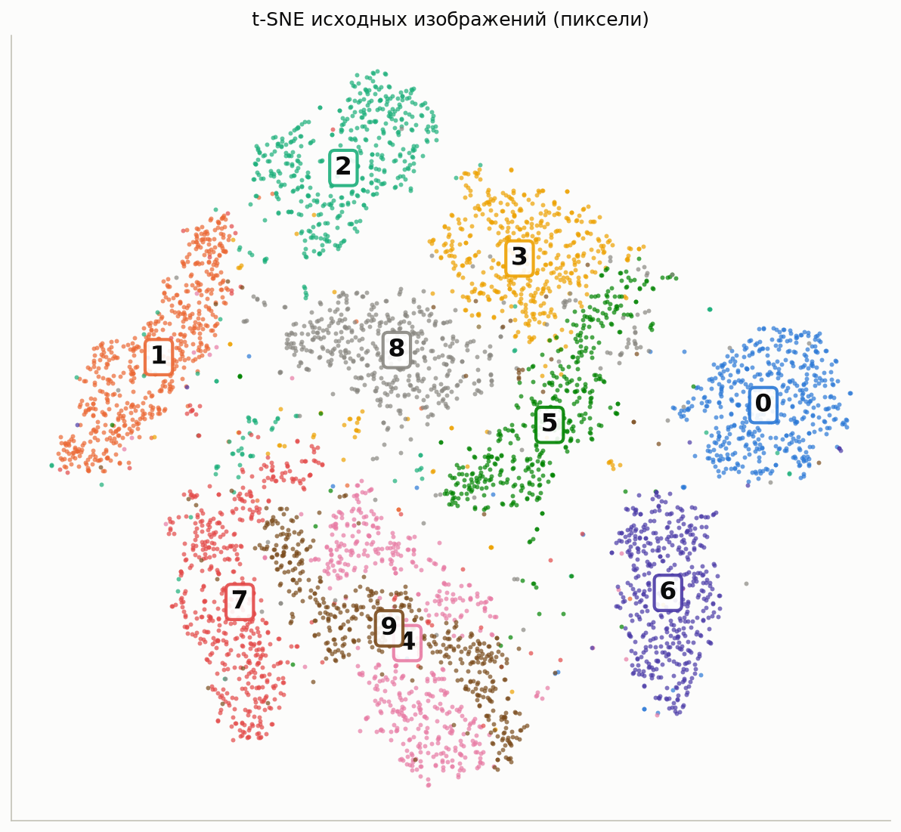

Что видно на карте:

- **0, 6, 2 и 1** образуют компактные облака, далеко отстоящие от остальных. На этих цифрах ошибок должно быть мало.
- **4, 9 и 7** лежат одной большой перемешанной областью внизу: 4 и 9 почти не разделяются (у обеих вертикальная черта справа и замкнутый или почти замкнутый верх), 7 примыкает к ним. Здесь следует ждать путаницы 4 ↔ 9, 9 ↔ 7, 7 ↔ 4.
- **3, 5 и 8** соприкасаются в центре: у них похожие изгибы и петли. Ожидаемые ошибки 3 ↔ 5, 5 ↔ 8, 3 ↔ 8.
- Вокруг облаков много одиночных точек, попавших к чужим цифрам, — это нетипично написанные цифры. Их будет труднее всего распознать.

---

## 4. Обучение

Средняя ошибка опустилась ниже **0.0001** на **38-й эпохе** (0.000099), и обучение остановилось. **Требование ТЗ выполнено.**

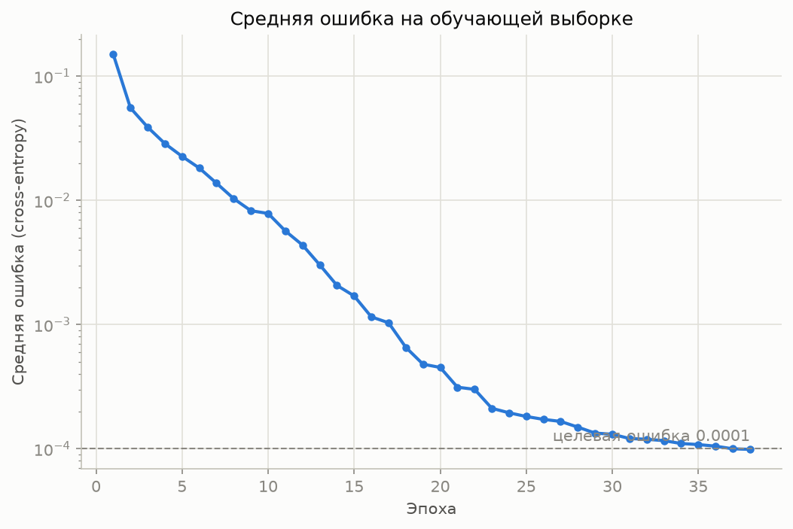

| Эпоха | 1 | 5 | 10 | 15 | 20 | 25 | 30 | 35 | 38 |
| --- | --- | --- | --- | --- | --- | --- | --- | --- | --- |
| Средняя ошибка | 0.1500 | 0.0226 | 0.0079 | 0.0017 | 0.00045 | 0.00018 | 0.00013 | 0.00011 | **0.000099** |
| Скорость обучения | 0.0100 | 0.0081 | 0.0063 | 0.0049 | 0.0038 | 0.0029 | 0.0023 | 0.0018 | 0.0015 |

Эпоха занимает около 61 с, всё обучение — около 39 минут. Первые 20 эпох ошибка падает почти экспоненциально (прямая на логарифмической шкале), затем замедляется: скорость обучения уже в 3–6 раз меньше начальной.

---

## 5. Оценка на тестовой выборке

Все показатели посчитаны вручную по матрице неточностей ([source/metrics.py](source/metrics.py)) на 21 000 тестовых изображений, которые сеть при обучении не видела.

### Матрица неточностей

Строки — истинная цифра, столбцы — ответ сети. Цвет в логарифмической шкале, чтобы на фоне диагонали были видны редкие ошибки.

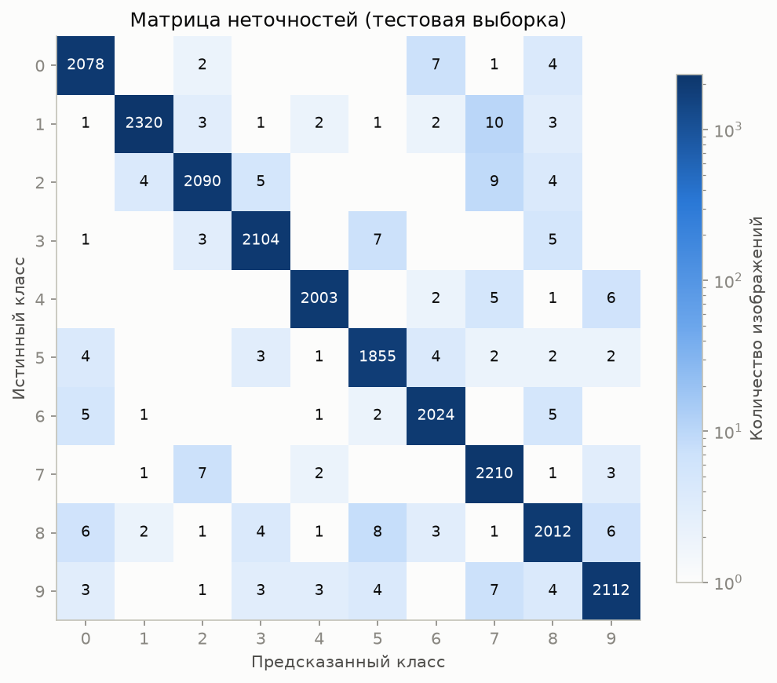

| | 0 | 1 | 2 | 3 | 4 | 5 | 6 | 7 | 8 | 9 |
| --- | --- | --- | --- | --- | --- | --- | --- | --- | --- | --- |
| **0** | **2078** | 0 | 2 | 0 | 0 | 0 | 7 | 1 | 4 | 0 |
| **1** | 1 | **2320** | 3 | 1 | 2 | 1 | 2 | 10 | 3 | 0 |
| **2** | 0 | 4 | **2090** | 5 | 0 | 0 | 0 | 9 | 4 | 0 |
| **3** | 1 | 0 | 3 | **2104** | 0 | 7 | 0 | 0 | 5 | 0 |
| **4** | 0 | 0 | 0 | 0 | **2003** | 0 | 2 | 5 | 1 | 6 |
| **5** | 4 | 0 | 0 | 3 | 1 | **1855** | 4 | 2 | 2 | 2 |
| **6** | 5 | 1 | 0 | 0 | 1 | 2 | **2024** | 0 | 5 | 0 |
| **7** | 0 | 1 | 7 | 0 | 2 | 0 | 0 | **2210** | 1 | 3 |
| **8** | 6 | 2 | 1 | 4 | 1 | 8 | 3 | 1 | **2012** | 6 |
| **9** | 3 | 0 | 1 | 3 | 3 | 4 | 0 | 7 | 4 | **2112** |

### Accuracy, precision, recall, F-мера

| Показатель | Значение |
| --- | --- |
| **Accuracy** | **0.9909** (192 ошибки из 21 000) |
| Precision (макро) | 0.9908 |
| Recall (макро) | 0.9908 |
| F-мера (макро) | 0.9908 |
| AUC (макро) | 0.99992 |

| Цифра | Precision | Recall | F-мера | AUC |
| --- | --- | --- | --- | --- |
| 0 | 0.9905 | 0.9933 | 0.9919 | 0.99997 |
| 1 | 0.9966 | 0.9902 | 0.9934 | 0.99997 |
| 2 | 0.9919 | 0.9896 | 0.9908 | 0.99993 |
| 3 | 0.9925 | 0.9925 | 0.9925 | 0.99989 |
| 4 | 0.9950 | 0.9931 | **0.9940** | 0.99996 |
| 5 | 0.9883 | 0.9904 | 0.9893 | 0.99984 |
| 6 | 0.9912 | 0.9931 | 0.9922 | 0.99997 |
| 7 | **0.9844** | 0.9937 | 0.9890 | 0.99994 |
| 8 | 0.9858 | **0.9843** | **0.9851** | 0.99982 |
| 9 | 0.9920 | 0.9883 | 0.9902 | 0.99986 |

- Хуже всего распознаётся **8**: самый низкий recall (0.984) — восьмёрки чаще всего принимаются за 5, 0 и 9.
- У **7** самый низкий precision (0.984): к семёркам сеть относит 35 чужих изображений, в основном единицы и двойки.
- Лучше всех — **4** и **1**.

### ROC-кривые и AUC

ROC-кривые построены для каждой цифры по схеме «один против остальных» по вероятностям сети. Справа — увеличенный левый верхний угол: на общем графике все кривые прижаты к углу.

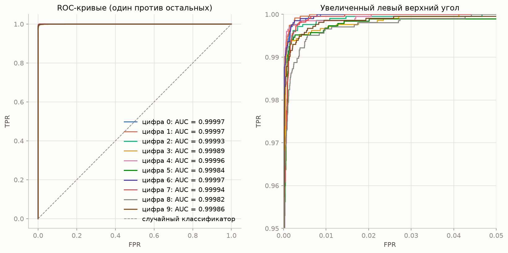

AUC всех цифр выше 0.9998, макро-AUC — **0.99992**. AUC выше accuracy, потому что оценивает другое: насколько хорошо вероятности *упорядочивают* изображения. Даже когда сеть ошибается, правильный класс обычно получает высокую вероятность. Самые «низкие» кривые — у 8 и 5, это те же цифры, что путаются чаще всего.

---

## 6. Анализ ошибок

### Где ошибки лежат на t-SNE

Та же карта t-SNE, на ней красным отмечены изображения, на которых обученная сеть ошиблась (51 из 5000 изображений карты). Подпись `4→9` значит «на самом деле 4, сеть ответила 9».

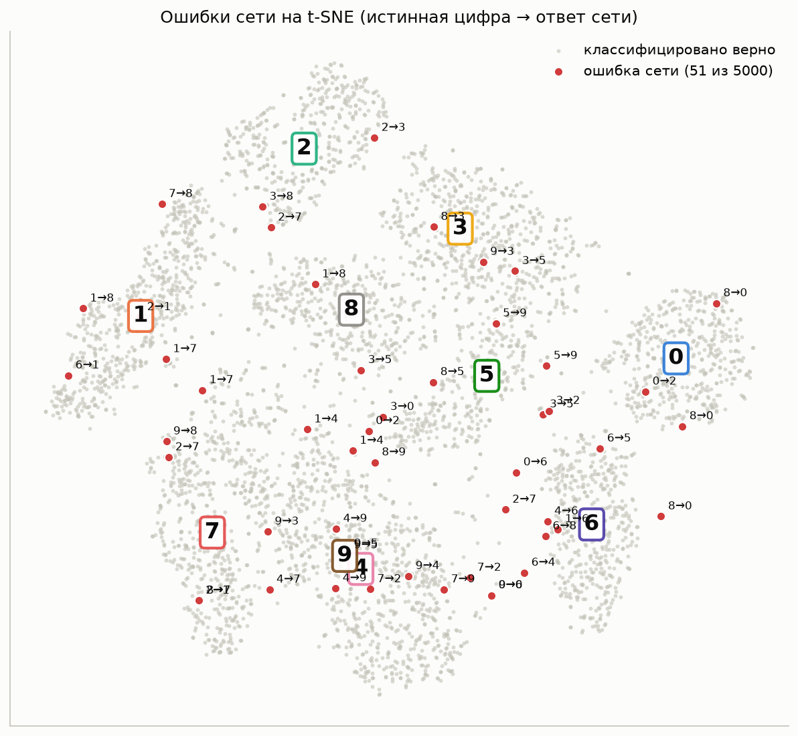

### Самые уверенные ошибки

24 ошибки, в которых сеть была наиболее уверена в неверном ответе.

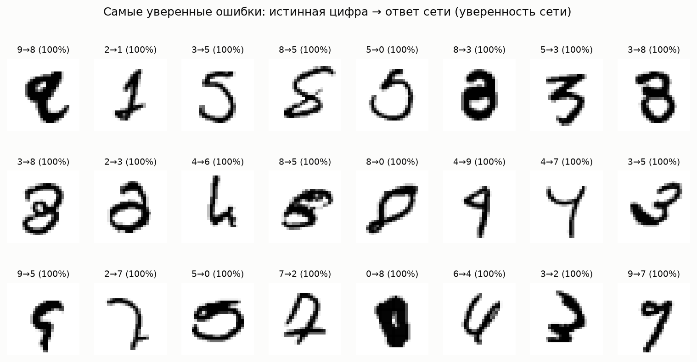

### Самые частые пары

| Истина → ответ | 1 → 7 | 2 → 7 | 8 → 5 | 0 → 6 | 7 → 2 | 9 → 7 | 3 → 5 | 4 → 9 | 8 → 0 | 8 → 9 |
| --- | --- | --- | --- | --- | --- | --- | --- | --- | --- | --- |
| Раз | 10 | 9 | 8 | 7 | 7 | 7 | 7 | 6 | 6 | 6 |

### Причины ошибок

1. **Похожие начертания цифр.** Ошибки лежат там, где t-SNE ещё до обучения показал соседство облаков: в зоне 4 / 9 / 7 и в зоне 3 / 5 / 8. Самые частые пары — именно оттуда: 4 → 9, 9 → 7, 3 → 5, 8 → 5. Пары 1 → 7 и 2 → 7 — это единицы с засечкой сверху и двойки без нижней петли: оба начертания дают горизонтальный штрих сверху и наклонную линию вниз, как у семёрки.
2. **Нетипичное написание.** На карте t-SNE много ошибок вдали от центров облаков, у их краёв или внутри чужих облаков: это изображения, которые на уровне пикселей ближе к другой цифре. На `errors.png` видно: восьмёрка, нарисованная как «S» с хвостом (8 → 5), сильно наклонённая четвёрка с открытым верхом, похожая на «h» (4 → 6), восьмёрка в форме листа (8 → 0).
3. **Неоднозначные и, вероятно, ошибочно размеченные изображения.** Часть примеров на `errors.png` и человек прочитал бы так же, как сеть: «3», ответ которой 5, выглядит как обычная пятёрка, «4 → 9» — как девятка, «0 → 8» — сплошное залитое пятно. С такими примерами не справится никакая модель: в базе MNIST известны ошибки разметки.
4. **Толстые, залитые или обрезанные штрихи.** Петли заливаются краской (0 → 8, 8 → 3), и пропадают признаки, по которым цифры различаются.

**Почему сеть уверена в ошибках на 100 %.** Сеть обучалась до средней ошибки 0.0001, то есть почти на всех обучающих изображениях давала правильному классу вероятность ≈ 1. Такая сеть выдаёт почти 0 или почти 1 и на тестовых изображениях, в том числе ошибочных. Уверенность обученной таким образом сети нельзя считать надёжной оценкой вероятности ошибки.

---

## 7. Исследования

ТЗ оставляет на усмотрение количество слоёв, размерность свёртки и гиперпараметры свёртки и пулинга. Каждый из этих пунктов проверен отдельным исследованием; код — в папке [investigations/](investigations/), результаты — в [results/investigations/](results/investigations/).

### Методика

- За основу взята **первая модель** лабораторной: 2 свёрточных слоя с 8 и 16 фильтрами 3×3, max-пулинг 2×2 с шагом 2, затем `Dense(64) → ReLU → Dense(10)`.
- В каждом исследовании меняется **один** параметр, остальное остаётся как у первой модели.
- Условия у всех вариантов одинаковые: те же данные, то же начальное зерно, тот же порядок изображений в каждой эпохе, скорость обучения 0.01, **5 эпох**. До целевой ошибки варианты не обучались: сравнивается качество при одинаковом бюджете обучения.
- Главный критерий — accuracy на тестовой выборке. Стандартная погрешность accuracy на 21 000 изображениях около **±0.09 п. п.** (`sqrt(p(1 − p) / n)` при p ≈ 0.984), поэтому разницу меньше ~0.1 п. п. (≈ 20 изображений) я считаю шумом и при ней выбираю более быстрый вариант.
- Каждый вариант обучен один раз с одним зерном, поэтому небольшие различия могут быть случайными.

Для каждого исследования построены четыре графика: `loss.png` (ошибка на обучении по эпохам), `accuracy.png` (accuracy на тесте по эпохам), `summary.png` (параметры, время эпохи, число ошибок) и `f1_per_class.png` (F-мера по цифрам). Время эпохи — медиана по эпохам, чтобы случайные задержки (например, сон ноутбука) не искажали сравнение.

### 7.1. Количество свёрточных слоёв

[investigations/conv_layers_count.py](investigations/conv_layers_count.py)

| Вариант | Свёрточная часть | Признаков на входе Dense | Параметров | Время эпохи | Ошибка обучения (5-я эпоха) | Accuracy | Ошибок |
| --- | --- | --- | --- | --- | --- | --- | --- |
| 1 слой | conv(8) → pool | 1352 | 87 322 | 29 с | 0.0240 | 98.31 % | 355 |
| **2 слоя** | conv(8) → pool → conv(16) → pool | 400 | 27 562 | 44 с | 0.0357 | **98.40 %** | **336** |
| 3 слоя | … → conv(32), без пулинга | 288 | 25 034 | 52 с | 0.0464 | 98.19 % | 380 |

У третьего слоя нет пулинга: после conv(32) карта 3×3, и пулинг 2×2 оставил бы 1×1.

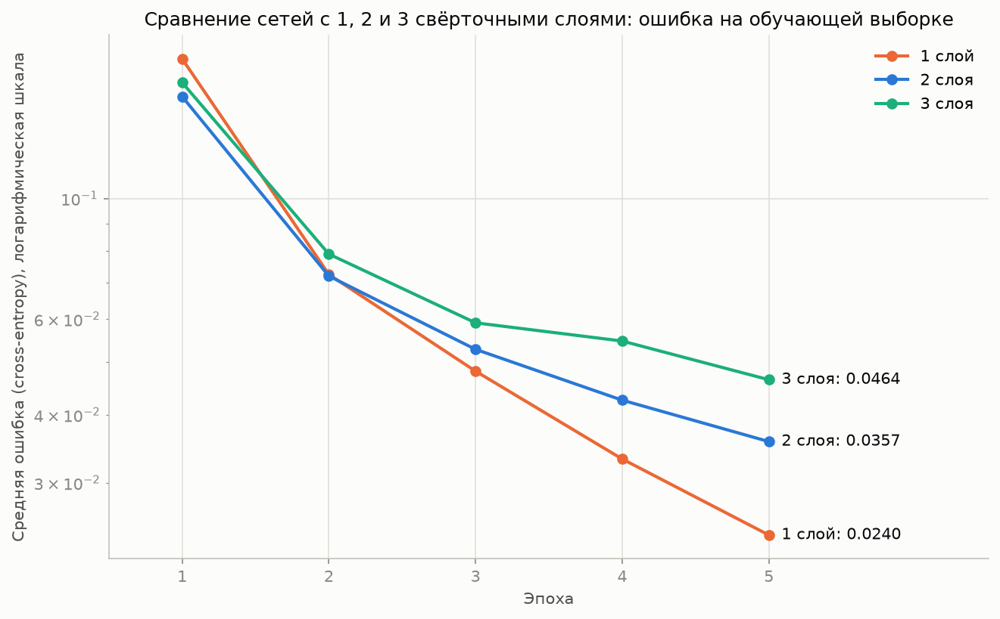

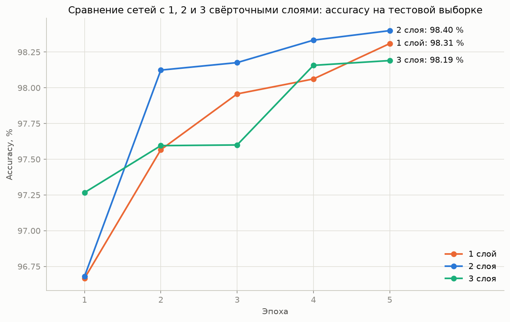

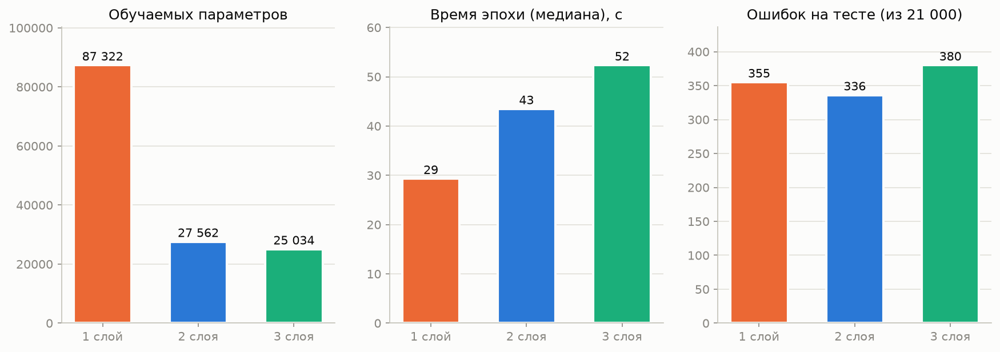

**Вывод.** Лучше всего на тесте два слоя. У одного слоя ошибка на обучении самая низкая, а на тесте он хуже: в его полносвязный слой приходит 1352 признака, параметров в 3 раза больше, и сеть сильнее подстраивается под обучающие изображения, а не под общие закономерности. Третий слой делает сеть медленнее и за 5 эпох учится хуже всех. **Выбрано: 2 свёрточных слоя.**

### 7.2. Число фильтров

[investigations/double_filters.py](investigations/double_filters.py)

| Вариант | Признаков | Параметров | Время эпохи | Время на изображение | Ошибка обучения | Accuracy | Ошибок |
| --- | --- | --- | --- | --- | --- | --- | --- |
| 8 / 16 фильтров | 400 | 27 562 | 44 с | 0.35 мс | 0.0357 | 98.40 % | 336 |
| **16 / 32 фильтра** | 800 | 56 714 | 63 с | 0.54 мс | 0.0230 | **98.72 %** | **268** |

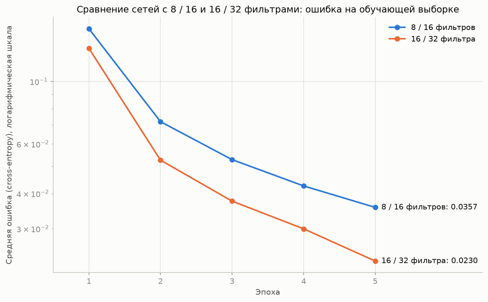

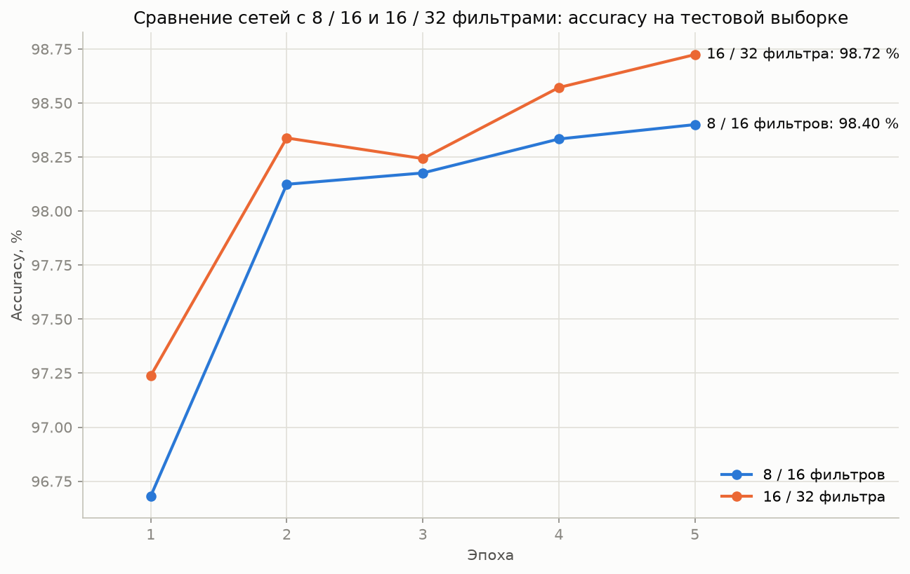

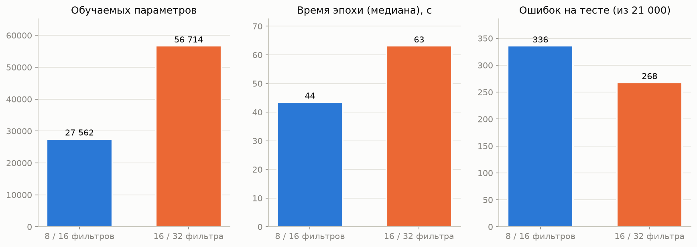

**Вывод.** Удвоение фильтров уменьшает число ошибок на 20 % (на 68 изображений, +0.32 п. п. — втрое больше погрешности). Сеть находит больше разных признаков, и accuracy выше на каждой эпохе. Цена — вдвое больше параметров и на 45 % дольше эпоха, для MNIST это приемлемо. **Выбрано: 16 и 32 фильтра.**

### 7.3. Размер ядра свёртки (размерность свёртки)

[investigations/kernel_size.py](investigations/kernel_size.py)

| Вариант | Размеры карт | Признаков | Параметров | Время эпохи | Ошибка обучения | Accuracy | Ошибок |
| --- | --- | --- | --- | --- | --- | --- | --- |
| **3×3** | 28 → 26 → 13 → 11 → 5 | 400 | 27 562 | 42 с | 0.0357 | 98.40 % | 336 |
| 5×5 | 28 → 24 → 12 → 8 → 4 | 256 | 20 522 | 63 с | 0.0397 | 98.49 % | 318 |
| 7×7 | 28 → 22 → 11 → 5 → 2 | 64 | 11 498 | 90 с | 0.0683 | 98.11 % | 397 |

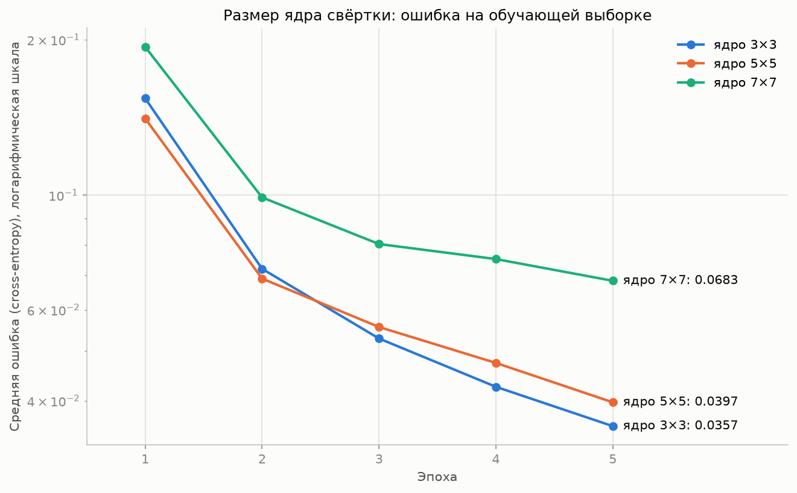

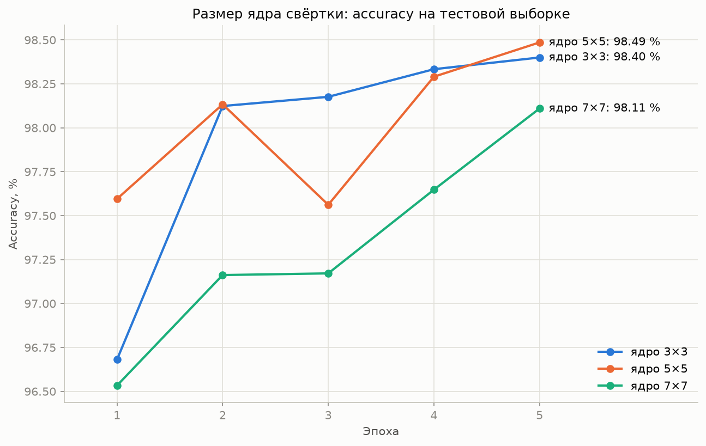

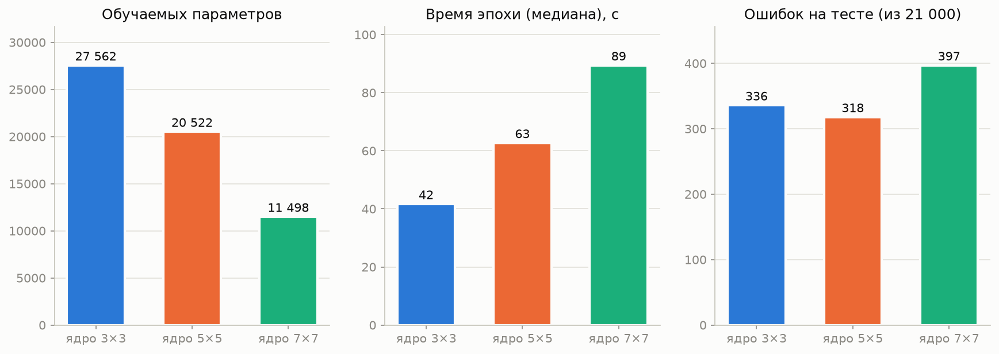

**Вывод.** Ядро 5×5 дало +0.09 п. п. (18 изображений) — это в пределах погрешности, — а эпоха стала на 50 % дольше: обратный проход свёртки перебирает все k² элементов ядра. Ядро 7×7 хуже всех: свёртка без дополнения нулями сильно сжимает карту, и к полносвязной части доходит всего 64 признака. **Выбрано: ядро 3×3.**

### 7.4. Размер окна пулинга

[investigations/pooling_window.py](investigations/pooling_window.py)

Шаг пулинга во всех вариантах равен 2, меняется только окно; начиная с 3×3, окна перекрываются. Шаг, равный окну, сравнить нельзя: при окне 5×5 карта после второй свёртки (3×3) меньше окна.

| Вариант | Признаков | Параметров | Время эпохи | Ошибка обучения | Accuracy | Ошибок |
| --- | --- | --- | --- | --- | --- | --- |
| **2×2** | 400 | 27 562 | 42 с | 0.0357 | **98.40 %** | **336** |
| 3×3 | 256 | 18 346 | 42 с | 0.0519 | 98.28 % | 362 |
| 4×4 | 256 | 18 346 | 41 с | 0.0659 | 97.69 % | 486 |
| 5×5 | 144 | 11 178 | 42 с | 0.0972 | 95.27 % | 994 |

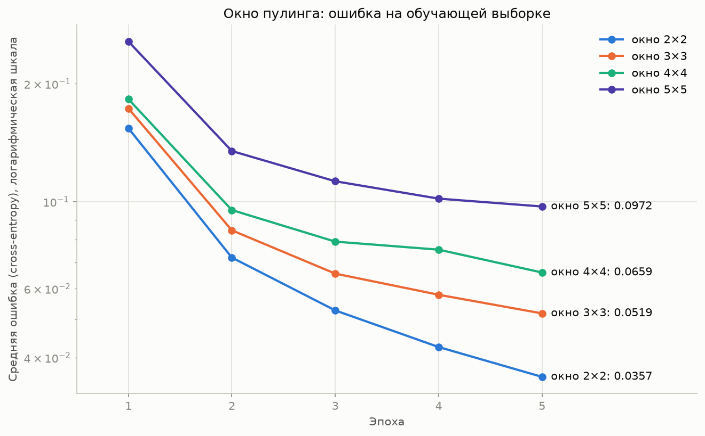

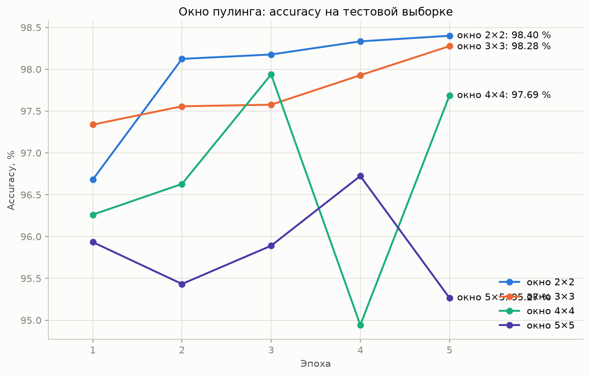

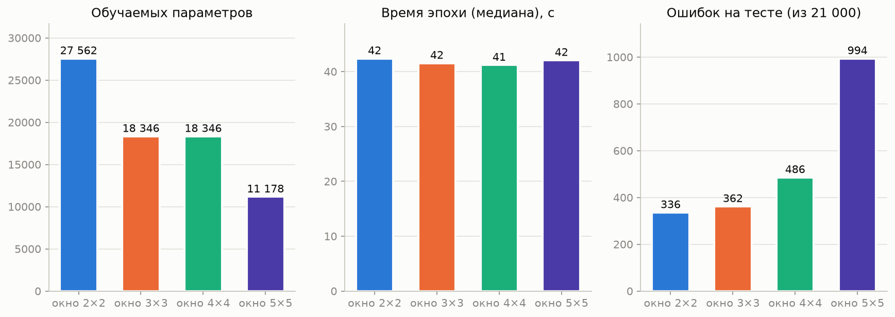

**Вывод.** Чем больше окно, тем хуже: большое окно выбирает один максимум из большой области и теряет информацию о том, где именно находится штрих. Окна 4×4 и 5×5 ещё и учатся нестабильно — accuracy на тесте скачет между эпохами (у 4×4 на 4-й эпохе падение до 94.9 %). На время пулинг почти не влияет. **Выбрано: окно 2×2 с шагом 2.**

### 7.5. Тип пулинга

[investigations/pooling_type.py](investigations/pooling_type.py)

| Вариант | Параметров | Время эпохи | Время на изображение | Ошибка обучения | Accuracy | Ошибок |
| --- | --- | --- | --- | --- | --- | --- |
| max-пулинг | 27 562 | 42 с | 0.31 мс | 0.0357 | 98.40 % | 336 |
| **average-пулинг** | 27 562 | 40 с | 0.26 мс | 0.0330 | **98.67 %** | **279** |

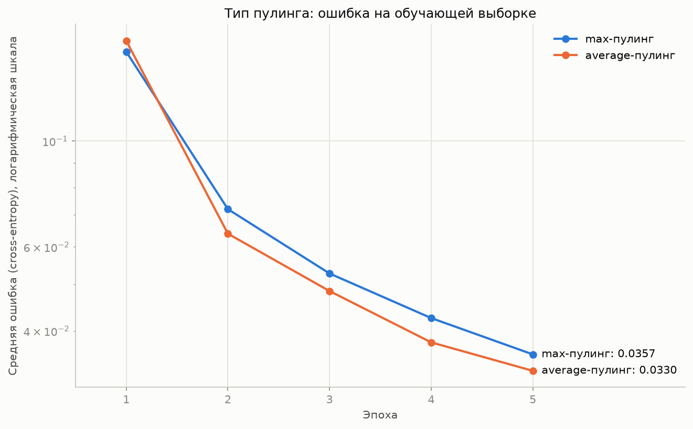

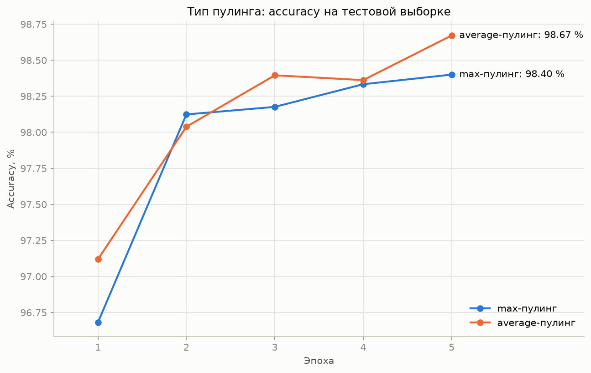

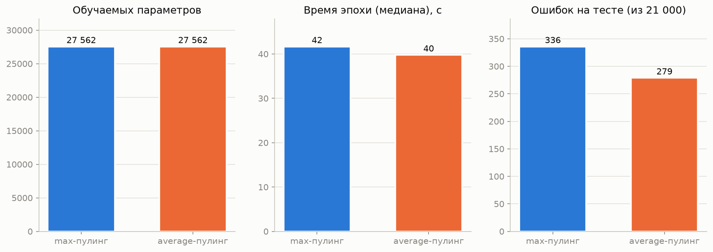

**Вывод.** Average-пулинг уменьшил число ошибок на 17 % (на 57 изображений, +0.27 п. п. — втрое больше погрешности) при том же числе параметров и чуть меньшем времени. Вероятное объяснение: при max-пулинге градиент проходит только через один элемент окна из четырёх, а при average — через все, поэтому каждое изображение обучает больше весов свёрточного слоя. На изображениях MNIST, где цифра — сплошной штрих на чистом фоне, усреднение почти не теряет информации. **Выбрано: average-пулинг.**

Слой `AvgPool2D` реализован в [source/layers.py](source/layers.py); его обратный проход проверен сравнением с численными производными (расхождение ~10⁻⁹).

### 7.6. Выбранные параметры

| Параметр | Первая модель | Варианты в исследовании | Выбрано | Основание |
| --- | --- | --- | --- | --- |
| Свёрточных слоёв | 2 | 1, 2, 3 | **2** | лучшая accuracy |
| Фильтров | 8 / 16 | 8/16, 16/32 | **16 / 32** | −20 % ошибок |
| Ядро свёртки | 3×3 | 3×3, 5×5, 7×7 | **3×3** | 5×5 лучше в пределах погрешности, но на 50 % медленнее |
| Шаг и дополнение свёртки | 1, без дополнения | — | **1, без дополнения** | шаг 1 не пропускает пиксели маленького изображения; дополнение нулями не требуется, карты 28×28 хватает на два слоя |
| Окно пулинга | 2×2, шаг 2 | 2×2 … 5×5, шаг 2 | **2×2, шаг 2** | лучшая accuracy |
| Тип пулинга | max | max, average | **average** | −17 % ошибок |

Параметры выбирались по отдельности. Совместный эффект изменений не обязан быть суммой отдельных, поэтому итоговая модель обучена заново и сравнена с первой ([раздел 8](#8-сравнение-с-первой-моделью)).

---

## 8. Сравнение с первой моделью

Сравниваются три набора весов на одной и той же тестовой выборке ([investigations/compare_models.py](investigations/compare_models.py), результаты — в [results/investigations/compare_models/](results/investigations/compare_models/)):

- **первая модель, 4 эпохи** — самый первый запуск: 8 / 16 фильтров, max-пулинг, постоянная скорость обучения, обучение прервано после 4 эпох ([results/archive_4_epochs/](results/archive_4_epochs/));
- **первая модель, до цели** — та же архитектура, обученная в тех же условиях, что и итоговая: скорость 0.01 с затуханием 0.95, до средней ошибки 0.0001 ([results/archive_baseline/](results/archive_baseline/));
- **оптимальная модель** — итоговая модель из разделов 2–6.

| | Первая, 4 эпохи | Первая, до цели | **Оптимальная** |
| --- | --- | --- | --- |
| Фильтров | 8 / 16 | 8 / 16 | 16 / 32 |
| Пулинг | max 2×2 | max 2×2 | average 2×2 |
| Обучаемых параметров | 27 562 | 27 562 | 56 714 |
| Эпох до остановки | 4 (прервано) | 19 | 38 |
| Время эпохи | ≈ 42 с | ≈ 42 с | ≈ 61 с |
| Время обучения | ≈ 3 мин | ≈ 13.5 мин | ≈ 39 мин |
| Средняя ошибка в последней эпохе | 0.0426 | 0.000097 | 0.000099 |
| Цель 0.0001 достигнута | нет | да | да |
| Время на изображение | 0.32 мс | 0.32 мс | 0.43 мс |
| **Accuracy** | 0.9774 | 0.9900 | **0.9909** |
| Precision (макро) | 0.9773 | 0.9900 | **0.9908** |
| Recall (макро) | 0.9776 | 0.9900 | **0.9908** |
| F-мера (макро) | 0.9773 | 0.9900 | **0.9908** |
| AUC (макро) | 0.99962 | 0.99986 | **0.99992** |
| **Ошибок на тесте** | 475 | 209 | **192** |

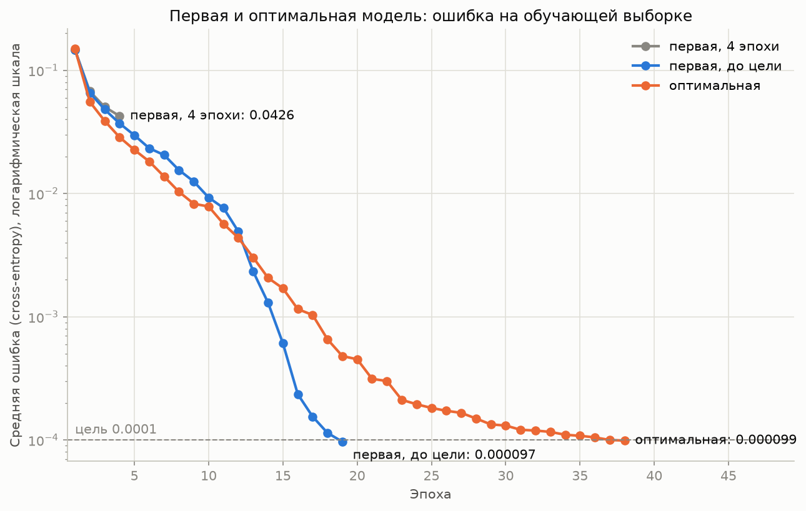

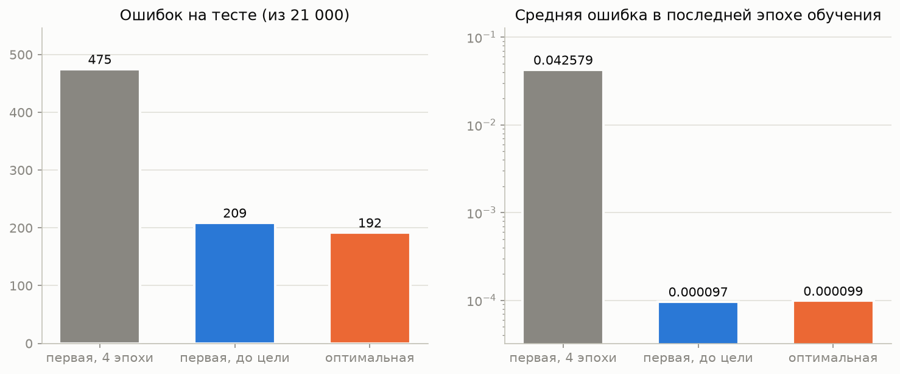

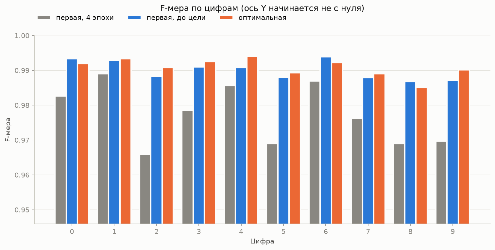

### Итог сравнения

1. **Главный прирост дало обучение до цели, а не архитектура.** Первая модель после 4 эпох ошибалась на 475 изображениях; та же модель, доученная до ошибки 0.0001, — на 209 (в 2.3 раза меньше).
2. **Оптимальная модель лучше по всем показателям, но ненамного.** 192 ошибки против 209 — на 17 изображений (8 %) меньше, accuracy +0.08 п. п., AUC 0.99992 против 0.99986, F-мера выше у 7 цифр из 10. Однако +0.08 п. п. — на уровне погрешности (≈ ±0.09 п. п.), поэтому уверенно утверждать, что оптимальная модель лучше на полностью обученной сети, нельзя.
3. **Выигрыш из исследований проявляется в начале обучения.** На графике ошибки оптимальная модель первые 12 эпох идёт заметно ниже первой — это то же, что показали 5-эпоховые исследования (98.72 % и 98.67 % против 98.40 %). При обучении до цели обе архитектуры упираются в один и тот же предел ~99 %, и разница сглаживается.
4. **Цена — время.** Оптимальная модель вдвое больше и до цели шла вдвое больше эпох (38 против 19): после 12-й эпохи её ошибка падает медленнее, чем у первой модели. Всего обучение заняло почти втрое больше времени, классификация одного изображения — на 35 % дольше.

**Вывод:** если важна максимальная точность — оптимальная модель (99.09 %, лучшая по всем метрикам). Если важно время обучения — первая архитектура, доученная до цели, даёт почти тот же результат (99.00 %) в 3 раза быстрее. Исследования на коротком обучении верно указали направление улучшения, но переоценили его величину для полностью обученной сети.

---

## 9. Выводы

1. Реализована свёрточная нейронная сеть на NumPy без фреймворков: свёртка, ReLU, max- и average-пулинг, полносвязные слои, softmax с перекрёстной энтропией, прямой и обратный проход, стохастический градиентный спуск.
2. Обучение обратным распространением ошибки доведено до средней ошибки **0.000099 < 0.0001** (38 эпох).
3. По матрице неточностей вычислены accuracy **0.9909**, precision **0.9908**, recall **0.9908**, F-мера **0.9908**; построены ROC-кривые, макро-AUC **0.99992**.
4. t-SNE, построенный до обучения, заранее показал зоны будущих ошибок: смешанные облака 4 / 9 / 7 и 3 / 5 / 8. Ошибки обученной сети лежат именно там и на краях облаков. Основные причины — похожие начертания, нетипичное написание и неоднозначные изображения.
5. Пять исследований обосновали выбор архитектуры: 2 свёрточных слоя, 16 / 32 фильтра, ядро 3×3, average-пулинг 2×2 с шагом 2. Существенный прирост при коротком обучении дали удвоение фильтров (−20 % ошибок) и average-пулинг (−17 %); ядро 5×5, третий слой и окна пулинга больше 2×2 не помогли.
6. После обучения до цели оптимальная модель лишь немного точнее первой (192 ошибки против 209, на уровне погрешности), но учится втрое дольше.

---

## 10. Запуск

```
pip install numpy matplotlib scikit-learn
```

Основная модель (из папки `lab2/source`):

```
python main.py            обучение до средней ошибки 0.0001, все графики и метрики
python main.py --load     без обучения: загрузить results/weights.npz и пересчитать метрики и графики
```

Исследования (из папки `lab2/investigations`):

```
python conv_layers_count.py     число свёрточных слоёв
python double_filters.py        число фильтров
python kernel_size.py           размер ядра свёртки
python pooling_window.py        размер окна пулинга
python pooling_type.py          тип пулинга
python compare_models.py        сравнение первой и оптимальной модели (без обучения)
```

У исследований есть флаг `--replot`: перерисовать графики по сохранённым результатам без обучения.

| Папка | Что в ней |
| --- | --- |
| [source/](source/) | Код основной модели |
| [investigations/](investigations/) | Код исследований |
| [results/](results/) | Графики и веса итоговой модели |
| [results/investigations/](results/investigations/) | Графики и результаты исследований и сравнения моделей |
| [results/archive_baseline/](results/archive_baseline/) | Первая модель, обученная до цели: веса, графики, журнал обучения |
| [results/archive_4_epochs/](results/archive_4_epochs/) | Самый первый запуск (4 эпохи) |
