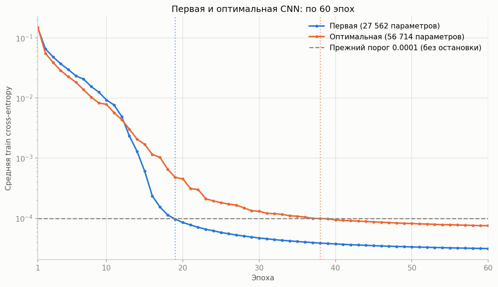
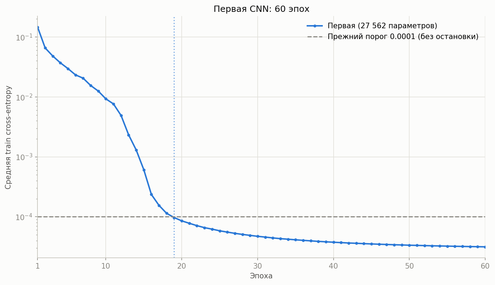
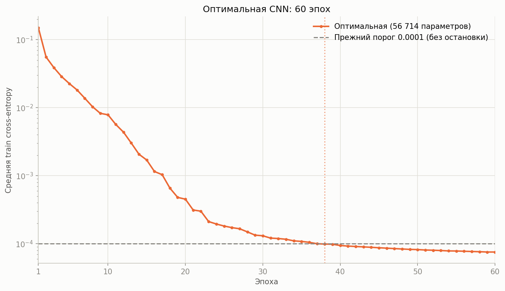
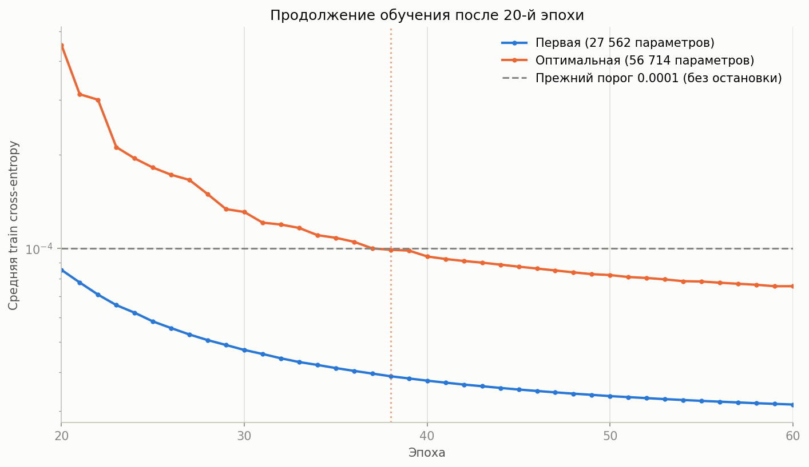
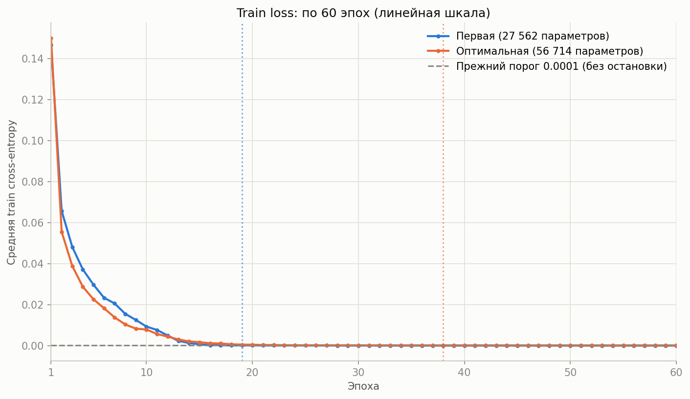

# Первая и оптимальная CNN: ровно по 60 эпох

Сравниваются исходная модель (8/16 фильтров, max-пулинг 2×2) и оптимальная (16/32 фильтра, average-пулинг 2×2). Обе реализованы на NumPy с ручным обратным проходом и SGD по одному изображению.

Каждая модель имеет 60 реальных значений loss: без экстраполяции и без остановки при достижении 0.0001. Потеря — средняя cross-entropy на 49 000 обучающих изображениях, усреднённая во время обновлений весов.

## Условия

Разбиение MNIST прежнее: все 70 000 изображений перемешаны с seed 42, 49 000 используются для обучения, 21 000 — для теста. Learning rate на эпохе e: `0.01 * 0.95**(e-1)`. Обновление после каждого изображения, без батчевого усреднения.

| Модель | Параметров | Эпох из архива | Дообучено эпох | Всего |
| --- | ---: | ---: | ---: | ---: |
| Первая | 27562 | 19 | 41 | 60 |
| Оптимальная | 56714 | 38 | 22 | 60 |

Архивные веса и начала историй сохранены без изменений. Для продолжения восстановлен поток перестановок: seed 42, инициализация соответствующей архитектуры, затем пропуск перестановок завершённых архивных эпох. Это соответствует схеме исходного `source/main.py`. Состояние SGD полностью задаётся весами, так как momentum не используется. Все новые checkpoint сохраняют также состояние генератора случайных чисел.

Исходный архив не содержал состояния RNG; восстановление опирается на документированную инициализацию и порядок вызовов исходной программы. Побитовое совпадение с гипотетическим непрерывным запуском в старом окружении не утверждается. Для нового полного запуска доступен `--from-scratch`.

## Графики

Пунктир по горизонтали — прежняя цель 0.0001, теперь только ориентир. Вертикальные цветные линии отмечают конец архивного участка и начало нового обучения. Логарифмическая шкала помогает различить малые ошибки после достижения цели.











## Итоги

| Показатель | Первая | Оптимальная |
| --- | ---: | ---: |
| Train loss на последней эпохе | 0.0000314502 | 0.0000755849 |
| Первая эпоха с loss ≤ 0.0001 | 19 | 38 |
| Test cross-entropy на последней эпохе | 0.067089 | 0.058354 |
| Test accuracy на последней эпохе | 0.990190 | 0.990857 |
| Ошибок на 21 000 тестовых изображениях | 206 | 192 |

- Первая: train loss уменьшился относительно конца архивного участка на 67.55 %. Итог: 0.0000314502 после 60 эпох.
- Оптимальная: train loss уменьшился относительно конца архивного участка на 23.65 %. Итог: 0.0000755849 после 60 эпох.

При одинаковом бюджете минимальная обучающая ошибка у модели «Первая» (0.0000314502). Максимальная итоговая test accuracy у модели «Оптимальная» (0.990857). Название «оптимальная» обозначает архитектуру, выбранную в предыдущих исследованиях, и не означает обязательного превосходства по любой метрике при любом бюджете.

Сравнение при одинаковом числе эпох отличается от прежнего сравнения при одинаковом пороге ошибки. Меньший train loss не гарантирует лучшую точность на новых изображениях: тест посчитан отдельно после завершения всех эпох и не управляет остановкой. Время дообучения измерялось при параллельных запусках и не сопоставляется напрямую со старыми временами.

## Воспроизведение

```powershell
python lab2/investigations/compare_60_epochs.py
python lab2/investigations/compare_60_epochs.py --replot
```

Checkpoint и CSV сохраняются после каждой эпохи. Повторный запуск продолжает незавершённый расчёт. Чтобы обучить обе сети заново с первой эпохи:

```powershell
python lab2/investigations/compare_60_epochs.py --from-scratch --output lab2/results/investigations/compare_60_epochs_fresh
```

Для каждой модели: `history.csv`, `weights.npz`, `training.log`, `timings.json`, `result.json`, `test_predictions.npz`. Общая сводка — `results.json`. Новое исследование не перезаписывает исходные `results/weights.npz` и `results/archive_baseline/weights.npz`.
