# Лабораторная работа №3: прогнозирование энергопотребления

Реализация и сравнение RNN, GRU и LSTM для прогноза `Usage_kWh` на 15 минут вперёд. Проведены исследования гиперпараметров
и проверены сочетания лучших значений на нескольких случайных инициализациях.

**Основной результат:** по среднему MSE на валидации для трёх seed выбрана **GRU**
с окном 24, скрытым состоянием 32, learning rate 0,001 и batch size 256.
На тесте получены **RMSE 7,8332 kWh и R² 0,936844**.
Тестовый MSE ниже исходной GRU на **26,91%**, а лучшей исходной модели LSTM — на **10,44%**.

## 1. Задача и данные

Используется датасет **Steel Industry Energy Consumption**: 35 040 наблюдений
за 2018 год с шагом 15 минут. Исходная таблица содержит 11 столбцов, пропусков нет.
Данные находятся в [data/Steel_industry_data.csv](data/Steel_industry_data.csv);
[описание источника и лицензии](data/README.md).

Модель прогнозирует `Usage_kWh[t]` по истории `[t − window, …, t − 1]`.
На каждом шаге используются пять признаков:

- стандартизированное потребление энергии;
- синус и косинус времени суток;
- синус и косинус дня недели.

Циклическое кодирование сохраняет близость конца и начала суток или недели.
В базовом исследовании остальные измерения таблицы не используются.
Их прошлые значения проверены [в отдельном исследовании](results/features/README.md).
Окно 24 соответствует 6 часам истории.
Горизонт прогноза — один отсчёт, то есть 15 минут. При последовательной оценке
история дополняется фактическими измерениями.

Разбиение хронологическое: **70% — обучение, 15% — валидация, 15% — тест**.
В исследованиях первые 48 строк служат контекстом, чтобы при разных окнах
обучающие цели приходились на одинаковые даты.

| Выборка | Число целей | Начало | Конец |
| --- | ---: | --- | --- |
| Обучение | 24 480 | 01.01.2018 12:00 | 13.09.2018 11:45 |
| Валидация | 5 256 | 13.09.2018 12:00 | 07.11.2018 05:45 |
| Тест | 5 256 | 07.11.2018 06:00 | 31.12.2018 23:45 |

Нормализация настраивается только на обучении. Окна не содержат собственной цели
и будущих измерений; перемешиваются только обучающие примеры. Валидация используется
для выбора весов и конфигурации, тест — для оценки уже выбранной модели.

## 2. Краткая теория

Рекуррентная сеть последовательно обрабатывает временные шаги и обновляет
скрытое состояние — представление накопленной истории. Последнее состояние окна
подаётся в линейный слой, который выдаёт прогноз одного числа.

| Архитектура | Принцип работы | Особенность |
| --- | --- | --- |
| RNN | `h_t = tanh(W_x x_t + W_h h_(t−1) + b)` | Простая и компактная; при длинных последовательностях возможны затухание и взрыв градиентов |
| GRU | Вентили reset и update управляют использованием прошлого состояния и новой информации | Избирательно сохраняет историю; при том же hidden size имеет меньше параметров, чем LSTM |
| LSTM | Вентили input, forget и output управляют отдельной памятью `c_t` | Более гибкое управление памятью, но больше параметров и вычислений |

В реализованной GRU кандидат состояния и обновление имеют вид:

```text
n_t = tanh(x_n + r_t ⊙ h_n)
h_t = z_t ⊙ h_(t−1) + (1 − z_t) ⊙ n_t
```

Здесь `r_t` и `z_t` — значения вентилей от 0 до 1, `x_n` и `h_n` — линейные
преобразования входа и прошлого состояния, `⊙` — поэлементное умножение.
У LSTM память обновляется по формулам:

```text
c_t = f_t ⊙ c_(t−1) + i_t ⊙ g_t
h_t = o_t ⊙ tanh(c_t)
```

В проекте один рекуррентный слой, начальные состояния каждого окна нулевые,
между окнами состояние не переносится. Готовые `nn.RNN`, `nn.GRU` и `nn.LSTM`
не используются. PyTorch предоставляет линейные слои, autograd и Adam.
Градиенты вычисляются обратным распространением через временные шаги — BPTT.
Ограничение нормы градиента до 1,0 помогает сдерживать взрыв градиентов.

**Гиперпараметры** задаются до обучения: окно, размер скрытого состояния,
learning rate, batch size и правила остановки. **Веса модели** подбираются
оптимизатором. Seed управляет инициализацией и порядком батчей; повторы с разными
seed позволяют оценить чувствительность результата к случайности.

Обучение минимизирует MSE стандартизированной цели. Итоговые метрики вычисляются
после возврата прогнозов в исходную шкалу:

```text
MSE  = mean((y − ŷ)²)
RMSE = sqrt(MSE)
R²   = 1 − sum((y − ŷ)²) / sum((y − mean(y))²)
```

Чем меньше MSE и RMSE, тем лучше. MSE измеряется в `(kWh)²`, RMSE — в `kWh`.
Чем ближе R² к 1, тем лучше; нулевое значение соответствует ошибке прогноза
средним фактических значений оцениваемой выборки, отрицательное — большей ошибке.
Потребление в kWh — энергия, а не мощность в kW.

Развёрнутый разбор формул, градиентов и примеров: [additions.md](additions.md).
Его разделы с прежними итогами относятся к однофакторному этапу; актуальный выбор
после проверки сочетаний приведён ниже.

## 3. План исследования

Сначала выполнены **33 обучения**: 11 конфигураций для каждой из трёх архитектур.
Один параметр менялся относительно базы: окно 24, hidden size 32,
learning rate 0,001, batch size 256, seed 42. Базовые запуски переиспользовались.

| Параметр | Проверенные значения |
| --- | --- |
| Длина окна | 8, 24, 48 отсчётов — 2, 6, 12 часов |
| Размер скрытого состояния | 16, 32, 64 |
| Learning rate | 0,0003; 0,001; 0,003 |
| Batch size | 128, 256, 512 |
| Seed | 7, 42, 123 |
| Бюджет обучения | 30, 60, 100 эпох |
| Patience | 7, 15, 25 эпох без улучшения |
| Минимальное число эпох | 0, 30, 60 при значении не выше бюджета |

Бюджеты эпох и правила ранней остановки сравнивались по записанным траекториям.
Это повторная оценка правил на существующих историях, а не отдельное обучение
для каждой комбинации правил. Недоступное продолжение истории не достраивается.

Затем для каждой архитектуры объединили лучшие однофакторные значения окна,
hidden size, learning rate и batch size. Каждое сочетание обучили на трёх seed:
**ещё 9 обучений**, всего **42 в двух этапах исследования**, без учёта первоначального
запуска трёх моделей за 30 эпох.

| Архитектура | Окно | Hidden size | Learning rate | Batch size |
| --- | ---: | ---: | ---: | ---: |
| RNN: сочетание лучших значений | 24 | 32 | 0,003 | 128 |
| GRU: сочетание лучших значений | 24 | 32 | 0,001 | 128 |
| LSTM: сочетание лучших значений | 8 | 64 | 0,003 | 128 |

База и сочетания сравнивались при одинаковом протоколе: до 100 эпох,
минимум 60, patience 25. В каждом запуске восстанавливались веса с минимальным
validation MSE. Итоговый кандидат выбирался по **среднему validation MSE на seed
7, 42 и 123** среди шести вариантов: три архитектуры × база/сочетание.
Seed итогового экземпляра заранее зафиксирован равным 42.

Число слоёв, Adam, набор признаков, MSE и clipping 1,0 оставлены фиксированными.
Другие оптимизаторы, dropout и регуляризация в исследованную сетку не входили.
`threads` и `log_every` — технические настройки.

## 4. Основные результаты исследования

### Однофакторные эксперименты

Сводный график показывает валидационный MSE для всех настроек из плана
исследования, кроме длины окна, которой посвящён отдельный раздел ниже.
Для размера состояния и батча показаны среднее и стандартное отклонение
по четырём seed. В панели ранней остановки каждая ячейка показывает
средний MSE по 33 сохранённым траекториям для указанного правила.

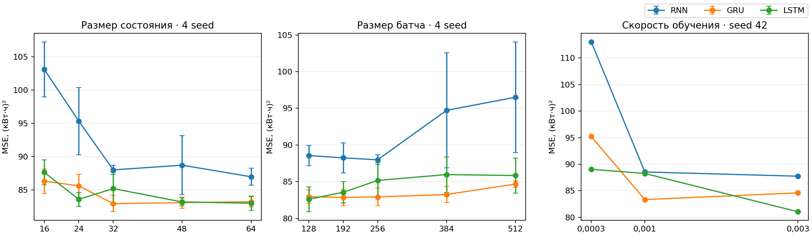

#### Длина окна

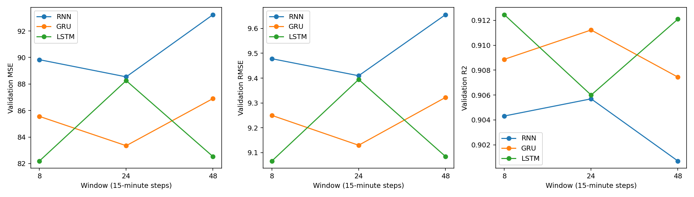

**Вывод по пяти повторам.** RNN и GRU показали наименьший средний MSE
при окне 24 отсчёта (6 часов): 89,65 и 82,85 соответственно. Для LSTM
лучшим по среднему MSE стало окно 48 отсчётов (12 часов): 82,81 против
83,38 при окне 8. График выше показывает отдельные запуски с seed 42,
а результаты по пяти seed приведены ниже.

<details>
<summary>Кривые обучения для разных окон</summary>

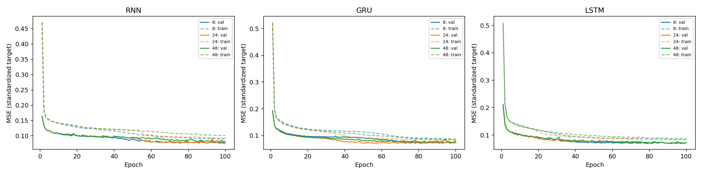

</details>

#### Длина окна RNN, GRU и LSTM в пяти повторах

Для каждой архитектуры проверены окна **8, 16, 24, 32 и 48** отсчётов
(2, 4, 6, 8 и 12 часов) с одинаковыми пятью seed (7, 21, 42, 84, 123).
В каждом из 75 запусков использованы базовые гиперпараметры из раздела 3,
общие даты обучающих и валидационных целей и бюджет до 100 эпох.
Для каждого запуска взяты веса лучшей эпохи по валидационному MSE.
Соединённые точки показывают средний MSE пяти запусков, вертикальные планки —
выборочное стандартное отклонение, полупрозрачные точки — отдельные замеры.

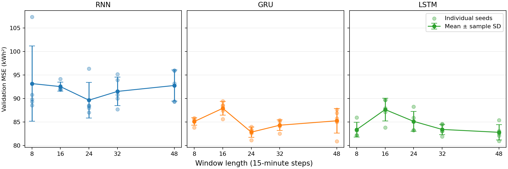

В таблице приведён средний MSE ± стандартное отклонение в (кВт·ч)².

| Окно, отсчёты | История, ч | RNN | GRU | LSTM |
| ---: | ---: | ---: | ---: | ---: |
| 8 | 2 | 93,18 ± 7,99 | 85,11 ± 0,78 | 83,38 ± 1,55 |
| 16 | 4 | 92,55 ± 0,95 | 87,93 ± 1,46 | 87,66 ± 2,42 |
| 24 | 6 | **89,65 ± 3,78** | **82,85 ± 1,07** | 85,15 ± 2,09 |
| 32 | 8 | 91,52 ± 3,02 | 84,33 ± 1,14 | 83,43 ± 1,10 |
| 48 | 12 | 92,78 ± 3,31 | 85,26 ± 2,63 | **82,81 ± 1,65** |

**Вывод.** Для RNN и GRU лучшее среднее получено при окне 24, для LSTM — при окне 48.
Средние лучших конфигураций LSTM и GRU различаются примерно на 0,03 (кВт·ч)²,
что мало на фоне разброса между seed. Расширенное сравнение проведено на валидации.

[Все 75 замеров](results/windows/runs.csv) ·
[Сводка по длинам окон](results/windows/summary.csv)

Воспроизведение из папки `lab3`:

```powershell
python investigations/windows.py --workers 8
```

#### Размер скрытого состояния

В расширенной серии для каждой архитектуры проверены размеры **16, 24, 32, 48 и 64**
с четырьмя одинаковыми seed (7, 21, 42, 84). Длина окна фиксирована на 24 отсчётах.
Используются те же даты целей и протокол до 100 эпох. Для размера 32 взяты
совпадающие запуски из исследования окон.

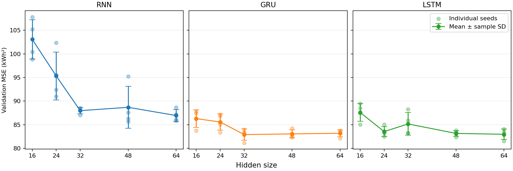

Соединённые точки показывают средний валидационный MSE по четырём запускам,
вертикальные планки — выборочное стандартное отклонение, полупрозрачные
точки — отдельные замеры. В таблице указан средний MSE ± стандартное
отклонение в (кВт·ч)².

| Размер состояния | RNN | GRU | LSTM |
| ---: | ---: | ---: | ---: |
| 16 | 103,08 ± 4,15 | 86,30 ± 1,85 | 87,62 ± 1,89 |
| 24 | 95,33 ± 5,06 | 85,58 ± 1,75 | 83,55 ± 1,07 |
| 32 | 87,98 ± 0,67 | **82,92 ± 1,23** | 85,17 ± 2,41 |
| 48 | 88,69 ± 4,43 | 83,06 ± 0,84 | 83,16 ± 0,60 |
| 64 | **86,95 ± 1,29** | 83,19 ± 0,75 | **82,98 ± 1,09** |

**Вывод.** RNN и LSTM показали наименьший средний MSE при размере 64,
а GRU — при размере 32. У GRU средние для размеров 32, 48 и 64 отличаются
менее чем на 0,3 (кВт·ч)² при стандартном отклонении от 0,75 до 1,23.

[Все 60 замеров](results/hidden_sizes/runs.csv) ·
[Сводка по размерам состояния](results/hidden_sizes/summary.csv)

```powershell
python investigations/windows.py --factor hidden_size --workers 8
```

<details>
<summary>Исходное сравнение трёх размеров и кривые обучения при seed 42</summary>

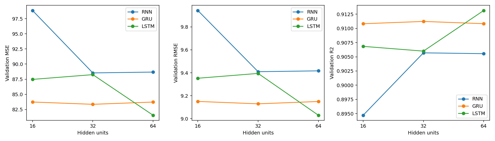

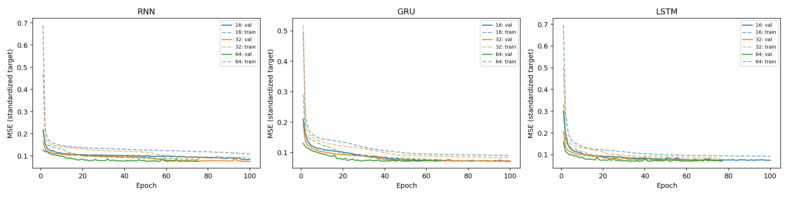

</details>

#### Скорость обучения

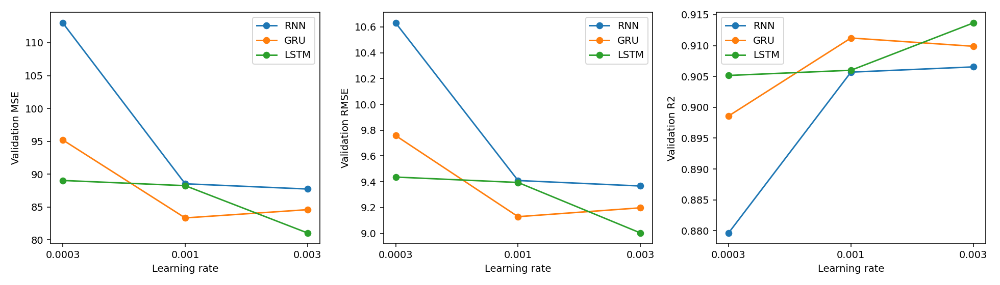

**Вывод.** При бюджете до 100 эпох шаг 0,0003 дал наибольший MSE у всех трёх
моделей. Лучшим для RNN и LSTM оказался шаг 0,003, для GRU — 0,001.

<details>
<summary>Кривые обучения для разных скоростей обучения</summary>

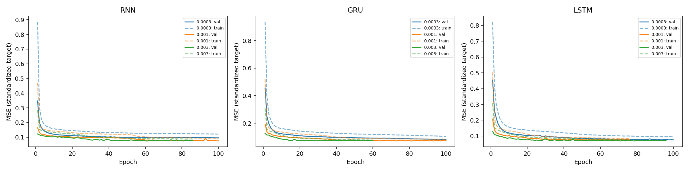

</details>

#### Размер батча

Для каждой архитектуры проверены батчи **128, 192, 256, 384 и 512** с четырьмя
одинаковыми seed (7, 21, 42, 84). Окно равно 24 отсчётам, размер состояния — 32.
Даты целей и протокол до 100 эпох совпадают. При меньшем батче за одну эпоху
выполняется больше обновлений весов. Для батча 256 использованы 12 запусков
из исследования окон с совпадающими настройками.

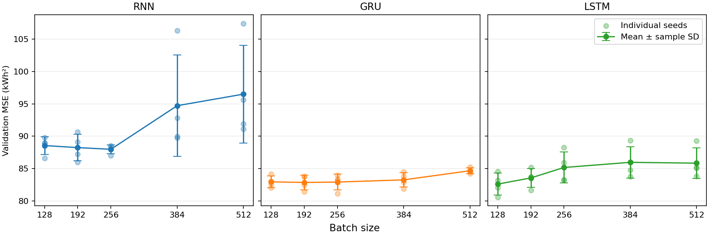

Соединённые точки показывают средний MSE четырёх запусков, вертикальные планки —
выборочное стандартное отклонение, полупрозрачные точки — отдельные замеры.
В таблице приведён средний MSE ± стандартное отклонение в (кВт·ч)².

| Размер батча | RNN | GRU | LSTM |
| ---: | ---: | ---: | ---: |
| 128 | 88,56 ± 1,38 | 82,95 ± 0,91 | **82,60 ± 1,70** |
| 192 | 88,24 ± 2,05 | **82,86 ± 1,14** | 83,56 ± 1,46 |
| 256 | **87,98 ± 0,67** | 82,92 ± 1,23 | 85,17 ± 2,41 |
| 384 | 94,72 ± 7,86 | 83,26 ± 1,12 | 85,97 ± 2,42 |
| 512 | 96,51 ± 7,54 | 84,67 ± 0,44 | 85,84 ± 2,38 |

**Вывод.** Минимальный средний MSE получен при батче 256 у RNN, 192 у GRU
и 128 у LSTM. У GRU средние для батчей 128, 192 и 256 различаются менее чем
на 0,10 (кВт·ч)² при стандартном отклонении от 0,91 до 1,23.

[Все 60 замеров](results/batch_sizes/runs.csv) ·
[Сводка по размерам батча](results/batch_sizes/summary.csv)

```powershell
python investigations/windows.py --factor batch_size --workers 8
```

<details>
<summary>Исходное сравнение батчей 128, 256 и 512 при seed 42</summary>

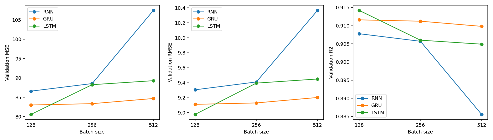

</details>

<details>
<summary>Кривые обучения для разных seed</summary>

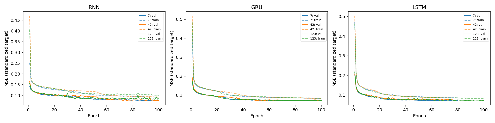

</details>

### Сочетания гиперпараметров

Все значения ниже относятся к **валидации**, усреднение выполнено по трём seed.
Стандартное отклонение MSE — выборочное.

| Модель | Средний MSE базы | Средний MSE сочетания | SD базы / сочетания | Изменение ошибки |
| --- | ---: | ---: | ---: | --- |
| RNN | 90,959968 | 88,772589 | 4,663127 / 1,348791 | Снижение на 2,40% |
| GRU | **83,036310** | 83,099972 | **0,406881** / 1,023781 | Рост на 0,08% |
| LSTM | 85,529328 | 86,224948 | 2,528027 / 1,593870 | Рост на 0,81% |

Сочетание улучшило средний результат RNN, но не позволило обойти GRU.
У GRU уменьшение батча до 128 не подтвердило улучшение на трёх seed и увеличило
разброс. У LSTM объединение лучших отдельных значений ухудшило среднюю ошибку.
**Оптимальные по отдельности значения не обязательно образуют лучшее сочетание:**
параметры влияют на обучение совместно.

Базовая GRU получила минимальный средний validation MSE среди шести кандидатов.
Различие между двумя конфигурациями GRU мало; три повтора не доказывают
статистическую значимость преимущества.

### Число эпох и ранняя остановка

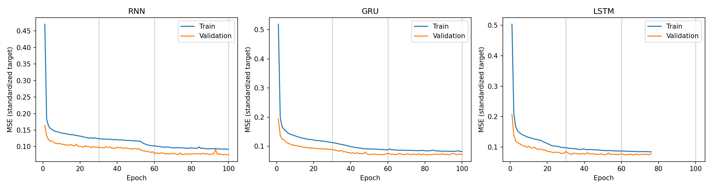

**Вывод по базовым траекториям.** При переходе от бюджета 60 к 100 эпох
MSE RNN снизился с 94,17 до 88,54, а GRU — с 84,32 до 83,35.
Лучший результат базовой LSTM остался на 51-й эпохе.

Ниже — средний validation MSE по 33 траекториям при `min_epochs = 60`.
Для бюджета 30 использовано `min_epochs = 30`.

| Бюджет эпох | Patience | Средний validation MSE |
| --- | ---: | ---: |
| 30 | 25 | 102,522939 |
| 60 | 25 | 92,248463 |
| 100 | 7 | 89,039048 |
| 100 | 15 | 88,155160 |
| 100 | 25 | **88,031407** |

В проверенной сетке бюджет 100 эпох и patience 25 дали минимальную среднюю ошибку.
При этих настройках `min_epochs = 0/30/60` дали одинаковый минимум;
сохранено 60 для общего протокола. Короткое ожидание может остановить обучение
до последующего улучшения. Выбирать следует лучшие валидационные веса:
снижение обучающей ошибки само по себе не гарантирует улучшения прогноза.

Полные таблицы и кривые: [однофакторные исследования](results/investigations/README.md),
[сочетания и правила остановки](results/ideal/README.md).

## 5. Итоговая модель

| Настройка | Выбранное значение |
| --- | --- |
| Архитектура | GRU, один рекуррентный слой |
| Входные признаки | 5 |
| Длина окна | 24 отсчёта — 6 часов |
| Размер скрытого состояния | 32 |
| Число обучаемых параметров | 3 777 |
| Оптимизатор и learning rate | Adam, 0,001 |
| Batch size | 256 |
| Максимум / минимум эпох | 100 / 60 |
| Patience | 25 |
| Ограничение нормы градиента | 1,0 |
| Итоговый seed | 42 |
| Выполнено эпох / лучшая эпоха | 100 / **81** |

Исследование подтвердило базовые значения гиперпараметров GRU. Улучшение
относительно первоначального запуска связано с обновлённым протоколом обучения
и выбором весов. Итоговый экземпляр взят из проверенного базового запуска
и сохранён отдельно; повторное обучение тех же весов не требовалось.

**«Идеальная модель» здесь означает победителя по принятому критерию среди
проверенных кандидатов.** Глобальная оптимальность не утверждается.

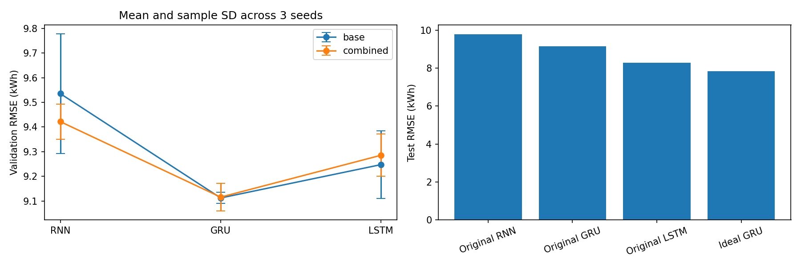

## 6. Сравнение с исходными моделями

Тестовые метрики посчитаны на одинаковых 5 256 целевых датах в исходной шкале.
Исходные модели сохранены в `results/baseline_30`.
Persistence предсказывает последнее наблюдение: `ŷ[t] = y[t−1]`.


| Архитектура | Окно | Hidden size | Learning rate | Batch size |
| --- | ---: | ---: | ---: | ---: |
| RNN: сочетание лучших значений | 24 | 32 | 0,003 | 128 |
| GRU: сочетание лучших значений | 24 | 32 | 0,001 | 128 |
| LSTM: сочетание лучших значений | 8 | 64 | 0,003 | 128 |


| Модель | MSE, (kWh)² | RMSE, kWh | R² |
| --- | ---: | ---: | ---: |
| Исходная RNN| 95,860619 | 9,790844 | 0,901332 |
| Исходная GRU | 83,955677 | 9,162733 | 0,913585 |
| Исходная LSTM | 68,510961 | 8,277135 | 0,929483 |
| **Итоговая GRU, выбор по среднему трёх seed** | **61,359340** | **7,833220** | **0,936844** |

Итоговая GRU снизила MSE на **26,91% относительно исходной GRU**
и на **10,44% относительно исходной LSTM**, лучшей модели первоначального запуска.
Она также получила меньшую тестовую ошибку, чем ранее выбранные однофакторные
модели. Тест оценивался после выбора по валидации и не использовался для смены победителя.

На первом этапе каждая архитектура выбиралась по лучшему отдельному запуску,
в том числе по seed. На итоговом этапе сравнивались средние трёх повторов
с заранее фиксированным seed финального экземпляра. Это разные критерии выбора,
поэтому прежняя победа LSTM и итоговый выбор GRU друг другу не противоречат.

## 7. Выводы и ограничения

1. **GRU дала лучший итоговый результат:** RMSE 7,8332 kWh, R² 0,936844.
   Более сложная LSTM не обеспечила преимущества в этой постановке.
2. **Проверка сочетаний необходима:** выигрыш отдельного параметра не гарантирует
   выигрыша при объединении с другими изменениями.
3. **Повторы с разными seed уточняют выбор:** локальный выигрыш батча 128
   у GRU не подтвердился по среднему трёх запусков.
4. **Бюджет обучения и сохранение лучших весов существенны:** бюджет 100 эпох
   и patience 25 оказались предпочтительнее короткого обучения в исследованной сетке.
5. **Выводы ограничены одним временным разбиением:** три seed оценивают случайность
   обучения, но не заменяют проверку на других временных периодах.

Сравнение с первоначальными моделями отражает изменение всего процесса:
кроме бюджета обучения, начало обучающих целей сдвинуто с индекса 24 на 48
для согласования окон. Поэтому снижение ошибки нельзя полностью приписать
одному гиперпараметру. База и сочетания итогового исследования используют
одинаковые обучающие даты.

Тестовый период уже использовался в первоначальной лабораторной; это повторная
оценка на прежнем периоде. Подбор может адаптироваться к валидации, поэтому
для более строгой оценки нужны дополнительные временные разбиения.
Прогноз проверен на один шаг вперёд с обновлением истории фактическими данными.
Линейный выход не ограничивает прогноз снизу, отрицательные значения не обрезаются.

## 8. Дополнительное исследование прошлых признаков

В отдельном эксперименте к базовым пяти признакам добавляются прошлые значения
других столбцов CSV: реактивная энергия, коэффициенты мощности, CO₂, тип нагрузки
и календарные поля. Проверяются пять отдельных групп, все дополнительные
физические численные показатели совместно и полный набор: **7 вариантов × 3 seed**.
Три базовых запуска GRU переиспользуются для сравнения.

Настройки GRU и даты выборок фиксированы, что позволяет оценить влияние признаков.
Численные признаки стандартизуются, категориальные кодируются one-hot; параметры
преобразований вычисляются только по train. Во вход попадает история до `t−1`,
а прогнозируется `Usage_kWh[t]`. Набор выбирается по среднему validation MSE,
после чего один итоговый экземпляр с seed 42 сравнивается на тесте с прежней GRU.

Основные результаты разделов выше относятся к базовым пяти признакам.
Итог отдельного исследования: **ни один расширенный набор не улучшил средний
validation MSE при фиксированных настройках GRU**.

| Набор дополнительных признаков | Всего входов | Средний validation MSE | Рост MSE к базе |
| --- | ---: | ---: | ---: |
| Без добавлений — база | 5 | **83,036310** | — |
| Календарные поля | 15 | 83,734559 | 0,84% |
| Тип нагрузки | 8 | 83,828935 | 0,95% |
| CO₂ | 6 | 83,916877 | 1,06% |
| Коэффициенты мощности | 7 | 84,451252 | 1,70% |
| Реактивная энергия | 7 | 86,161212 | 3,76% |
| Все дополнительные столбцы | 23 | 88,371635 | 6,43% |
| Все дополнительные физические численные показатели | 10 | 89,214750 | 7,44% |

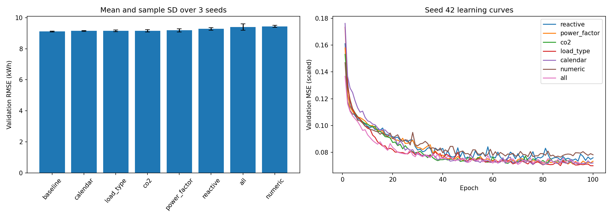

Для каждого варианта использованы seed 7, 42 и 123. Дополнительные данные
не гарантируют улучшения: они могут дублировать уже доступную информацию
и увеличивают число параметров входной проекции. Причина ухудшения отдельно
не устанавливалась; результат относится к проверенным наборам и фиксированной GRU.
По валидации сохранена прежняя модель с пятью признаками; её тестовые показатели
остались **RMSE 7,8332 kWh, R² 0,936844**. Расширенным моделям может потребоваться
собственная настройка гиперпараметров — это отдельная задача.

**[Отчёт по дополнительным признакам](results/features/README.md)** содержит
сводку всех вариантов, графики, выбранный набор и отдельное сравнение на тесте.
Модель сохраняется в `results/features/selected_model.pt`; прежние веса сохраняются.

## 9. Запуск и файлы проекта

Команды выполняются **из папки `lab3`**:

```powershell
python -m pip install -r requirements.txt

# Отдельное сравнение трёх моделей
python source/main.py --output results_manual

# Проверка сочетаний, выбор итоговой модели и подробный отчёт
python investigations/ideal.py --workers 3

# Отдельное исследование дополнительных прошлых признаков
python investigations/features.py --workers 3
```

Скрипт итогового исследования проверяет и при необходимости выполняет
однофакторные обучения. Завершённые запуски переиспользуются при совпадении
настроек и хешей кода и данных. Обучение выполняется локально на CPU,
датасет не сокращается, интернет для обучения не нужен.
`--workers` задаёт число одновременно обучаемых моделей.

| Файл или каталог | Назначение |
| --- | --- |
| [source/models.py](source/models.py) | Явная реализация ячеек RNN, GRU и LSTM |
| [source/data_preparation.py](source/data_preparation.py) | Признаки, разбиение и окна |
| [source/main.py](source/main.py) | Обучение и оценка трёх архитектур |
| [investigations/run.py](investigations/run.py) | Однофакторные исследования |
| [investigations/ideal.py](investigations/ideal.py) | Проверка сочетаний и выбор итоговой модели |
| [investigations/features.py](investigations/features.py) | Отдельное исследование дополнительных прошлых признаков |
| [results/features/README.md](results/features/README.md) | Сравнение расширенных наборов признаков с базовой GRU |
| [results/ideal/README.md](results/ideal/README.md) | Подробный итоговый отчёт |
| [results/ideal/ideal_model.pt](results/ideal/ideal_model.pt) | Обученные веса итоговой GRU и сведения о предобработке |
| [results/ideal/ideal_config.json](results/ideal/ideal_config.json) | Конфигурация, критерий выбора, метрики и хеши |
| [results/ideal/selection.csv](results/ideal/selection.csv) | Сравнение шести кандидатов по трём seed |
| [results/ideal/comparison.csv](results/ideal/comparison.csv) | Сравнение итоговой модели с исходными |
| [results/ideal/predictions.csv](results/ideal/predictions.csv) | Фактические значения и тестовые прогнозы |
| [results/ideal/ideal_history.csv](results/ideal/ideal_history.csv) | История обучения итоговой модели |
| [results/investigations/README.md](results/investigations/README.md) | Отчёт по 33 однофакторным обучениям |
| `results/baseline_30/` | Сохранённые исходные модели и результаты |
| [additions.md](additions.md) | Развёрнутая теория и пояснения для защиты |

Для итоговой модели проверены загрузка checkpoint, воспроизведение прогнозов
и метрик, совпадение тестовых дат и контрольная сумма весов.
Проверки отсутствия утечки данных в исследовании признаков:
`python -B -m unittest discover -s investigations -p test_features.py -v`.
