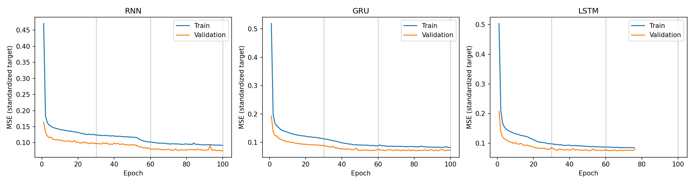
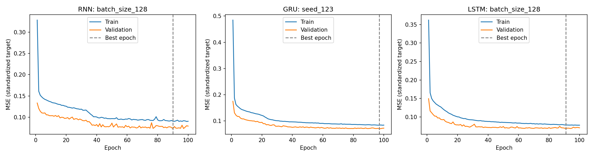
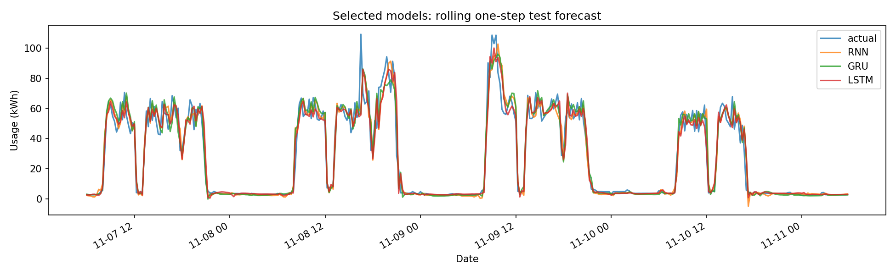
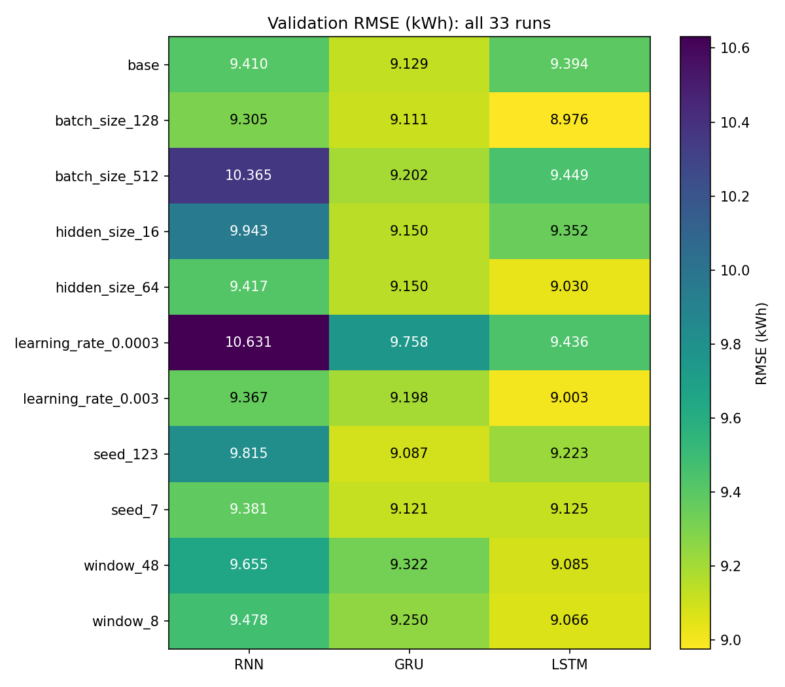

# Лабораторная работа №3: подробный разбор

Этот файл объясняет лабораторную от постановки задачи до интерпретации результатов.
Формулы соответствуют [реальному коду моделей](source/models.py), а численные
результаты взяты из сохранённых CSV и JSON. В примерах с маленькими числами
используются условные данные: они нужны для понимания вычислений.

Рекуррентные ячейки написаны явно. PyTorch предоставляет линейные преобразования,
автоматическое дифференцирование и Adam. **Ручной реализации обратного прохода
в проекте нет**; ниже градиенты выведены, чтобы объяснить, что вычисляет autograd.

## Содержание

1. [Задача и основные определения](#task)
2. [Файлы проекта и порядок работы](#files)
3. [Датасет и временное разбиение](#data)
4. [Нормализация и календарные признаки](#features)
5. [Скользящие окна и размеры тензоров](#windows)
6. [Обозначения и производные активаций](#notation)
7. [Обычная RNN: прямой проход и пример](#rnn)
8. [BPTT и проблема градиентов](#bptt)
9. [GRU: устройство, пример и обратный проход](#gru)
10. [LSTM: устройство, пример и обратный проход](#lstm)
11. [Число параметров и стоимость вычислений](#parameters)
12. [MSE: смысл, вывод и производная](#loss)
13. [Обучение: батчи, clipping, Adam, early stopping](#training)
14. [MSE, RMSE и R²: вывод и примеры](#metrics)
15. [Шесть исследований и их результаты](#studies)
16. [Итоговые модели и выводы](#results)
17. [Как читать визуализации](#plots)
18. [Воспроизведение и проверка результатов](#reproduce)
19. [Вопросы для защиты](#questions)

---

<a id="task"></a>
## 1. Задача и основные определения

**Временной ряд** — последовательность измерений, упорядоченных по времени:

$$
y_0,y_1,\ldots,y_{N-1}.
$$

Здесь $y_\tau$ — `Usage_kWh`, энергия, указанная для очередного 15-минутного
отсчёта. Единица измерения — **kWh, киловатт-час**. Это энергия, а не мощность
в kW: значение 20 kWh нельзя называть «мощностью 20 киловатт».

**Регрессия** — предсказание численного значения. В отличие от классификации,
сеть выдаёт одно вещественное число, а не вероятности классов.

**Прогнозирование** — регрессия, в которой ответ относится к будущему относительно
доступной истории. Простое восстановление `Usage_kWh` по измерениям того же момента
времени было бы другой постановкой.

Обозначим длину истории через $L$. Задача лабораторной:

$$
\widehat y_\tau=F_\theta(x_{\tau-L},\ldots,x_{\tau-1}),
$$

где $x_\tau$ — вектор признаков момента $\tau$, а $\theta$ — обучаемые параметры.
Истинное $y_\tau$ не подаётся на вход при предсказании самого себя.

**Горизонт прогноза** равен одному отсчёту, то есть 15 минутам. Для базового окна
$L=24$ используется история за предшествующие 6 часов. Между первым и последним
измерениями внутри окна — 5 часов 45 минут; ещё 15 минут отделяют последнее
измерение от прогнозируемой точки.

**Пример.** Для прогноза на 12:00 модель с $L=24$ получает наблюдения с 06:00 до
11:45. После появления реального измерения на 12:00 оно может использоваться
при прогнозе на 12:15. Такая оценка называется последовательным прогнозом
на один шаг с обновлением истории фактическими наблюдениями.

Она отличается от рекурсивного прогноза: при рекурсивном подходе предсказание
на 12:00 само подставлялось бы во вход для прогноза на 12:15. В лабораторной
такой многошаговый режим не исследуется.

**Модель** задаёт семейство функций $F_\theta$. **Обучение** подбирает $\theta$.
**Гиперпараметры** задаются до обучения: длина окна, число скрытых нейронов,
learning rate, размер батча, предел эпох. **Seed** задаёт начальное состояние
генераторов случайных чисел и влияет на инициализацию весов и порядок батчей.

<a id="files"></a>
## 2. Файлы проекта и порядок работы

| Файл или каталог | Назначение |
| --- | --- |
| [data/Steel_industry_data.csv](data/Steel_industry_data.csv) | Локальный исходный датасет |
| [data/README.md](data/README.md) | Источник, авторы, лицензия и архив |
| [source/data_preparation.py](source/data_preparation.py) | Даты, признаки, стандартизация, окна |
| [source/models.py](source/models.py) | Прямой проход RNN, GRU, LSTM |
| [source/main.py](source/main.py) | Обучение, метрики, сохранение весов и графиков |
| [investigations/run.py](investigations/run.py) | Все исследования, выбор моделей по валидации |
| [investigations/update_readme.py](investigations/update_readme.py) | Формирование основного отчёта |
| [results/investigations/README.md](results/investigations/README.md) | Подробные результаты исследований |
| [results/metrics.csv](results/metrics.csv) | Итоговые тестовые метрики |
| [results/results.json](results/results.json) | Выбранные конфигурации и сведения о запусках |
| [results/predictions.csv](results/predictions.csv) | Даты, фактические значения и прогнозы |
| `results/baseline_30/` | Первоначальный запуск до расширения исследований |

Обычный запуск `source/main.py` обучает три модели с одной заданной конфигурацией.
Запуск исследований обучает 11 конфигураций для каждой из трёх архитектур,
сравнивает их на валидации и затем оценивает выбранные модели на тесте.


В обучении используется только обучающая часть. Валидация управляет выбором весов
и конфигурации. Тест применяется после выбора; его ошибка не входит в `backward()`.

<a id="data"></a>
## 3. Датасет и временное разбиение

### 3.1. Что находится в CSV

После разбора дат и сортировки доступны 35 040 наблюдений за 2018 год:
с 01.01.2018 00:00 до 31.12.2018 23:45, с интервалом 15 минут.

Число строк согласуется с частотой измерений:

$$
365\cdot24\cdot\frac{60}{15}=35\,040.
$$

| Столбец | Содержание | Использование в модели |
| --- | --- | --- |
| `date` | Дата и время | Сортировка и календарные признаки |
| `Usage_kWh` | Потреблённая энергия | Прошлые значения на входе и будущая цель |
| `Lagging_Current_Reactive.Power_kVarh` | Показатель реактивной энергии | Не используется |
| `Leading_Current_Reactive_Power_kVarh` | Показатель реактивной энергии | Не используется |
| `CO2(tCO2)` | Показатель выбросов CO₂ из CSV | Не используется |
| `Lagging_Current_Power_Factor` | Коэффициент мощности | Не используется |
| `Leading_Current_Power_Factor` | Коэффициент мощности | Не используется |
| `NSM` | Число секунд от полуночи | Заменён признаками из `date` |
| `WeekStatus` | Будний/выходной день | Не используется отдельно |
| `Day_of_week` | День недели | Вычисляется из `date` |
| `Load_Type` | Категория нагрузки | Не используется |

Таким образом, это прогноз по истории потребления и календарю. Не предполагается,
что будущие показатели производства, выбросов или тип нагрузки заранее известны.
Добавить их прошлые значения в отдельном исследовании можно, но текущие результаты
получены без них.

Даты разбираются по явному формату `%d/%m/%Y %H:%M`, затем строки сортируются.
Проверяется, что разность соседних дат равна 15 минутам, а целевые значения конечны.
Автоматического заполнения пропусков в коде нет: нарушение условий вызывает ошибку.

### 3.2. Почему разбиение хронологическое

Случайное разбиение окон могло бы перемешать прошлое и будущее: модель обучалась бы
на более поздних режимах работы, а проверялась на более ранних. Кроме того,
соседние окна сильно перекрываются. Это не соответствует реальному сценарию,
когда прогноз строится для периода, ещё не использованного при обучении.

Границы исходных строк:

$$
n_{tr}=\lfloor0.70N\rfloor=24\,528,
\qquad
n_{val}=\lfloor0.85N\rfloor=29\,784.
$$

В терминах Python правая граница среза не включается:

```python
train_rows = frame.iloc[:24528]
validation_rows = frame.iloc[24528:29784]
test_rows = frame.iloc[29784:35040]
```

В исследованиях цели обучения начинаются с индекса 48 для **всех** вариантов окна.
Это обеспечивает одинаковые даты целей при $L=8$, $24$ и $48$:

$$
N_{train}=24\,528-48=24\,480,
$$

$$
N_{validation}=29\,784-24\,528=5\,256,
\qquad
N_{test}=35\,040-29\,784=5\,256.
$$

| Выборка исследований | Первая цель | Последняя цель |
| --- | --- | --- |
| Обучение | 01.01.2018 12:00 | 13.09.2018 11:45 |
| Валидация | 13.09.2018 12:00 | 07.11.2018 05:45 |
| Тест | 07.11.2018 06:00 | 31.12.2018 23:45 |

В обычном `source/main.py` первая обучающая цель имеет индекс $L$, а не 48.
Поэтому при базовом $L=24$ обычный запуск содержит 24 504 обучающих примера.
Это небольшое, но реальное отличие двух режимов запуска.

### 3.3. Что считается утечкой данных

**Утечка данных** — использование информации, которая не была бы доступна
при соответствующем реальном прогнозе.

Примеры утечки: вычислить среднее по всему году перед разбиением; подать
`Usage_kWh[t]` на вход для предсказания `Usage_kWh[t]`; выбирать гиперпараметры
по минимальной тестовой ошибке.

Контекст первого валидационного окна может включать последние обучающие строки.
Контекст первого тестового окна может включать последние валидационные строки.
Это допустимо: в момент прогноза эти прошлые наблюдения уже известны.
Важна граница по **целям** и отсутствие будущего внутри каждого входного окна.

<a id="features"></a>
## 4. Нормализация и календарные признаки

### 4.1. Стандартизация потребления

Потребление преобразуется к сопоставимому численному масштабу:

$$
\mu=\frac1{n_{tr}}\sum_{j=0}^{n_{tr}-1}y_j,
\qquad
s=\sqrt{\frac1{n_{tr}}\sum_{j=0}^{n_{tr}-1}(y_j-\mu)^2},
$$

$$
u_\tau=\frac{y_\tau-\mu}{s}.
$$

В NumPy используется `std()` с `ddof=0`, поэтому делитель — $n_{tr}$, не
$n_{tr}-1$. Это масштабирование данных, а не оценка несмещённой выборочной дисперсии.
В данном запуске $\mu\approx28.6940$ kWh, $s\approx34.3911$ kWh.

Оба числа вычисляются только по первым 24 528 исходным строкам — включая строки,
которые служат обучающим контекстом. Валидация и тест на эти числа не влияют.

**Пример.** При условных $\mu=30$, $s=10$ наблюдение 50 kWh превращается в 2,
а 20 kWh — в −1. Отрицательное стандартизированное значение означает
«ниже обучающего среднего», а не отрицательное физическое потребление.

Обратное преобразование прогноза:

$$
\widehat y_\tau=s\widehat u_\tau+\mu.
$$

Зачем это нужно: большой масштаб входа способен загнать `tanh` в насыщение,
где производная мала. Стандартизация облегчает оптимизацию, хотя сама по себе
не гарантирует хорошего прогноза и не ограничивает значения интервалом $[-1,1]$.

### 4.2. Циклические признаки

Пусть $m_\tau$ — число минут от полуночи, а $d_\tau\in\{0,\ldots,6\}$ — день
недели, где понедельник имеет индекс 0. Определим:

$$
\phi_\tau=2\pi\frac{m_\tau}{1440},
\qquad
\psi_\tau=2\pi\frac{d_\tau}{7}.
$$

Входной вектор:

$$
x_\tau=
\begin{bmatrix}
u_\tau&\sin\phi_\tau&\cos\phi_\tau&\sin\psi_\tau&\cos\psi_\tau
\end{bmatrix}^{\mathsf T}\in\mathbb R^5.
$$

Почему не просто число часа? В числовой шкале 23:45 далеко от 00:00, хотя
по суточному циклу они соседние. На окружности эти точки близки.

Для двух фаз $a,b$ квадрат расстояния между кодировками равен:

$$
\begin{aligned}
D^2&=(\sin a-\sin b)^2+(\cos a-\cos b)^2\\
&=2-2(\sin a\sin b+\cos a\cos b)\\
&=2-2\cos(a-b)=4\sin^2\frac{a-b}{2}.
\end{aligned}
$$

Следовательно, близкие по циклу моменты получают близкие векторы независимо
от перехода через полночь. Две координаты нужны, поскольку один синус неоднозначен:
например, у фаз 0 и $\pi$ одинаковый синус, но разные косинусы.

Все пять признаков в текущей реализации относятся к **прошлым отсчётам окна**.
Отдельный вектор календаря прогнозируемого момента к выходному слою не добавляется.

<a id="windows"></a>
## 5. Скользящие окна и размеры тензоров

### 5.1. Превращение ряда в примеры обучения

Для каждого допустимого индекса цели $\tau$ создаётся пара:

$$
X_\tau=[x_{\tau-L},\ldots,x_{\tau-1}],\qquad Y_\tau=u_\tau.
$$

В [классе Windows](source/data_preparation.py) это буквально:

```python
t = self.start + index
return self.features[t - self.window:t], self.targets[t]
```

**Маленький пример.** Для ряда `[2, 4, 6, 8, 10]`, окна 3 и только одного
признака примеры были бы следующими:

| Вход | Цель |
| --- | --- |
| `[2, 4, 6]` | `8` |
| `[4, 6, 8]` | `10` |

Число примеров одного непрерывного ряда без дополнительных ограничений равно
$N-L$. Окна перекрываются, но внутри каждого сохраняется временной порядок.
Перемешивание готовых обучающих окон не означает перемешивание шагов внутри окна.

### 5.2. Размерности

Обозначим размер батча через $B$, входную размерность через $D=5$, размер состояния
через $H$. В коде используется порядок `batch, time, feature`:

| Величина | Форма |
| --- | --- |
| Батч входов | $(B,L,D)$ |
| Скрытое состояние одного шага | $(B,H)$ |
| Дополнительная память LSTM | $(B,H)$ |
| Последнее скрытое состояние | $(B,H)$ |
| Линейный выход до `squeeze` | $(B,1)$ |
| Прогноз и целевой батч | $(B,)$ |

Для $B=128$, $L=24$, $H=32$ сеть получает тензор `(128, 24, 5)` и выдаёт 128 чисел.
`squeeze(-1)` удаляет только последнюю размерность длины 1; размер батча сохраняется
даже для последнего батча из одного примера.

В формулах далее векторы считаются столбцами. `nn.Linear` применяет эквивалентную
операцию к строкам батча: математическое $Wx+b$ соответствует коду
`x @ W.T + b`.

Входная проекция вычисляется сразу для всего окна. Затем `unbind(dim=1)`
последовательно отдаёт срезы по времени. Это ускоряет одинаковые линейные операции,
но зависимость $h_t$ от $h_{t-1}$ остаётся последовательной.

<a id="notation"></a>
## 6. Обозначения и производные активаций

Внутри одного окна используем локальный индекс $t=1,\ldots,L$; глобальный индекс
цели остаётся $\tau$. Таким образом, локальный $x_1$ — это глобальный
$x_{\tau-L}$, а локальный $x_L$ — глобальный $x_{\tau-1}$.

| Символ | Значение |
| --- | --- |
| $h_t\in\mathbb R^H$ | Скрытое состояние после шага $t$ |
| $c_t\in\mathbb R^H$ | Память LSTM |
| $W\in\mathbb R^{H\times D}$ | Веса входной проекции одной группы |
| $U\in\mathbb R^{H\times H}$ | Веса рекуррентной проекции одной группы |
| $b^x,b^h\in\mathbb R^H$ | Два вектора смещения |
| $v\in\mathbb R^H$, $b_y\in\mathbb R$ | Параметры выходного слоя |
| $\odot$ | Поэлементное умножение |
| $\bar a$ | Градиент $\partial\mathcal L/\partial a$ |
| $\operatorname{diag}(a)$ | Диагональная матрица с элементами $a$ |

### 6.1. Сигмоида

$$
\sigma(a)=\frac1{1+e^{-a}}.
$$

Её значения лежат между 0 и 1, поэтому она подходит для управляющих ворот.
Выведем производную:

$$
\sigma'(a)=\frac{e^{-a}}{(1+e^{-a})^2}
=\frac1{1+e^{-a}}\left(1-\frac1{1+e^{-a}}\right)
=\sigma(a)(1-\sigma(a)).
$$

Максимум производной равен $1/4$, достигается при $a=0$.

### 6.2. Гиперболический тангенс

$$
\tanh(a)=\frac{e^a-e^{-a}}{e^a+e^{-a}}.
$$

Дифференцируя дробь, получаем:

$$
\tanh'(a)
=\frac{(e^a+e^{-a})^2-(e^a-e^{-a})^2}{(e^a+e^{-a})^2}
=1-\tanh^2(a).
$$

`tanh` выдаёт значения между −1 и 1, но при больших по модулю аргументах
насыщается: производная приближается к нулю.

<a id="rnn"></a>
## 7. Обычная RNN: прямой проход и пример

**Рекуррентная нейронная сеть, RNN**, обрабатывает последовательность по шагам,
передавая скрытое состояние дальше. В задании RNN также обозначена как RMLP;
здесь реализована обычная рекуррентная ячейка с `tanh`.

Начальное состояние каждого окна:

$$
h_0=0.
$$

Шаг сети:

$$
a_t=Wx_t+b^x+Uh_{t-1}+b^h,
\qquad
h_t=\tanh(a_t).
$$

Одни и те же $W,U,b^x,b^h$ используются на всех шагах. Поэтому увеличение окна
с 24 до 48 не удваивает число параметров, хотя увеличивает объём вычислений.

Выход после последнего шага:

$$
\widehat u_\tau=v^{\mathsf T}h_L+b_y.
$$

Это схема **many-to-one**: много входных шагов дают одну прогнозируемую величину.
Линейный выход нужен для регрессии; `softmax` здесь не используется.
Состояние между соседними окнами не переносится, даже если окна перекрываются.

### Численный пример RNN

Возьмём один вход и один скрытый нейрон, условные веса $W=0.5$, $U=0.2$,
оба смещения 0, $v=2$, $b_y=0.1$. Пусть окно содержит $x_1=1$, $x_2=2$.

$$
h_1=\tanh(0.5\cdot1+0.2\cdot0)=\tanh(0.5)\approx0.4621,
$$

$$
h_2=\tanh(0.5\cdot2+0.2\cdot0.4621)
=\tanh(1.0924)\approx0.7978,
$$

$$
\widehat u=2\cdot0.7978+0.1\approx1.6955.
$$

Первый вход влияет на результат через $h_1$. Обычный MLP, которому подавалось бы
только $x_2$, такого пути не имел бы. MLP по развёрнутому целому окну тоже способен
использовать историю, но это другая архитектура: она не разделяет одни и те же
рекуррентные веса по времени.

<a id="bptt"></a>
## 8. BPTT и проблема градиентов

**Backpropagation Through Time, BPTT**, — обратное распространение ошибки через
развёрнутую во времени вычислительную цепочку. Развёртка — не создание независимых
весов на каждом шаге: везде используются одни и те же параметры.

### 8.1. Градиент выходного слоя

Для батча размера $B$ функция потерь имеет вид:

$$
\mathcal L=\frac1B\sum_{j=1}^B(\widehat u_j-u_j)^2.
$$

Для одного элемента батча обозначим:

$$
e=\frac{\partial\mathcal L}{\partial\widehat u}
=\frac2B(\widehat u-u).
$$

Из $\widehat u=v^{\mathsf T}h_L+b_y$ следуют:

$$
\bar v=e h_L,\qquad \bar b_y=e,\qquad \bar h_L=e v.
$$

В градиенте всего батча вклады всех его примеров суммируются. Множитель $1/B$
уже входит в $e$, второй раз делить на $B$ не нужно.

### 8.2. Обратный шаг RNN

Из $h_t=\tanh(a_t)$ по правилу цепочки:

$$
\delta_t=\bar a_t=\bar h_t\odot(1-h_t^2).
$$

Далее, поскольку $a_t=Wx_t+b^x+Uh_{t-1}+b^h$:

$$
\bar h_{t-1}=U^{\mathsf T}\delta_t,
\qquad
\bar x_t=W^{\mathsf T}\delta_t.
$$

Вклады в параметры от шага $t$:

$$
\bar W\mathrel{+}=\delta_t x_t^{\mathsf T},
\qquad
\bar U\mathrel{+}=\delta_t h_{t-1}^{\mathsf T},
$$

$$
\bar b^x\mathrel{+}=\delta_t,
\qquad
\bar b^h\mathrel{+}=\delta_t.
$$

Знак $\mathrel{+}=$ означает накопление вкладов: параметры общие для всех шагов
и всех примеров батча. Для одного окна итог, например:

$$
\frac{\partial\mathcal L}{\partial W}
=\sum_{t=1}^L\delta_t x_t^{\mathsf T}.
$$

Поскольку выход построен только из $h_L$, на промежуточных шагах нет отдельной
локальной ошибки прогноза. Градиент приходит туда от последующих состояний.
Для $h_0$ градиент можно вычислить математически, но обновлять нечего: начальное
состояние задано нулями и не является параметром модели.

### 8.3. Почему градиент затухает или взрывается

Якобиан одного перехода:

$$
J_t=\frac{\partial h_t}{\partial h_{t-1}}
=\operatorname{diag}(1-h_t^2)U.
$$

Для влияния раннего состояния на позднее возникает произведение:

$$
\frac{\partial h_L}{\partial h_k}=J_LJ_{L-1}\cdots J_{k+1}.
$$

Для согласованной матричной нормы:

$$
\left\|\frac{\partial h_L}{\partial h_k}\right\|
\le\prod_{t=k+1}^L\|J_t\|.
$$

Если множители систематически малы, влияние ранних шагов становится очень слабым.
Например, $0.5^{24}\approx5.96\cdot10^{-8}$.
При больших множителях градиент может быстро расти: $1.5^{24}\approx16\,834$.
Последнее число иллюстрирует возможность роста, а не доказывает взрыв градиента
конкретной обученной сети: верхняя оценка нормы не обязана достигаться.

Насыщение `tanh` уменьшает множитель $1-h_t^2$. Поэтому способность выполнить
прямой проход по длинному окну ещё не означает способность научиться использовать
самые ранние значения этого окна.

GRU и LSTM добавляют управляемые пути сохранения состояния. Ограничение нормы
градиента помогает против взрыва, но не восстанавливает уже затухший градиент.

<a id="gru"></a>
## 9. GRU: устройство, пример и обратный проход

**Gated Recurrent Unit, GRU**, — рекуррентная ячейка с управляющими воротами.
Ворота — вектор коэффициентов от 0 до 1; каждое скрытое измерение получает
собственную степень сохранения или обновления информации.

В GRU одно состояние $h_t$, как у RNN. Отдельного вектора памяти $c_t$ нет.

### 9.1. Прямой проход именно реализованного варианта

Определим входные и рекуррентные проекции для трёх групп:

$$
p_t^q=W_qx_t+b_q^x,\qquad
s_t^q=U_qh_{t-1}+b_q^h,\qquad q\in\{r,z,n\}.
$$

Затем:

$$
r_t=\sigma(p_t^r+s_t^r),
$$

$$
z_t=\sigma(p_t^z+s_t^z),
$$

$$
n_t=\tanh(p_t^n+r_t\odot s_t^n),
$$

$$
\boxed{h_t=z_t\odot h_{t-1}+(1-z_t)\odot n_t.}
$$

Роли величин:

- $r_t$, **reset gate**, регулирует вклад прошлого состояния в вычисление кандидата.
- $z_t$, **update gate**, в принятой здесь записи регулирует сохранение старого состояния.
- $n_t$ — кандидат нового состояния.

Если $z_t\approx1$, то $h_t\approx h_{t-1}$: история сохраняется.
Если $z_t\approx0$, то $h_t\approx n_t$: состояние обновляется кандидатом.
Если $r_t\approx0$, рекуррентная часть кандидата подавляется; она может оставаться
значимой для вычисления других ворот, поэтому это не означает полного удаления
всех зависимостей от прошлого на данном шаге.

**Важно для сопоставления формул.** Встречается другая запись GRU:

$$
n_t=\tanh(W_nx_t+U_n(r_t\odot h_{t-1})+b_n).
$$

Здесь reset применяется **до** умножения на $U_n$. В нашем варианте, совместимом
с PyTorch, reset применяется **после** рекуррентной линейной проекции:

$$
r_t\odot(U_nh_{t-1}+b_n^h).
$$

В общем случае $r\odot(Uh)\ne U(r\odot h)$, поэтому эти формулы нельзя молча
подменять. Также иногда коэффициенты $z$ и $1-z$ в записи обновления меняют местами;
объяснять смысл update gate нужно относительно конкретной формулы.

В коде группы упакованы в проекции размерности $3H$, а `chunk(3, dim=-1)`
разделяет их в порядке **reset, update, candidate**.

### 9.2. Численный пример GRU

Рассмотрим одну координату. Пусть на шаге уже вычислены:

$$
h_{t-1}=0.8,\quad r_t=0.25,\quad z_t=0.9,
\quad p_t^n=0.2,\quad s_t^n=0.8.
$$

Тогда:

$$
n_t=\tanh(0.2+0.25\cdot0.8)=\tanh(0.4)\approx0.3799,
$$

$$
h_t=0.9\cdot0.8+0.1\cdot0.3799\approx0.7580.
$$

Состояние изменилось мало: update gate сохранил 90 % старого значения.
При тех же остальных величинах, но $z_t=0.1$, получили бы:

$$
h_t=0.1\cdot0.8+0.9\cdot0.3799\approx0.4220.
$$

Это иллюстрация работы ворот, а не утверждение, что все их значения независимы:
в реальной сети они вычисляются из общих входа и предыдущего состояния.

### 9.3. Вывод обратного прохода GRU

Пусть известен полный входящий градиент $\bar h_t$ от выхода и будущих шагов.
Начнём с последней операции:

$$
h_t=z_t\odot h_{t-1}+(1-z_t)\odot n_t.
$$

Дифференцирование по её аргументам даёт:

$$
\bar n_t=\bar h_t\odot(1-z_t),
\qquad
\bar z_t=\bar h_t\odot(h_{t-1}-n_t),
$$

$$
\bar h_{t-1}^{\mathrm{direct}}=\bar h_t\odot z_t.
$$

Обозначим предактивацию кандидата как $a_t^n=p_t^n+r_t\odot s_t^n$.
Из $n_t=\tanh(a_t^n)$:

$$
\bar a_t^n=\bar n_t\odot(1-n_t^2).
$$

По правилу производной произведения:

$$
\bar p_t^n=\bar a_t^n,
\qquad
\bar r_t=\bar a_t^n\odot s_t^n,
\qquad
\bar s_t^n=\bar a_t^n\odot r_t.
$$

Для предактиваций reset и update gate:

$$
\delta_t^r=\bar r_t\odot r_t\odot(1-r_t),
\qquad
\delta_t^z=\bar z_t\odot z_t\odot(1-z_t).
$$

Учитываем все пути к прошлому состоянию:

$$
\boxed{
\bar h_{t-1}=
\bar h_t\odot z_t+
U_r^{\mathsf T}\delta_t^r+
U_z^{\mathsf T}\delta_t^z+
U_n^{\mathsf T}(\bar a_t^n\odot r_t).
}
$$

Вклады в градиент входа:

$$
\bar x_t=W_r^{\mathsf T}\delta_t^r+
W_z^{\mathsf T}\delta_t^z+
W_n^{\mathsf T}\bar a_t^n.
$$

Градиенты весов получаются внешним произведением локального градиента на аргумент
линейной проекции. Например:

$$
\bar W_n\mathrel{+}=\bar a_t^n x_t^{\mathsf T},
\qquad
\bar U_n\mathrel{+}=(\bar a_t^n\odot r_t)h_{t-1}^{\mathsf T}.
$$

Для reset и update соответственно используются $\delta_t^r$ и $\delta_t^z$.
Вклады суммируются по времени и батчу.

В этой реализации у смещений кандидата **разные** локальные градиенты:

$$
\bar b_n^x\mathrel{+}=\bar a_t^n,
\qquad
\bar b_n^h\mathrel{+}=\bar a_t^n\odot r_t.
$$

Причина — рекуррентное смещение находится внутри произведения на reset gate.
Простое объединение этих двух смещений в один постоянный вектор в общем случае
изменило бы модель.

В формуле $\bar h_{t-1}$ есть прямой путь через $z_t$. Он помогает сохранять
градиент, но полный якобиан GRU не равен просто $\operatorname{diag}(z_t)$:
сами ворота и кандидат тоже зависят от $h_{t-1}$.

<a id="lstm"></a>
## 10. LSTM: устройство, пример и обратный проход

**Long Short-Term Memory, LSTM**, хранит два состояния:

- $c_t$ — память, или cell state;
- $h_t$ — скрытое состояние, передаваемое рекуррентной проекции и выходному слою.

Смысл разделения: сеть может сохранить информацию в $c_t$, но выдать наружу
только управляемую её часть через $h_t$.

### 10.1. Прямой проход

Для групп $q\in\{i,f,g,o\}$:

$$
a_t^q=W_qx_t+b_q^x+U_qh_{t-1}+b_q^h.
$$

Ворота и кандидат:

$$
i_t=\sigma(a_t^i),\qquad f_t=\sigma(a_t^f),
$$

$$
g_t=\tanh(a_t^g),\qquad o_t=\sigma(a_t^o).
$$

Обновление состояний:

$$
\boxed{c_t=f_t\odot c_{t-1}+i_t\odot g_t,}
$$

$$
\boxed{h_t=o_t\odot\tanh(c_t).}
$$

Начальные состояния $h_0=c_0=0$. В этой реализации нет peephole-связей:
сами $c_{t-1}$ и $c_t$ не подаются отдельными слагаемыми в предактивации ворот.

| Величина | Роль |
| --- | --- |
| $f_t$, forget gate | Какую долю старой памяти сохранить |
| $i_t$, input gate | Какую долю кандидата записать |
| $g_t$, candidate | Какое новое содержимое предложить |
| $o_t$, output gate | Какую часть преобразованной памяти выдать в $h_t$ |

Все четыре группы проецируются совместно в размерность $4H$, а затем
`chunk(4, dim=-1)` разделяет их в порядке **input, forget, candidate, output**.
Выход регрессии строится из $h_L$, не непосредственно из $c_L$.

### 10.2. Численный пример LSTM

Для одной координаты пусть:

$$
c_{t-1}=2,\quad f_t=0.9,\quad i_t=0.1,
\quad g_t=-0.5,\quad o_t=0.8.
$$

Тогда:

$$
c_t=0.9\cdot2+0.1\cdot(-0.5)=1.75,
$$

$$
h_t=0.8\tanh(1.75)\approx0.7531.
$$

Значительная часть прежней памяти сохранилась, а отрицательный кандидат немного
уменьшил её. Память $c_t$ не ограничена интервалом $[-1,1]$, но $h_t$ ограничено
из-за `tanh` и output gate.

### 10.3. Почему аддитивная память помогает

Если временно рассматривать значения ворот как заданные, по прямой связи памяти:

$$
\left.\frac{\partial c_t}{\partial c_{t-1}}\right|_{\text{фиксированные ворота}}
=\operatorname{diag}(f_t).
$$

Для нескольких шагов вклад прямого пути равен произведению forget gate:

$$
\prod_{j=k+1}^t\operatorname{diag}(f_j).
$$

Например, при $f=0.99$ за 24 перехода сохраняется множитель
$0.99^{24}\approx0.786$, тогда как при $f=0.5$ — около $5.96\cdot10^{-8}$.
Сеть может научиться значениям $f$, близким к единице, для нужных координат памяти.

Это объяснение **прямого пути**, а не полный якобиан всей рекуррентной системы:
есть и косвенные пути через $h$, ворота и кандидата. LSTM уменьшает трудности
с длинными зависимостями, но не гарантирует отсутствие затухающих градиентов
при любых весах, данных и длине окна.

### 10.4. Вывод обратного прохода LSTM

На шаг $t$ приходят два градиента: $\bar h_t$ и вклад $\bar c_t^{future}$
от памяти следующего шага. Обозначим $q_t=\tanh(c_t)$.
Из $h_t=o_t\odot q_t$:

$$
\bar o_t=\bar h_t\odot q_t,
$$

$$
\bar c_t=\bar c_t^{future}+
\bar h_t\odot o_t\odot(1-q_t^2).
$$

Важно сложить оба вклада в память: иначе потеряется один из путей влияния.

Теперь дифференцируем $c_t=f_t\odot c_{t-1}+i_t\odot g_t$:

$$
\bar f_t=\bar c_t\odot c_{t-1},\qquad
\bar i_t=\bar c_t\odot g_t,
$$

$$
\bar g_t=\bar c_t\odot i_t,\qquad
\bar c_{t-1}^{future}=\bar c_t\odot f_t.
$$

Проходим через активации:

$$
\delta_t^i=\bar i_t\odot i_t\odot(1-i_t),
\qquad
\delta_t^f=\bar f_t\odot f_t\odot(1-f_t),
$$

$$
\delta_t^g=\bar g_t\odot(1-g_t^2),
\qquad
\delta_t^o=\bar o_t\odot o_t\odot(1-o_t).
$$

Оставшиеся линейные проекции дают:

$$
\bar h_{t-1}=\sum_{q\in\{i,f,g,o\}}U_q^{\mathsf T}\delta_t^q,
\qquad
\bar x_t=\sum_{q\in\{i,f,g,o\}}W_q^{\mathsf T}\delta_t^q.
$$

Вклады в параметры каждой группы:

$$
\bar W_q\mathrel{+}=\delta_t^q x_t^{\mathsf T},
\qquad
\bar U_q\mathrel{+}=\delta_t^q h_{t-1}^{\mathsf T},
$$

$$
\bar b_q^x\mathrel{+}=\delta_t^q,
\qquad
\bar b_q^h\mathrel{+}=\delta_t^q.
$$

Для начала обратного прохода $\bar h_L$ приходит от линейного выхода,
а $\bar c_L^{future}=0$: после последнего шага больше нет памяти следующей ячейки.
Далее вычисления идут от $t=L$ к $t=1$.

### 10.5. Что действительно делает autograd

PyTorch запоминает вычислительный граф операций `Linear`, `sigmoid`, `tanh`,
сложения и умножения. Вызов `loss.backward()` применяет правило цепочки по графу
и накапливает градиенты общих параметров. Он не выбирает learning rate,
не выполняет шаг Adam и не выбирает лучшую эпоху: это отдельные части программы.

Написанные здесь формулы позволяют проверить каждую локальную производную.
Для фактического обучения в код не вставляются отдельные ручные функции `backward`
для ячеек.

<a id="parameters"></a>
## 11. Число параметров и стоимость вычислений

### 11.1. Вывод числа параметров

У каждой группы есть:

$$
\underbrace{HD}_{\text{входные веса}}+
\underbrace{H^2}_{\text{рекуррентные веса}}+
\underbrace{2H}_{\text{два смещения}}.
$$

У выходного слоя $H$ весов и одно смещение. Если число групп равно $K$:

$$
\boxed{P=K(HD+H^2+2H)+H+1.}
$$

Для RNN $K=1$, GRU $K=3$, LSTM $K=4$. Два смещения учитываются потому, что
в коде две отдельные `nn.Linear` с `bias=True`. В RNN и LSTM их сумма могла бы
быть записана одним смещением математически, но число обучаемых параметров
нужно считать по фактической реализации.

При $D=5$, $H=32$ одна группа содержит:

$$
32\cdot5+32^2+2\cdot32=160+1024+64=1248.
$$

| Архитектура | Подстановка | Всего параметров |
| --- | --- | ---: |
| RNN | $1248+33$ | 1 281 |
| GRU | $3\cdot1248+33$ | 3 777 |
| LSTM | $4\cdot1248+33$ | 5 025 |

Размеры проекций: RNN — $H$, GRU — $3H$, LSTM — $4H$.
При $H=64$ существенным становится квадратичный член $H^2$, поэтому удвоение
скрытого размера увеличивает число параметров более чем вдвое.

### 11.2. Стоимость прохода

Основные матричные операции одного батча имеют порядок:

$$
O\bigl(BLK(DH+H^2)\bigr).
$$

Это оценка порядка, а не точное время на конкретном CPU. Обратный проход тоже
имеет сопоставимый порядок, но требует хранения промежуточных состояний и ворот.
Длинное окно увеличивает объём вычислений и память для графа, даже если число
параметров не меняется.

Сравнивать архитектуры при одинаковом $H$ удобно, но у них разные числа параметров.
Поэтому различие ошибок нельзя автоматически объяснить только устройством ворот.

<a id="loss"></a>
## 12. MSE: смысл, вывод и производная

### 12.1. Функция потерь

**Функция потерь** — численная мера ошибки, которую минимизирует обучение.
В этой лабораторной для батча:

$$
\mathcal L=\operatorname{MSE}(u,\widehat u)
=\frac1B\sum_{j=1}^B(\widehat u_j-u_j)^2.
$$

Квадрат не позволяет положительным и отрицательным ошибкам взаимно уничтожаться
и сильнее штрафует крупные промахи. Ошибка 10 даёт вклад 100, а ошибка 2 — вклад 4.
Поэтому редкие большие ошибки на переключениях нагрузки могут существенно влиять
на MSE всего периода.

### 12.2. Вывод производной

Для отдельного $\widehat u_j$ в сумме зависит от него только одно слагаемое:

$$
\frac{\partial\mathcal L}{\partial\widehat u_j}
=\frac1B\frac{\partial}{\partial\widehat u_j}(\widehat u_j-u_j)^2
=\boxed{\frac2B(\widehat u_j-u_j)}.
$$

В коде используется MSE без коэффициента $1/2$, поэтому двойку нельзя потерять.
Запись потерь с $1/(2B)$ тоже допустима как другой выбор масштаба, но это уже
не буквальная формула `nn.MSELoss()` с настройками по умолчанию.

Если прогноз выше цели, производная положительна. Градиентный спуск уменьшает
прогноз через изменение параметров в противоположную градиенту сторону.

### 12.3. Почему MSE связано с условным средним

Пусть для фиксированного входа $X$ возможны разные будущие значения $Y$.
Обозначим $m=\mathbb E[Y\mid X]$. Для любого прогноза $a$:

$$
\begin{aligned}
\mathbb E[(Y-a)^2\mid X]
&=\mathbb E[((Y-m)+(m-a))^2\mid X]\\
&=\mathbb E[(Y-m)^2\mid X]+(m-a)^2.
\end{aligned}
$$

Смешанный член исчезает, поскольку $\mathbb E[Y-m\mid X]=0$.
Первое слагаемое от $a$ не зависит, а второе минимально при $a=m$.
Следовательно, идеальный прогноз для ожидаемой квадратичной ошибки — условное среднее.

Это одна из причин сглаживания неопределённых пиков: если точный скачок нельзя
определить по доступной истории, минимизация MSE не обязана воспроизводить
максимально возможное потребление.

### 12.4. Связь с нормальным распределением ошибок

Дополнительная интерпретация: предположим независимые ошибки
$Y_j=F_\theta(X_j)+\varepsilon_j$, где $\varepsilon_j\sim\mathcal N(0,\omega^2)$
и дисперсия $\omega^2$ фиксирована. Тогда:

$$
p(y_j\mid X_j,\theta)=\frac1{\sqrt{2\pi\omega^2}}
\exp\left(-\frac{(y_j-F_\theta(X_j))^2}{2\omega^2}\right).
$$

Минус логарифм правдоподобия всей выборки:

$$
-\log p(y\mid X,\theta)
=\frac N2\log(2\pi\omega^2)
+\frac1{2\omega^2}\sum_j(y_j-F_\theta(X_j))^2.
$$

Первое слагаемое постоянно по $\theta$, второе отличается от MSE только положительным
множителем. При этих предположениях максимум правдоподобия эквивалентен минимуму MSE.
Это **объяснение выбора критерия**, а не результат проверки независимости
или нормальности реальных ошибок: таких статистических проверок в работе нет.

### 12.5. Связь ошибок до и после стандартизации

Поскольку $y_j=s u_j+\mu$ и $\widehat y_j=s\widehat u_j+\mu$:

$$
y_j-\widehat y_j=s(u_j-\widehat u_j).
$$

После возведения в квадрат и усреднения:

$$
\boxed{\operatorname{MSE}_{kWh}=s^2\operatorname{MSE}_{scaled}},
\qquad
\boxed{\operatorname{RMSE}_{kWh}=s\operatorname{RMSE}_{scaled}}.
$$

Например, при условном $s=10$ ошибка MSE 0.04 на стандартизированной шкале
соответствует MSE 4 $(kWh)^2$ и RMSE 2 kWh.

При фиксированном $s>0$ минимум MSE достигается на тех же прогнозах в обеих шкалах.
Но величина градиентов и динамика оптимизации зависят от масштабирования.

<a id="training"></a>
## 13. Обучение: батчи, clipping, Adam, early stopping

### 13.1. Эпоха, батч, шаг

**Эпоха** — один проход по всем обучающим примерам. **Батч** — группа примеров,
по которой вычисляется одна оценка градиента. **Шаг оптимизатора** — одно обновление
параметров после обработки батча.

Для 24 480 примеров число шагов за эпоху:

$$
S_{epoch}=\left\lceil\frac{24\,480}{B}\right\rceil.
$$

| Батч | Шагов за эпоху | Шагов за 100 эпох |
| ---: | ---: | ---: |
| 128 | 192 | 19 200 |
| 256 | 96 | 9 600 |
| 512 | 48 | 4 800 |

Последний батч может быть неполным: `drop_last` не включён.
Одинаковое число эпох при разных батчах не означает одинаковое число обновлений.

### 13.2. Что делает один шаг кода

```python
optimizer.zero_grad()                           # Удалить градиенты предыдущего батча
loss = loss_fn(model(x), y)                     # Прямой проход и MSE
loss.backward()                                 # BPTT через autograd
nn.utils.clip_grad_norm_(model.parameters(), 1.0)
optimizer.step()                               # Обновить параметры Adam
```

`zero_grad()` нужен потому, что PyTorch по умолчанию накапливает градиенты.
Без обнуления складывались бы градиенты разных батчей, а здесь такое накопление
не предусмотрено.

### 13.3. Ограничение нормы градиента

Объединим градиенты всех обучаемых параметров в один вектор $g$.
Его евклидова норма:

$$
\|g\|_2=\sqrt{\sum_j g_j^2}.
$$

Идеализированная формула clipping с порогом $C$:

$$
g_{clip}=g\cdot\min\left(1,\frac C{\|g\|_2}\right).
$$

Нулевой градиент оставляется нулевым; реализация также использует малую численную
поправку для устойчивости. В работе $C=1$.

Например, $g=(3,4)$ имеет норму 5. При пороге 1 получится $(0.6,0.8)$:
направление сохранено, норма уменьшена до 1.

Это ограничение **общей нормы**, а не независимое обрезание каждой координаты
в интервал $[-1,1]$. Оно применяется после `backward()` и до шага Adam.
Оно не ограничивает напрямую норму шага Adam, поскольку Adam дополнительно
использует историю градиентов и покоординатное масштабирование.

### 13.4. От градиентного спуска к Adam

Обычный градиентный спуск:

$$
\theta_k=\theta_{k-1}-\eta g_k,
$$

где $k$ — номер обновления параметров, а $\eta$ — learning rate.
Это другой индекс, не индекс временного шага внутри окна.

Adam хранит экспоненциальные средние градиента и его квадрата:

$$
m_k=\beta_1m_{k-1}+(1-\beta_1)g_k,
$$

$$
v_k=\beta_2v_{k-1}+(1-\beta_2)(g_k\odot g_k).
$$

При $m_0=v_0=0$ первые оценки смещены к нулю. Развернём первую рекурсию:

$$
m_k=(1-\beta_1)\sum_{j=1}^k\beta_1^{k-j}g_j.
$$

Если математическое ожидание градиента постоянно и равно $\gamma$, то:

$$
\mathbb E[m_k]
=(1-\beta_1)\gamma\sum_{j=1}^k\beta_1^{k-j}
=(1-\beta_1^k)\gamma.
$$

Отсюда получается поправка начального смещения:

$$
\widehat m_k=\frac{m_k}{1-\beta_1^k},
\qquad
\widehat v_k=\frac{v_k}{1-\beta_2^k}.
$$

Для второго момента рассуждение аналогично. Поправка не утверждает стационарность
реальных градиентов во время обучения, а устраняет эффект нулевой инициализации
экспоненциальных средних при соответствующей модели ожиданий.

Итоговый шаг выполняется покоординатно:

$$
\boxed{\theta_k=\theta_{k-1}
-\eta\frac{\widehat m_k}{\sqrt{\widehat v_k}+\epsilon}.}
$$

В проекте у Adam задаётся learning rate, остальные настройки оставлены стандартными:
$\beta_1=0.9$, $\beta_2=0.999$, $\epsilon=10^{-8}$, weight decay равен 0.
Сюда поступает уже ограниченный градиент $g_{clip}$.

**Пример первого шага для одной координаты.** При $g_1=2$ до clipping,
для иллюстрации самого Adam возьмём этот градиент без изменения:
$m_1=0.2$, $v_1=0.004$, $\widehat m_1=2$, $\widehat v_1=4$.
При $\eta=0.001$ изменение параметра приблизительно равно −0.001.
В настоящем обучении такой одиночный градиент сначала был бы ограничен до 1;
для первого шага Adam знак и примерный масштаб изменения остались бы теми же.

### 13.5. Как считаются train loss и validation loss

Обучающая ошибка эпохи агрегируется с весами по числу примеров:

$$
\operatorname{TrainMSE}_{epoch}
=\frac{\sum_b B_b\operatorname{MSE}_b}{\sum_b B_b}.
$$

Это важно для неполного последнего батча: простое среднее батчевых ошибок
давало бы ему такой же вес, как полному батчу.

При этом батчевые ошибки вычисляются **во время обновления весов**: разные батчи
видят немного разные параметры. Это не точная оценка всей обучающей выборки
с одним фиксированным состоянием весов в конце эпохи.

Валидация проходит после обучающей части эпохи, с текущими фиксированными весами,
без обновлений и под `torch.no_grad()`. На всех 5 256 валидационных целях
вычисляется одна MSE.

`model.train()` и `model.eval()` задают режим модулей. В текущей сети нет dropout
или batch normalization, поэтому сами эти переключения формулы ячейки не меняют.
`no_grad()` отдельно отключает построение графа для вычисления производных.

Ошибка валидации ниже обучающей не является автоматическим признаком ошибки кода:
периоды могут иметь разную сложность, а train loss здесь усредняется во время
обновлений. Для строгого сравнения ошибок одного checkpoint можно дополнительно
пройти обе выборки без обучения; текущая история этого отдельно не делает.

### 13.6. Early stopping и восстановление лучших весов

Параметры расширенных запусков:

- максимум 100 эпох;
- минимум 60 эпох;
- patience 25 эпох без улучшения validation MSE;
- улучшение означает строгое уменьшение ошибки, без дополнительного порога.

Алгоритм:

```text
после каждой эпохи:
    если validation MSE меньше лучшей:
        сохранить независимую копию весов
        запомнить номер эпохи
        stale = 0
    иначе:
        stale += 1
    если выполнено минимум 60 эпох и stale >= 25:
        остановиться
после остановки или достижения лимита:
    восстановить лучшие сохранённые веса
```

`copy.deepcopy(model.state_dict())` нужен, чтобы сохранённое состояние не изменялось
вместе с продолжающими обучаться параметрами.

**Фактический пример.** Базовая LSTM получила минимум на 51-й эпохе. За следующие
25 эпох нового минимума не появилось, поэтому запуск остановился на 76-й эпохе,
после чего восстановлены веса 51-й. При лимите 100 эпох это корректный результат,
а не потеря последних 24 эпох из-за сбоя.

Для GRU со скоростью 0.003 минимум был на 29-й эпохе. Уже к 54-й эпохе было
25 эпох без улучшения, но нижняя граница 60 ещё не выполнена. Поэтому остановка
произошла на 60-й эпохе.

**Переобучение** — ситуация, когда подстройка под обучающие данные продолжает
улучшаться, а способность предсказывать новые данные ухудшается. Early stopping
ориентируется на валидацию и снижает такой риск, но не устраняет его полностью.

<a id="metrics"></a>
## 14. MSE, RMSE и R²: вывод и примеры

Метрики финального отчёта считаются на тестовых прогнозах в исходных kWh.
Внутри функции `metrics()` массивы приводятся к `float64`; сами сети обучаются
с тензорами `float32`.

### 14.1. MSE

Пусть есть $n$ фактических значений и соответствующих прогнозов. Остаток:
$e_j=y_j-\widehat y_j$. Тогда:

$$
\operatorname{SSE}=\sum_{j=1}^n e_j^2,
\qquad
\operatorname{MSE}=\frac{\operatorname{SSE}}n.
$$

Единица MSE — $(kWh)^2$. Чем меньше, тем лучше; 0 означает точное совпадение
всех прогнозов и фактических значений.

### 14.2. RMSE

Чтобы вернуть ошибку к единицам исходной величины, берётся корень:

$$
\operatorname{RMSE}=\sqrt{\operatorname{MSE}}.
$$

RMSE измеряется в kWh. Это среднеквадратичная ошибка, **не** средняя абсолютная
ошибка и не гарантия, что каждый прогноз ошибается не более чем на RMSE.

### 14.3. Вывод R² из постоянного прогноза

Сначала найдём лучший постоянный прогноз $c$ по квадрату ошибки:

$$
Q(c)=\sum_j(y_j-c)^2,
\qquad
Q'(c)=2\sum_j(c-y_j)=0.
$$

Отсюда:

$$
c=\overline y=\frac1n\sum_j y_j.
$$

Ошибка этого постоянного прогноза — общая сумма квадратов:

$$
\operatorname{SST}=\sum_j(y_j-\overline y)^2.
$$

Доля ошибки модели относительно этой базовой ошибки — $\operatorname{SSE}/\operatorname{SST}$.
Вычитая её из 1, получаем коэффициент детерминации:

$$
\boxed{R^2=1-\frac{\operatorname{SSE}}{\operatorname{SST}}.}
$$

Интерпретация при $\operatorname{SST}>0$:

- $R^2=1$: прогноз точный;
- $R^2=0$: квадрат ошибки равен ошибке постоянного прогноза средним этой выборки;
- $R^2<0$: модель хуже такого постоянного прогноза;
- например, $R^2=0.936$ означает, что SSE составляет около 6.4 % от SST.

Среднее тестовой выборки здесь — математический ориентир метрики, а не заранее
доступная величина для реального прогноза. Оно не подаётся сети на вход.
R² не следует называть «процентом правильных ответов» или точностью классификации.
Для произвольной модели оно также не обязано равняться квадрату корреляции
между фактом и прогнозом.

Если все реальные значения одинаковы, SST равна нулю и эта формула требует
отдельного соглашения. В текущем коде специальной обработки этого случая нет;
в реальных валидационном и тестовом периодах лабораторной цель не постоянна.

### 14.4. Пример ручного расчёта

Пусть $y=(10,20,30)$, $\widehat y=(12,18,33)$.

| Факт | Прогноз | Остаток $y-\widehat y$ | Квадрат |
| ---: | ---: | ---: | ---: |
| 10 | 12 | −2 | 4 |
| 20 | 18 | 2 | 4 |
| 30 | 33 | −3 | 9 |

$$
\operatorname{SSE}=17,\qquad
\operatorname{MSE}=\frac{17}{3}\approx5.6667,
\qquad
\operatorname{RMSE}\approx2.3805.
$$

Среднее факта равно 20, поэтому:

$$
\operatorname{SST}=(10-20)^2+(20-20)^2+(30-20)^2=200,
$$

$$
R^2=1-\frac{17}{200}=0.915.
$$

Для той же тройки производная MSE по прогнозам:

$$
\frac23(\widehat y-y)=\left(\frac43,-\frac43,2\right).
$$

### 14.5. Почему три метрики дают одинаковое ранжирование

На одной и той же выборке $n$ и SST постоянны:

$$
\operatorname{RMSE}=\sqrt{\operatorname{MSE}},
\qquad
R^2=1-\frac{n\operatorname{MSE}}{\operatorname{SST}}.
$$

Корень строго возрастает, а R² линейно убывает по MSE. Поэтому минимум MSE,
минимум RMSE и максимум R² достигаются одной и той же моделью, если используются
одинаковые точки и нет специальных весов или агрегаций.

Три метрики нужны для разных способов интерпретации ошибки, а не являются тремя
независимыми свидетельствами превосходства архитектуры. Сравнивая R² разных
временных периодов, нужно учитывать, что дисперсия целевого ряда может различаться.

### 14.6. Инвариантность R² к стандартизации

При общем преобразовании факта и прогноза $y=s u+\mu$:

$$
\operatorname{SSE}_y=s^2\operatorname{SSE}_u,
\qquad
\operatorname{SST}_y=s^2\operatorname{SST}_u.
$$

Множители сокращаются, поэтому $R_y^2=R_u^2$. В идеальной арифметике равенство
точное; в вычислениях `float32` возможны небольшие расхождения округления.

### 14.7. Persistence как практический ориентир

Базовая модель без обучения:

$$
\widehat y_\tau=y_{\tau-1}.
$$

Она использует только последнее известное потребление. Для инерционного ряда
это содержательный конкурент: высокая R² нейросети сама по себе ещё не говорит,
что она лучше такого простого прогноза.

Persistence и постоянное среднее в определении R² — разные ориентиры.
Persistence доступна в момент прогноза, а среднее всей тестовой части заранее
неизвестно.

<a id="studies"></a>
## 15. Шесть исследований и их результаты

### 15.1. Схема экспериментов

Базовая конфигурация: $L=24$, $H=32$, learning rate 0.001, batch size 256,
seed 42. Для каждой архитектуры меняется один фактор относительно этой базы.

| Исследование | Проверенные значения |
| --- | --- |
| Бюджет эпох | Лучший результат в префиксах до 30, 60, 100 эпох |
| Длина окна | 8, 24, 48 |
| Скрытое состояние | 16, 32, 64 |
| Learning rate | 0.0003, 0.001, 0.003 |
| Batch size | 128, 256, 512 |
| Seed | 7, 42, 123 |

У пяти факторов по два небазовых значения. Следовательно, на архитектуру нужно:

$$
1+5\cdot2=11\ \text{уникальных обучений}.
$$

Для трёх архитектур — $11\cdot3=33$ обучения. Исследование числа эпох использует
уже полученную базовую траекторию и не требует трёх новых запусков.
Всего выполнено **3096 эпох**, в каждом отдельном запуске — от 60 до 100.
Валидация выполнена после каждой обучающей эпохи.

Это **однофакторный анализ**, а не полный перебор сочетаний. Он помогает понять
влияние конкретной настройки относительно выбранной базы. Он не показывает,
какое совместное сочетание окна 48, скрытого размера 64 и скорости 0.003 было бы
лучшим: такие сочетания отдельно не обучались.

Все таблицы исследований используют **валидационные** метрики. Итоговый тест
расположен в отдельном разделе и не участвует в выборе конфигураций.

### 15.2. Исследование числа эпох

Из базовой истории берётся минимум validation MSE среди первых 30 эпох,
затем среди первых 60 и среди всех доступных до 100.

| Модель | До 30 эпох: val RMSE | До 60 эпох: val RMSE | До 100 эпох: val RMSE |
| --- | ---: | ---: | ---: |
| RNN | 10.6965 | 9.7039 | 9.4096 |
| GRU | 10.2455 | 9.1824 | 9.1294 |
| LSTM | 9.6872 | 9.3944 | 9.3944 |

Относительное снижение лучшего validation MSE от бюджета 30 до бюджета 100:

$$
\Delta=100\%\cdot
\frac{\operatorname{MSE}_{30}-\operatorname{MSE}_{100}}
{\operatorname{MSE}_{30}}.
$$

Получено: RNN — около **22.62 %**, GRU — **20.60 %**, LSTM — **5.95 %**.

Для LSTM в строке бюджета 100 реально доступно 76 эпох: сработала ранняя остановка.
Лучший результат достигнут на 51-й, поэтому расширение бюджета после 60 не улучшило
минимум. Это не означает, что ошибки всех эпох 60–76 одинаковы.

Минимум по расширяющемуся множеству эпох не может ухудшаться по определению.
Поэтому для оценки переобучения нужно смотреть и на саму кривую validation loss,
а не только на монотонную последовательность «лучший результат к данному моменту».

Числа этого исследования отличаются от первоначального запуска за 30 эпох:
здесь единые обучающие цели с индекса 48, один поток на процесс и одна непрерывная
траектория расширенного запуска. Сравнение префиксов внутри этой траектории
корректнее изолирует влияние бюджета эпох.

[Таблица бюджетов](results/investigations/epochs.csv).



### 15.3. Исследование длины окна

Окна 8, 24 и 48 соответствуют истории за 2, 6 и 12 часов.
Больше истории может дать дополнительную информацию, но также увеличивает
вычислительную цепочку и сложность использования ранних шагов.

Лучшие варианты в пределах этого исследования:

| Модель | Лучшее окно | Val RMSE, kWh |
| --- | ---: | ---: |
| RNN | 24 | 9.4096 |
| GRU | 24 | 9.1294 |
| LSTM | 8 | 9.0660 |

Увеличение окна до 48 не улучшило ни одну архитектуру относительно её лучшего
проверенного окна. Нельзя делать вывод «длинная история бесполезна»: могли
потребоваться другие гиперпараметры, признаки или больше данных. Проверены
конкретные три длины при фиксированной остальной конфигурации.

[Все значения и графики](results/investigations/window.csv).

### 15.4. Исследование скрытого размера

$H$ определяет размер внутреннего представления. Малое $H$ ограничивает ёмкость,
большое увеличивает число параметров, стоимость и возможность подстройки под шум.

| Модель | Лучшее $H$ | Val RMSE, kWh |
| --- | ---: | ---: |
| RNN | 32 | 9.4096 |
| GRU | 32 | 9.1294 |
| LSTM | 64 | 9.0300 |

Для RNN и GRU удвоение скрытого размера не дало преимущества в данном запуске.
Для LSTM 64 нейрона улучшили валидацию по сравнению с 32, но это ещё не итоговый
победитель среди всех других исследований.

[Таблица скрытых размеров](results/investigations/hidden_size.csv).

### 15.5. Исследование learning rate

Learning rate задаёт общий масштаб шага оптимизатора. Слишком малое значение
может не дать достаточно продвинуться за заданное число эпох; слишком большое
может приводить к нестабильным переходам и пропуску хороших областей параметров.
Adam адаптирует шаги по координатам, но не делает выбор learning rate ненужным.

| Модель | Лучшая скорость в исследовании | Val RMSE, kWh |
| --- | ---: | ---: |
| RNN | 0.003 | 9.3671 |
| GRU | 0.001 | 9.1294 |
| LSTM | 0.003 | 9.0031 |

Скорость 0.0003 не стала лучшей ни для одной модели в бюджете 100 эпох.
Это может отражать недостаточное время оптимизации, а не невозможность получить
хорошую модель с такой скоростью при другом расписании или большем бюджете.
Расписания уменьшения learning rate в этой работе нет.

[Таблица скоростей](results/investigations/learning_rate.csv).

### 15.6. Исследование размера батча

Размер батча влияет и на оценку градиента, и на число обновлений за эпоху.
Небольшой батч обычно даёт более изменчивые градиенты, но это не означает
автоматически лучшую или худшую обобщающую способность.

| Модель | Лучший батч в исследовании | Val RMSE, kWh |
| --- | ---: | ---: |
| RNN | 128 | 9.3051 |
| GRU | 128 | 9.1106 |
| LSTM | 128 | 8.9761 |

В этом эксперименте батч 128 оказался лучшим для всех трёх архитектур.
Однако за одинаковые 100 эпох он выполняет в четыре раза больше обновлений,
чем батч 512. Поэтому эксперимент не отделяет статистический эффект размера
батча от эффекта числа шагов оптимизации.

Число шагов записано в столбце `optimizer_steps`
[общей таблицы](results/investigations/validation_summary.csv).
Время `training_seconds` включает конкуренцию параллельных процессов за CPU,
поэтому не используется для строгого сравнения скорости архитектур.

[Таблица батчей](results/investigations/batch_size.csv).

### 15.7. Исследование seed

При базовых гиперпараметрах проверены seed 7, 42 и 123. Меняются инициализация
параметров и последовательность перемешивания окон. Фиксированный seed нужен
для воспроизводимости конкретного запуска, но сам по себе не доказывает
устойчивость результата.

| Модель | Средняя val RMSE | Выборочное стандартное отклонение | Минимум | Максимум |
| --- | ---: | ---: | ---: | ---: |
| RNN | 9.5352 | 0.2428 | 9.3811 | 9.8151 |
| GRU | 9.1124 | 0.0223 | 9.0871 | 9.1294 |
| LSTM | 9.2475 | 0.1364 | 9.1247 | 9.3944 |

Здесь стандартное отклонение рассчитано по трём значениям с делителем $3-1$:

$$
s_{seed}=\sqrt{\frac1{K-1}\sum_{j=1}^K(RMSE_j-\overline{RMSE})^2},\quad K=3.
$$

Это разброс результатов запусков, а не оценка неопределённости отдельного
прогноза и не готовый доверительный интервал качества.

При этих условиях GRU показала меньший разброс по инициализациям.
Небольшие различия между другими гиперпараметрами могут быть сопоставимы
с вариативностью по seed. Каждый небазовый вариант гиперпараметров проверен
только при seed 42; многократного повторения всех вариантов не было.

Выбор лучшего seed по валидации допустим как часть данного поиска, но его нужно
отличать от сообщения среднего качества архитектуры по нескольким запускам.

[Таблица seed](results/investigations/seed.csv).

<a id="results"></a>
## 16. Итоговые модели и выводы

### 16.1. Как выбирались модели

Для каждой архитектуры выбран один из 11 запусков с минимальным validation MSE.
Внутри каждого запуска предварительно выбраны веса лучшей валидационной эпохи.
Таким образом, есть два уровня выбора:

1. веса по эпохам в рамках фиксированной конфигурации;
2. конфигурация по валидационной ошибке этих лучших весов.

Получены следующие настройки:

| Модель | Окно | $H$ | Learning rate | Батч | Seed | Обучено эпох | Выбрана эпоха |
| --- | ---: | ---: | ---: | ---: | ---: | ---: | ---: |
| RNN | 24 | 32 | 0.001 | 128 | 42 | 100 | 90 |
| GRU | 24 | 32 | 0.001 | 256 | 123 | 100 | 97 |
| LSTM | 24 | 32 | 0.001 | 128 | 42 | 100 | 91 |

Например, LSTM с $H=64$ была лучшей в исследовании скрытого размера, но среди
всех 11 запусков ещё лучше оказалась конфигурация с $H=32$ и батчем 128.
Лучшая настройка внутри одного исследования не обязана стать общей итоговой.

### 16.2. Тестовые метрики

Все модели оцениваются на одних и тех же 5 256 тестовых целях:

| Модель | MSE, $(kWh)^2$ | RMSE, kWh | R² |
| --- | ---: | ---: | ---: |
| Persistence | 135.729812 | 11.650314 | 0.860295 |
| RNN | 62.211729 | 7.887441 | 0.935966 |
| GRU | 62.272090 | 7.891267 | 0.935904 |
| LSTM | **61.734299** | **7.857118** | **0.936458** |

Лучший результат по всем трём метрикам у LSTM. Её MSE примерно на 54.52 % ниже
ошибки Persistence:

$$
100\%\left(1-\frac{61.734299}{135.729812}\right)\approx54.52\%.
$$

При этом разница RMSE между LSTM и RNN составляет всего около **0.0303 kWh**.
После настройки все три архитектуры оказались близки по качеству.
По одному периоду и одному выбранному запуску нельзя утверждать статистически
значимое или универсальное превосходство LSTM. RNN использует меньше параметров,
что тоже важно, если качество практически сопоставимо.

### 16.3. Сравнение с первоначальными 30 эпохами

| Модель | Прежняя test RMSE | Новая test RMSE | Снижение test MSE |
| --- | ---: | ---: | ---: |
| RNN | 9.790844 | 7.887441 | 35.10 % |
| GRU | 9.162733 | 7.891267 | 25.83 % |
| LSTM | 8.277135 | 7.857118 | 9.89 % |

Качество всех трёх итоговых моделей улучшилось. Но это результат всего нового
процесса: большего бюджета, выбора гиперпараметров, других выбранных seed
и небольшого изменения начала обучающих целей. Нельзя приписывать все проценты
только числу эпох. Чистое сравнение бюджетов находится в разделе 15.2.

### 16.4. Что можно заключить из работы

1. История потребления и календарные признаки позволяют построить полезный
   прогноз следующего 15-минутного отсчёта: все три сети лучше Persistence.
2. Бюджета 30 эпох было недостаточно для лучших результатов базовых RNN и GRU.
   Базовая LSTM улучшалась до 51-й эпохи, после чего увеличение бюджета не помогло.
3. Увеличение окна или числа нейронов не гарантирует улучшения. Влияние параметров
   зависит от архитектуры и остальных настроек.
4. По валидации полезным оказался батч 128, но часть эффекта может объясняться
   большим числом обновлений за эпоху.
5. Финальная LSTM имеет минимальную тестовую ошибку, однако настроенные RNN и GRU
   почти сравнялись с ней. Итог отличается от первоначального более заметного
   разрыва между архитектурами.
6. Контроль валидации необходим: лучшие веса часто получены до последней эпохи.

### 16.5. Ограничения выводов

Подбор многократно использовал одну валидационную часть. Поэтому сам выбор
конфигурации может подстроиться под особенности этого периода.
Тест не управлял выбором в новом поиске, но тот же тестовый период уже использовался
в первоначальном запуске лабораторной: это не совершенно новый независимый набор.

Не проверялись другие годы, другие предприятия, рекурсивный многошаговый прогноз,
несколько временных разбиений и полная сетка гиперпараметров. Не проводились тесты
значимости разницы ошибок и построение прогнозных интервалов.

Разумные дальнейшие исследования: несколько последовательных временных разбиений,
повторение конфигураций на нескольких seed, сравнение с сезонным прогнозом
«как в тот же момент вчера» и добавление доступных прошлых производственных признаков.
Это предложения для продолжения, а не уже выполненные эксперименты.

<a id="plots"></a>
## 17. Как читать визуализации

### 17.1. Кривые обучения и валидации



По горизонтали — номер эпохи, по вертикали — MSE стандартизированной цели.
Синяя линия — train, оранжевая — validation. Вертикальный пунктир отмечает
выбранную лучшую эпоху.

Сначала ищем общий ход ошибки, затем положение минимума валидации и поведение
после него. Убывание только синей кривой не доказывает улучшение будущих прогнозов.
Небольшие колебания validation loss естественны при батчевой оптимизации.
Для преобразования значения вертикальной оси в MSE исходной шкалы нужен множитель $s^2$.

Для каждого исследования дополнительно есть график `*_loss.png`: в нём показаны
train пунктиром и validation сплошными линиями для всех трёх значений параметра.
Цвет объединяет соответствующие кривые одного варианта.

### 17.2. Фактический ряд и прогнозы



Показаны первые 384 тестовые точки, то есть четыре суток отсчётов.
Из-за начала теста в 06:00 это не обязательно четыре полных календарных дня.
Метрики в таблицах рассчитаны на всём тесте, а не только на изображённом фрагменте.

Следует смотреть на устойчивые уровни, резкие включения/выключения нагрузки,
пики и возможное запаздывание. Большая часть кривых может визуально совпадать,
поэтому график не заменяет численное сравнение ошибок.

Предсказания линейного выхода не ограничены снизу. Небольшие отрицательные значения
могут появляться около низкой нагрузки. В этой работе они не обрезаются:
отображение и метрики используют одни и те же исходные прогнозы.

### 17.3. Сводка всех 33 запусков



Строки — конфигурации, столбцы — архитектуры. В ячейках записана validation RMSE
в kWh. Меньше — лучше; цветовая шкала относится к этой же величине.
`base` — базовая конфигурация, например `window_48` меняет только окно на 48.

Это **валидационная**, не тестовая карта. По ней сравниваются кандидаты перед
итоговой оценкой. На графиках отдельных параметров соединяющие линии помогают
сравнивать проверенные точки, но не доказывают форму зависимости между ними.

<a id="reproduce"></a>
## 18. Воспроизведение и проверка результатов

### 18.1. Обычное обучение

Из корня репозитория:

```powershell
python -m pip install -r lab3/requirements.txt
python lab3/source/main.py --output lab3/results_manual
```

По умолчанию: окно 24, скрытый размер 32, батч 256, скорость 0.001, seed 42,
до 100 эпох, минимум 60, patience 25. Это общий запуск трёх моделей с одинаковыми
настройками, а не автоматическое восстановление трёх разных выбранных конфигураций.
Отдельный каталог результата сохраняет итоговые файлы исследований от перезаписи.

Для изменения настроек:

```powershell
python lab3/source/main.py --window 48 --hidden-size 64 --epochs 100 --output lab3/results_custom
```

При уменьшении максимума эпох нужно согласовать нижний предел:

```powershell
python lab3/source/main.py --epochs 40 --min-epochs 40 --output lab3/results_40
```

### 18.2. Полный набор исследований

```powershell
python lab3/investigations/run.py --workers 3
```

Каждый процесс использует один поток PyTorch; `--workers` задаёт число параллельно
обучаемых моделей. Завершённые запуски с совпадающими настройками и хешами
датасета и основных исходных файлов переиспользуются. Поэтому повторный запуск
с уже готовыми результатами в основном пересобирает отчёты и графики.

```powershell
# Повторить все обучения независимо от готовых записей
python lab3/investigations/run.py --workers 3 --force
# Пересобрать только основной README из готовых итоговых файлов
python lab3/investigations/update_readme.py
```

Seed фиксируется для Python, NumPy и PyTorch. Включены детерминированные алгоритмы.
Хеши позволяют проверить, что данные и основные исходники совпадают с записью
запуска. Воспроизводимость всё равно следует оценивать с учётом версий библиотек
и вычислительного окружения: одинаковый seed не является обещанием побитового
совпадения на произвольном оборудовании и любой версии PyTorch.

### 18.3. Пример загрузки итоговой модели

Следующий пример выполняется из корня репозитория и показывает первый тестовый
прогноз сохранённой LSTM:

```python
import sys
from pathlib import Path

import torch

sys.path.insert(0, str(Path("lab3/source").resolve()))
from data_preparation import prepare_data
from models import RecurrentRegressor

checkpoint = torch.load("lab3/results/lstm.pt", weights_only=True)
info = checkpoint["preprocessing"]
model = RecurrentRegressor(
    checkpoint["kind"],
    input_size=checkpoint["input_size"],
    hidden_size=checkpoint["hidden_size"],
)
model.load_state_dict(checkpoint["state_dict"])
model.eval()

datasets, frame, _ = prepare_data(
    "lab3/data/Steel_industry_data.csv", info["window"]
)
x, _ = datasets["test"][0]
with torch.no_grad():
    prediction_scaled = model(x.unsqueeze(0)).item()
prediction_kwh = prediction_scaled * info["std"] + info["mean"]
print(prediction_kwh)
```

`unsqueeze(0)` добавляет размер батча: окно `(L, 5)` становится `(1, L, 5)`.
В этом примере используется тот же исходный CSV, поэтому заново вычисленные
признаки совпадают с обучающими настройками. Для нового ряда нужно применять
**сохранённые** `mean` и `std` к его прошлым измерениям, а не заново подгонять
нормализацию по всему новому ряду. Иначе это будет другая процедура предсказания.

### 18.4. Что сохраняется и что было проверено

Для каждого исследования в `results/investigations/runs/` находятся:

- `result.json`: конфигурация, метрики валидации, лучшие эпохи и хеши;
- `*_history.csv`: train MSE и validation MSE каждой выполненной эпохи;
- `*.pt`: лучшие веса и параметры предобработки;
- `validation_predictions.csv`: валидационные факты и прогнозы;
- `training.log`: сообщения о ходе обучения.

В итоговом `results/` сохранены выбранные модели, их истории, тестовые прогнозы,
метрики и графики. Первоначальные результаты 30 эпох находятся в `baseline_30/`.

Фактически выполнены следующие проверки:

1. Выходы и градиенты по входу явных RNN, GRU и LSTM сопоставлены с эквивалентными
   модулями PyTorch при одинаковых весах.
2. Проверены размеры и смещение окон относительно цели, а также совпадение дат
   целей во всех 11 конфигурациях исследований.
3. Проверены все 33 истории: конечность значений, диапазон 60–100 эпох и совпадение
   выбранной эпохи с минимумом validation MSE.
4. Валидационные метрики пересчитаны из сохранённых прогнозов и сопоставлены
   с функциями scikit-learn; тестовые метрики также проверены независимо.
5. Убедились, что выбранная конфигурация каждой архитектуры минимизирует
   validation MSE среди её 11 запусков.
6. Итоговые веса загружены заново и воспроизвели сохранённые тестовые прогнозы.

Эти проверки подтверждают согласованность реализации и файлов результата,
но не заменяют исследование обобщающей способности на новых временных периодах.

<a id="questions"></a>
## 19. Вопросы для защиты

### Почему здесь нужна рекуррентная сеть?

Цель зависит от истории: предыдущее потребление помогает определить текущий режим
работы. Рекуррентная сеть последовательно преобразует историю в состояние.
Это не доказывает, что RNN обязательно лучше любой нерекуррентной модели:
сравнение с MLP по окну или другими архитектурами отдельно не проводилось.

### Какой именно прогноз делает сеть?

Одно следующее значение за 15 минут по фактической истории, с её обновлением
после каждого нового наблюдения. Не весь тестовый период из одной исходной точки.

### Почему `Usage_kWh` одновременно является входом и целью?

На вход поступают только **прошлые** значения $y_{\tau-L},\ldots,y_{\tau-1}$,
а цель — $y_\tau$. Это авторегрессионное использование ряда, а не подстановка ответа.

### Что отличает RNN, GRU и LSTM?

RNN каждый шаг преобразует вход и старое состояние через `tanh`. GRU использует
ворота сброса и обновления одного состояния. LSTM разделяет память $c$ и скрытый
выход $h$, управляя сохранением, записью и чтением памяти.

### Можно ли вывести формулы ворот из одного лишь MSE?

Нет. Уравнения RNN, GRU и LSTM — выбранные определения архитектур. Из MSE
и этих уравнений по правилу цепочки выводятся градиенты для обучения.
Структура ворот не является единственным возможным следствием задачи регрессии.

### Что делает hidden size?

Задаёт число координат внутреннего состояния. Это не длина истории и не число
рекуррентных слоёв. При $H=32$, $L=24$ один слой последовательно обновляет
32-мерное состояние 24 раза.

### Почему не используется случайное разбиение?

Модель должна проверяться на более позднем периоде, который не участвовал
в обучении. Случайное смешивание перекрывающихся временных окон хуже отражало бы
реальный сценарий применения.

### Почему окна пересекают границу обучения и валидации?

Вход — уже известная история; границы выборок определяются датами целей.
Последние обучающие наблюдения доступны при первом валидационном прогнозе.

### Почему состояние обнуляется для каждого окна?

Каждое окно рассматривается как самостоятельный пример. Это позволяет
перемешивать обучающие окна. Перенос состояния между случайно перемешанными
окнами связывал бы несвязанные временные фрагменты.

### Что важнее: число эпох или лучшая эпоха?

Число эпох задаёт доступный бюджет, а лучшая эпоха выбирается по валидации.
Сто эпох не означают, что нужно использовать именно веса сотой эпохи.

### Почему три метрики выбрали одну и ту же модель?

На одинаковых тестовых точках RMSE и R² однозначно выражаются через MSE.
Их ранжирование должно совпадать; различается удобство интерпретации.

### Что означает R² около 0.936?

Квадратичная ошибка прогноза составляет около 6.4 % от ошибки постоянного
прогноза средним той же тестовой выборки. Это не «93.6 % правильных ответов».

### Для чего нужен clipping, если используется Adam?

Adam масштабирует обновления по истории градиентов, а clipping ограничивает
текущую общую норму градиента перед его передачей оптимизатору. Это разные механизмы.

### Какая модель лучшая и насколько убедителен этот вывод?

На данном тестовом периоде минимальная RMSE у LSTM — 7.8571 kWh. Но разница
с настроенными RNN и GRU мала, а многократных независимых тестовых периодов нет.
Корректный вывод — локальное преимущество в выполненном эксперименте,
а не универсальное превосходство LSTM.

### Что можно предложить для улучшения работы?

Повторить сравнение на нескольких временных разбиениях и seed, проверить
сезонные базовые модели, доступные дополнительные признаки и другие горизонты.
При необходимости физических ограничений исследовать неотрицательный выход
или обработку отрицательных прогнозов, пересчитав метрики как отдельный вариант.

---

Основной отчёт: [README.md](README.md).
Полные таблицы, графики и выводы исследований:
[results/investigations/README.md](results/investigations/README.md).
