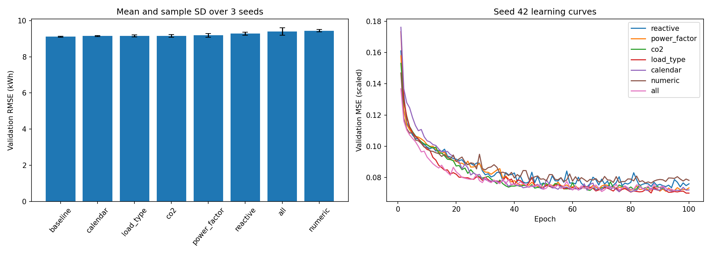

# Отдельное исследование дополнительных прошлых признаков

Проверено влияние дополнительных столбцов CSV при фиксированных настройках итоговой GRU. Результаты прежних исследований не перезаписываются.

## Методика

База: 5 признаков — история Usage_kWh и циклический календарь. Окно 24, hidden_size 32, Adam lr=0.001, batch_size 256, до 100 эпох, min_epochs 60, patience 25, clipping 1.0. Для каждого набора выполнены 3 обучения с seed 7/42/123; 21 новое обучение, 3 базовых запуска переиспользованы с проверкой сигнатур. Изменяются входные признаки, поэтому число весов входной проекции также меняется. Другие гиперпараметры не подбираются заново.

Все дополнительные значения берутся из [t−24, …, t−1], никогда из строки цели t. Предполагается, что измерения этих прошлых отсчётов уже доступны в момент прогноза. Это условие особенно существенно для CO₂ и категории нагрузки, которые могут появляться с задержкой в реальной системе.

Нормализация численных столбцов и словарь one-hot категорий настраиваются только на первых 70% строк. Значения test не участвуют в расчёте среднего и стандартного отклонения. Для категории вне обучающего словаря скрипт завершится ошибкой, а не расширит словарь по тесту. Обучающие цели начинаются с индекса 48; train/val/test и даты полностью совпадают с прежним исследованием.

## Наборы признаков

Каждый набор добавляется к базовым пяти признакам.

- **reactive**: `Lagging_Current_Reactive.Power_kVarh`, `Leading_Current_Reactive_Power_kVarh`.
- **power_factor**: `Lagging_Current_Power_Factor`, `Leading_Current_Power_Factor`.
- **co2**: `CO2(tCO2)`.
- **load_type**: `Load_Type`.
- **calendar**: `NSM`, `WeekStatus`, `Day_of_week`.
- **numeric**: `Lagging_Current_Reactive.Power_kVarh`, `Leading_Current_Reactive_Power_kVarh`, `Lagging_Current_Power_Factor`, `Leading_Current_Power_Factor`, `CO2(tCO2)`.
- **all**: `Lagging_Current_Reactive.Power_kVarh`, `Leading_Current_Reactive_Power_kVarh`, `Lagging_Current_Power_Factor`, `Leading_Current_Power_Factor`, `CO2(tCO2)`, `NSM`, `WeekStatus`, `Day_of_week`, `Load_Type`.

NSM, WeekStatus и Day_of_week проверяются как альтернативные представления календаря; они в основном дублируют информацию даты. Категориальные столбцы кодируются one-hot, численные — стандартизуются.

## Валидация: выбор набора

| group | mean_MSE | sd_MSE | mean_RMSE | sd_RMSE | input_size | seeds | MSE_reduction_percent |
| --- | --- | --- | --- | --- | --- | --- | --- |
| baseline | 83.036310 | 0.406881 | 9.112408 | 0.022339 | 5 | 3 | 0.000000 |
| calendar | 83.734559 | 0.490399 | 9.150633 | 0.026800 | 15 | 3 | -0.840896 |
| load_type | 83.828935 | 1.070365 | 9.155690 | 0.058441 | 8 | 3 | -0.954553 |
| co2 | 83.916877 | 1.308833 | 9.160429 | 0.071587 | 6 | 3 | -1.060460 |
| power_factor | 84.451252 | 1.971826 | 9.189320 | 0.107179 | 7 | 3 | -1.704004 |
| reactive | 86.161212 | 1.519877 | 9.282065 | 0.082067 | 7 | 3 | -3.763297 |
| all | 88.371635 | 3.990085 | 9.399008 | 0.213130 | 23 | 3 | -6.425292 |
| numeric | 89.214750 | 1.102301 | 9.445236 | 0.058323 | 10 | 3 | -7.440649 |

Положительный MSE_reduction_percent означает снижение ошибки относительно базы. SD — выборочное стандартное отклонение. Три seed не доказывают статистическую значимость. Победитель определяется по среднему validation MSE, итоговый seed заранее фиксирован: 42.



## Итоговое сравнение на тесте

По валидации выбран набор **baseline**.

| model | MSE | RMSE | R2 |
| --- | --- | --- | --- |
| Previous GRU (5 features) | 61.359339 | 7.833220 | 0.936844 |
| Selected GRU (baseline) | 61.359340 | 7.833220 | 0.936844 |

Снижение тестового MSE относительно прежней GRU: **-0.00%** (отрицательное значение означает ухудшение). Тест вычисляется только после выбора одного набора, а не для перебора всех кандидатов.

## Выводы

**Ни один из семи расширенных наборов не улучшил средний validation MSE.**
Выбрана базовая GRU с пятью признаками. Ближе всего к ней календарные поля
(рост MSE на 0,84%); полный набор увеличил MSE на 6,43%.
Тестовое качество выбранной модели осталось прежним: RMSE 7,8332 kWh, R² 0,936844.
Причины ухудшения отдельно не устанавливались. Дублирование информации и рост
числа параметров — возможные объяснения, требующие проверки. Настройка других
гиперпараметров для расширенных входов в этот эксперимент не входит.

- **calendar**: средний validation MSE 83.7346; снижение относительно базы -0.84%.
- **load_type**: средний validation MSE 83.8289; снижение относительно базы -0.95%.
- **co2**: средний validation MSE 83.9169; снижение относительно базы -1.06%.
- **power_factor**: средний validation MSE 84.4513; снижение относительно базы -1.70%.
- **reactive**: средний validation MSE 86.1612; снижение относительно базы -3.76%.
- **all**: средний validation MSE 88.3716; снижение относительно базы -6.43%.
- **numeric**: средний validation MSE 89.2148; снижение относительно базы -7.44%.

Это исследование оценивает добавление признаков при фиксированной GRU. Выводы не распространяются автоматически на другие архитектуры, горизонты и периоды. Тестовый период уже использовался ранее; для независимой оценки необходим новый период. Добавление признаков не заменяет проверку их доступности при практическом прогнозировании.

## Воспроизведение

Из папки lab3:

```powershell
python investigations/features.py --workers 3
```

`validation_runs.csv` и `validation_summary.csv` — результаты всех повторов и сводка; `runs/` — веса, преобразования, истории и validation-прогнозы; `selected_model.pt` и `selected_config.json` — выбранная модель; `test_comparison.csv` и `test_predictions.csv` — итоговый тест.
