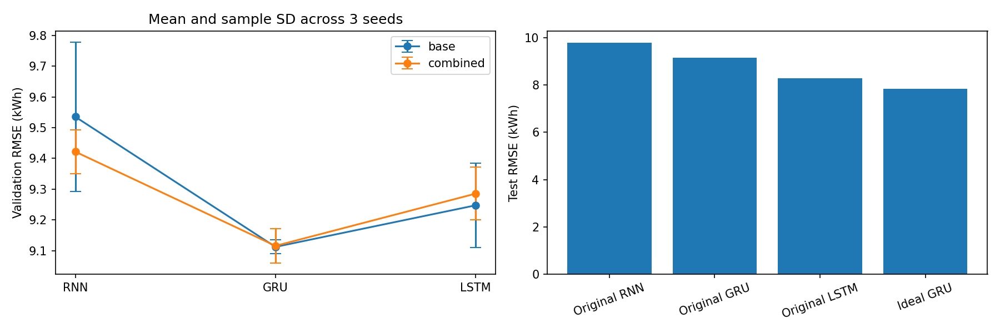

# Итоговая модель после исследования гиперпараметров

«Идеальная» означает лучшую среди проверенных вариантов по заданному критерию; глобальный оптимум не доказан.

## План и границы исследования

Переиспользованы 33 обучения с проверкой хешей кода, данных и настроек. Исследованы window = 8/24/48, hidden_size = 16/32/64, learning_rate = 0.0003/0.001/0.003, batch_size = 128/256/512, seed = 7/42/123, бюджеты = 30/60/100 эпох. Подробные однофакторные таблицы и кривые: [первое исследование](../investigations/REPORT.md).

Для каждой архитектуры лучшие значения четырёх параметров при seed 42 объединены. Каждое сочетание обучено на трёх seed; сравнение с базой выполнено по среднему validation MSE. Складывать отдельные выигрыши нельзя: результат сочетания измеряется отдельно. Лимит 100 эпох, min_epochs 60, patience 25 одинаковы для базы и сочетаний. Финальный seed заранее фиксирован: 42, а не самый удачный seed.

Сочетания: RNN: `{'window': 24, 'hidden_size': 32, 'learning_rate': 0.003, 'batch_size': 128, 'seed': 42}` ; GRU: `{'window': 24, 'hidden_size': 32, 'learning_rate': 0.001, 'batch_size': 128, 'seed': 42}` ; LSTM: `{'window': 8, 'hidden_size': 64, 'learning_rate': 0.003, 'batch_size': 128, 'seed': 42}`

## Проверка сочетаний на трёх seed

| model | family | mean_MSE | std_MSE | mean_RMSE | std_RMSE | seeds |
| --- | --- | --- | --- | --- | --- | --- |
| GRU | base | 83.036310 | 0.406881 | 9.112408 | 0.022339 | 3 |
| GRU | combined | 83.099972 | 1.023781 | 9.115803 | 0.056130 | 3 |
| LSTM | base | 85.529328 | 2.528027 | 9.247536 | 0.136427 | 3 |
| LSTM | combined | 86.224948 | 1.593870 | 9.285475 | 0.085708 | 3 |
| RNN | base | 90.959968 | 4.663127 | 9.535234 | 0.242764 | 3 |
| RNN | combined | 88.772589 | 1.348791 | 9.421740 | 0.071466 | 3 |

- RNN: изменение среднего validation MSE относительно базы +2.40% (положительное число означает снижение ошибки).
- GRU: изменение среднего validation MSE относительно базы -0.08% (положительное число означает снижение ошибки).
- LSTM: изменение среднего validation MSE относительно базы -0.81% (положительное число означает снижение ошибки).

Стандартное отклонение выборочное; три повтора не доказывают статистическую значимость. Окончательный выбор делается между шестью кандидатами: 3 архитектуры × база/сочетание. Отдельные однофакторные победители вне этих семейств не объявляются устойчивыми победителями.

Базовая GRU имеет минимальное среднее MSE; уменьшение batch_size до 128 не подтвердило выигрыш на трёх seed и увеличило разброс. У RNN сочетание улучшило средний результат, но не достигло качества GRU. У LSTM объединение индивидуально лучших значений ухудшило средний результат. Поэтому итоговые параметры GRU совпали с базовыми: исследование может подтвердить исходные значения.

## Ранняя остановка и эпохи

Дополнительно проверены patience = 7/15/25 и min_epochs = 0/30/60 для бюджетов 30/60/100 (min_epochs ≤ budget). Правила воспроизведены по фактическим историям обучения: они не меняют градиенты до остановки. Если исходная история закончилась раньше требуемого правила, complete=False; продолжение не выдумывается. Сводка использует только запуски, полные для всех правил, чтобы сравнивать одинаковые траектории. Эти расчёты описательные; для итогового обучения сохранён общий протокол 100/60/25.

| budget | min_epochs | patience | mean_validation_MSE | mean_epochs | runs |
| --- | --- | --- | --- | --- | --- |
| 30 | 0 | 7 | 102.522939 | 30.000000 | 33 |
| 30 | 0 | 15 | 102.522939 | 30.000000 | 33 |
| 30 | 0 | 25 | 102.522939 | 30.000000 | 33 |
| 30 | 30 | 7 | 102.522939 | 30.000000 | 33 |
| 30 | 30 | 15 | 102.522939 | 30.000000 | 33 |
| 30 | 30 | 25 | 102.522939 | 30.000000 | 33 |
| 60 | 0 | 7 | 93.141693 | 51.878788 | 33 |
| 60 | 0 | 15 | 92.273002 | 59.060606 | 33 |
| 60 | 0 | 25 | 92.248463 | 59.818182 | 33 |
| 60 | 30 | 7 | 93.141693 | 51.878788 | 33 |
| 60 | 30 | 15 | 92.273002 | 59.060606 | 33 |
| 60 | 30 | 25 | 92.248463 | 59.818182 | 33 |
| 60 | 60 | 7 | 92.248463 | 60.000000 | 33 |
| 60 | 60 | 15 | 92.248463 | 60.000000 | 33 |
| 60 | 60 | 25 | 92.248463 | 60.000000 | 33 |
| 100 | 0 | 7 | 90.235837 | 63.272727 | 33 |
| 100 | 0 | 15 | 88.179700 | 87.606061 | 33 |
| 100 | 0 | 25 | 88.031407 | 93.636364 | 33 |
| 100 | 30 | 7 | 90.235837 | 63.272727 | 33 |
| 100 | 30 | 15 | 88.179700 | 87.606061 | 33 |
| 100 | 30 | 25 | 88.031407 | 93.636364 | 33 |
| 100 | 60 | 7 | 89.039048 | 74.393939 | 33 |
| 100 | 60 | 15 | 88.155160 | 88.757576 | 33 |
| 100 | 60 | 25 | 88.031407 | 93.818182 | 33 |

В этой сводке минимальное среднее validation MSE достигается при бюджете 100 и patience 25. min_epochs = 0/30/60 дают одинаковый минимум; сохранено 60 для соответствия протоколу повторных обучений. Малый patience 7 завершает обучение быстрее, но даёт более высокую ошибку. Это обосновывает протокол 100/60/25 в пределах проверенной сетки.

Все строки: [stopping_rules.csv](stopping_rules.csv). threads/log_every — технические настройки, не параметры качества. Архитектура ячеек, один слой, Adam, MSE, clip_grad_norm=1 и признаки сохранены как в исходной реализации. Новые семейства оптимизаторов, число слоёв, dropout и регуляризация в этот поиск не входят.

## Выбранная модель и сравнение с исходной

Выбрана **GRU**, семейство **base**, параметры `{'window': 24, 'hidden_size': 32, 'learning_rate': 0.001, 'batch_size': 256, 'seed': 42}`. Лучшая эпоха: 81; выполнено эпох: 100.

| model | MSE | RMSE | R2 |
| --- | --- | --- | --- |
| Original RNN | 95.860619 | 9.790844 | 0.901332 |
| Original GRU | 83.955677 | 9.162733 | 0.913585 |
| Original LSTM | 68.510961 | 8.277135 | 0.929483 |
| Ideal GRU | 61.359340 | 7.833220 | 0.936844 |

Результаты ранее выбранных однофакторных моделей (для полноты сравнения):

| model | MSE | RMSE | R2 |
| --- | --- | --- | --- |
| Persistence | 135.729812 | 11.650314 | 0.860295 |
| RNN | 62.211729 | 7.887441 | 0.935966 |
| GRU | 62.272090 | 7.891267 | 0.935904 |
| LSTM | 61.734299 | 7.857118 | 0.936458 |

Прежние модели выбирались по лучшему отдельному запуску, текущая — по среднему трёх seed. Поэтому новая процедура не гарантирует минимальную тестовую ошибку среди всех ранее просмотренных моделей; тест не используется для смены победителя.

Снижение тестового MSE относительно исходной GRU: **26.91%**. Исходные модели взяты из сохранённого запуска baseline_30; сравниваются те же 5256 целевых дат. Даты и значения проверяются программно. Исходное обучение начинало цели с индекса 24, исследования — с 48: это сравнение всего обновлённого процесса, а не чистый эффект одного параметра. Чистое сравнение сочетаний с базой выше использует одинаковые обучающие даты.

Разбиение хронологическое 70/15/15, нормализация только по train. Тест не участвует в выборе конфигурации; прежний тестовый период уже использовался в лабораторной. Вывод ограничен этим временным разбиением и исследованной сеткой.

## Воспроизведение

Здесь сохранены результаты реализации на PyTorch. Конфигурация, критерий выбора и хеши записаны в `ideal_config.json`. История, сводки и прогнозы доступны в CSV. [Запуск текущей версии на NumPy](../../RUNNING.md#исследования)
