# Исследования RNN, GRU и LSTM

Выполнены шесть исследований: бюджет эпох, длина окна, размер скрытого состояния, скорость обучения, размер батча и случайная инициализация. Всего 33 отдельных обучения: 11 конфигураций × 3 архитектуры.

Каждый запуск: до 100 эпох, минимум 60, patience 25. На каждой эпохе считаются train MSE и validation MSE; лучшие веса выбираются по validation MSE. Все исследования используют полные данные, без сокращённой выборки.

Базовая конфигурация: окно 24, hidden size 32, learning rate 0.001, batch size 256, seed 42. В каждом исследовании меняется один параметр. Сочетания лучших значений разных параметров отдельно не проверялись, поэтому выводы не описывают глобальный оптимум.

Во всех запусках первые 48 строк служат контекстом: обучающие цели начинаются 01.01.2018 12:00 (24 480 примеров). Даты валидации и теста прежние, по 5 256 точек. Нормализация только по обучающей части. В исследованиях тест не вычисляется: он используется после выбора одной конфигурации для каждой архитектуры.

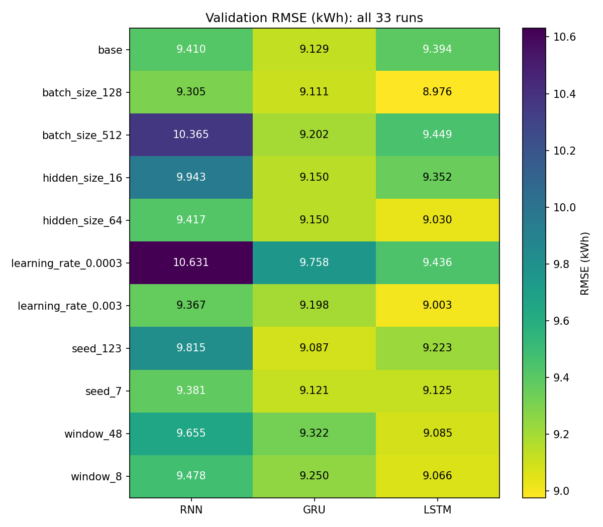

## 1. Бюджет эпох

Сравниваются лучшие validation MSE в префиксах одной базовой траектории до 30, 60 и 100 эпох. Это не три независимых обучения. Если сработала ранняя остановка, фактическое число доступных эпох указано в таблице.

| model | budget | epochs_available | best_epoch | validation_MSE | validation_RMSE | validation_R2 |
| --- | --- | --- | --- | --- | --- | --- |
| RNN | 30 | 30 | 26 | 114.415616 | 10.696524 | 0.878135 |
| RNN | 60 | 60 | 60 | 94.165257 | 9.703878 | 0.899704 |
| RNN | 100 | 100 | 99 | 88.539781 | 9.409558 | 0.905695 |
| GRU | 30 | 30 | 30 | 104.969918 | 10.245483 | 0.888196 |
| GRU | 60 | 60 | 57 | 84.316886 | 9.182423 | 0.910193 |
| GRU | 100 | 100 | 81 | 83.346260 | 9.129417 | 0.911227 |
| LSTM | 30 | 30 | 28 | 93.841886 | 9.687202 | 0.900048 |
| LSTM | 60 | 60 | 51 | 88.254724 | 9.394399 | 0.905999 |
| LSTM | 100 | 76 | 51 | 88.254724 | 9.394399 | 0.905999 |

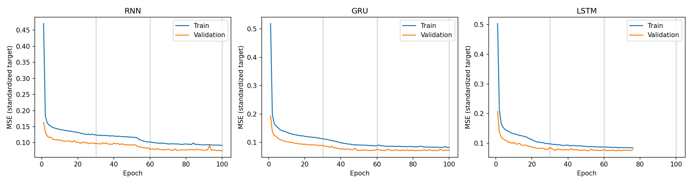

## 2. Длина входной последовательности

| model | window | MSE | RMSE | R2 | best_epoch | epochs_run |
| --- | --- | --- | --- | --- | --- | --- |
| GRU | 8 | 85.557173 | 9.249712 | 0.908872 | 89 | 100 |
| GRU | 24 | 83.346265 | 9.129418 | 0.911227 | 81 | 100 |
| GRU | 48 | 86.900784 | 9.322059 | 0.907441 | 98 | 100 |
| LSTM | 8 | 82.192897 | 9.066030 | 0.912456 | 97 | 100 |
| LSTM | 24 | 88.254733 | 9.394399 | 0.905999 | 51 | 76 |
| LSTM | 48 | 82.528175 | 9.084502 | 0.912099 | 90 | 100 |
| RNN | 8 | 89.834136 | 9.478087 | 0.904317 | 100 | 100 |
| RNN | 24 | 88.539790 | 9.409558 | 0.905695 | 99 | 100 |
| RNN | 48 | 93.227660 | 9.655447 | 0.900702 | 97 | 100 |

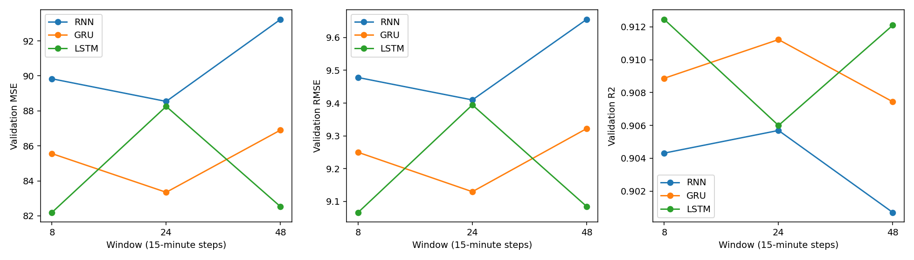

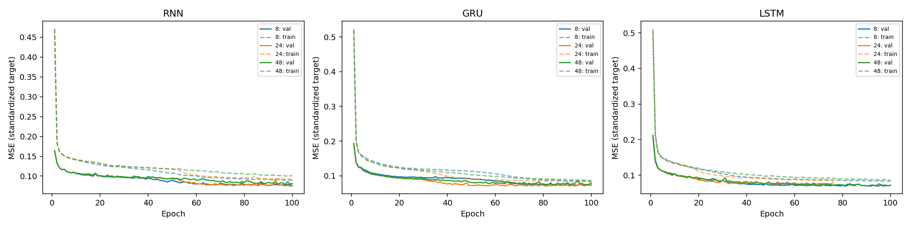

- RNN: лучшее значение window = 24, validation MSE = 88.5398; снижение относительно базовой конфигурации 0.00 %.
- GRU: лучшее значение window = 24, validation MSE = 83.3463; снижение относительно базовой конфигурации 0.00 %.
- LSTM: лучшее значение window = 8, validation MSE = 82.1929; снижение относительно базовой конфигурации 6.87 %.

## 3. Размер скрытого состояния

| model | hidden_size | MSE | RMSE | R2 | best_epoch | epochs_run |
| --- | --- | --- | --- | --- | --- | --- |
| GRU | 16 | 83.726260 | 9.150205 | 0.910822 | 100 | 100 |
| GRU | 32 | 83.346265 | 9.129418 | 0.911227 | 81 | 100 |
| GRU | 64 | 83.717405 | 9.149722 | 0.910832 | 42 | 67 |
| LSTM | 16 | 87.467492 | 9.352406 | 0.906838 | 92 | 100 |
| LSTM | 32 | 88.254733 | 9.394399 | 0.905999 | 51 | 76 |
| LSTM | 64 | 81.541436 | 9.030030 | 0.913149 | 52 | 77 |
| RNN | 16 | 98.856969 | 9.942684 | 0.894707 | 99 | 100 |
| RNN | 32 | 88.539790 | 9.409558 | 0.905695 | 99 | 100 |
| RNN | 64 | 88.675998 | 9.416793 | 0.905550 | 51 | 76 |

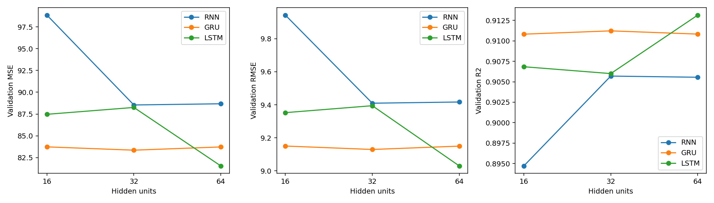

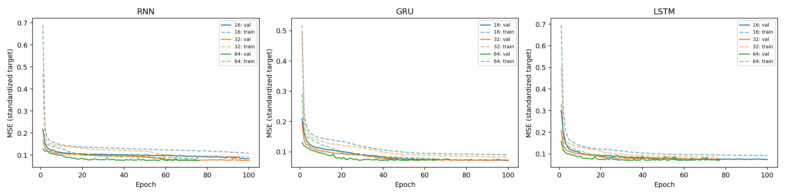

- RNN: лучшее значение hidden_size = 32, validation MSE = 88.5398; снижение относительно базовой конфигурации 0.00 %.
- GRU: лучшее значение hidden_size = 32, validation MSE = 83.3463; снижение относительно базовой конфигурации 0.00 %.
- LSTM: лучшее значение hidden_size = 64, validation MSE = 81.5414; снижение относительно базовой конфигурации 7.61 %.

## 4. Скорость обучения

| model | learning_rate | MSE | RMSE | R2 | best_epoch | epochs_run |
| --- | --- | --- | --- | --- | --- | --- |
| GRU | 0.000300 | 95.211447 | 9.757635 | 0.898589 | 100 | 100 |
| GRU | 0.001000 | 83.346265 | 9.129418 | 0.911227 | 81 | 100 |
| GRU | 0.003000 | 84.604171 | 9.198053 | 0.909887 | 29 | 60 |
| LSTM | 0.000300 | 89.044967 | 9.436364 | 0.905157 | 100 | 100 |
| LSTM | 0.001000 | 88.254733 | 9.394399 | 0.905999 | 51 | 76 |
| LSTM | 0.003000 | 81.055217 | 9.003067 | 0.913667 | 71 | 96 |
| RNN | 0.000300 | 113.012288 | 10.630724 | 0.879630 | 99 | 100 |
| RNN | 0.001000 | 88.539790 | 9.409558 | 0.905695 | 99 | 100 |
| RNN | 0.003000 | 87.743063 | 9.367127 | 0.906544 | 61 | 86 |

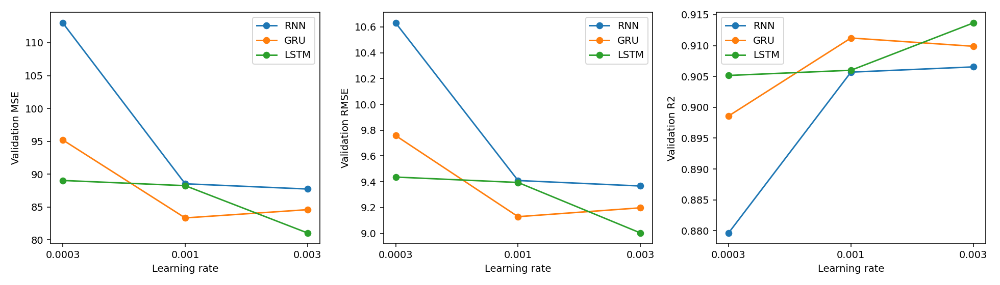

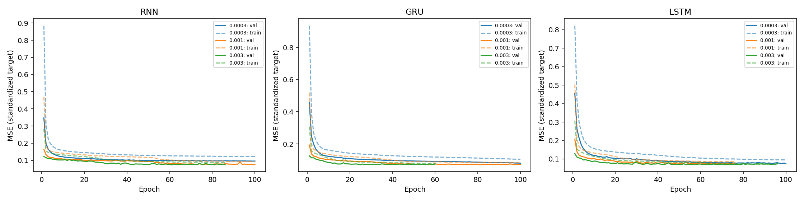

- RNN: лучшее значение learning_rate = 0.003, validation MSE = 87.7431; снижение относительно базовой конфигурации 0.90 %.
- GRU: лучшее значение learning_rate = 0.001, validation MSE = 83.3463; снижение относительно базовой конфигурации 0.00 %.
- LSTM: лучшее значение learning_rate = 0.003, validation MSE = 81.0552; снижение относительно базовой конфигурации 8.16 %.

## 5. Размер батча

| model | batch_size | MSE | RMSE | R2 | best_epoch | epochs_run |
| --- | --- | --- | --- | --- | --- | --- |
| GRU | 128 | 83.002496 | 9.110571 | 0.911593 | 53 | 78 |
| GRU | 256 | 83.346265 | 9.129418 | 0.911227 | 81 | 100 |
| GRU | 512 | 84.680169 | 9.202183 | 0.909806 | 95 | 100 |
| LSTM | 128 | 80.570480 | 8.976106 | 0.914184 | 91 | 100 |
| LSTM | 256 | 88.254733 | 9.394399 | 0.905999 | 51 | 76 |
| LSTM | 512 | 89.284794 | 9.449063 | 0.904902 | 77 | 100 |
| RNN | 128 | 86.585692 | 9.305143 | 0.907777 | 90 | 100 |
| RNN | 256 | 88.539790 | 9.409558 | 0.905695 | 99 | 100 |
| RNN | 512 | 107.438613 | 10.365260 | 0.885566 | 100 | 100 |

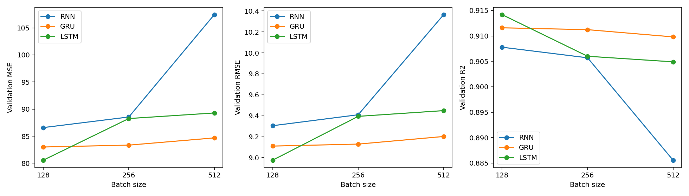

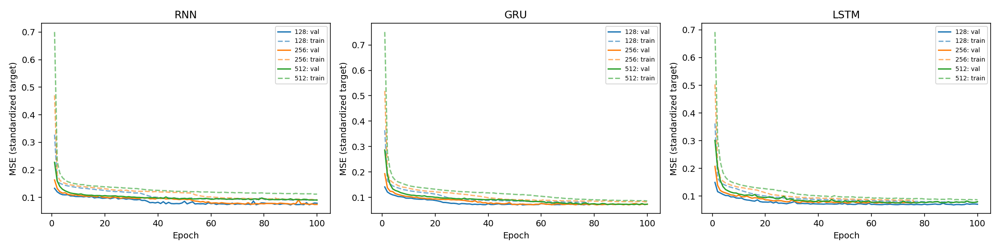

- RNN: лучшее значение batch_size = 128, validation MSE = 86.5857; снижение относительно базовой конфигурации 2.21 %.
- GRU: лучшее значение batch_size = 128, validation MSE = 83.0025; снижение относительно базовой конфигурации 0.41 %.
- LSTM: лучшее значение batch_size = 128, validation MSE = 80.5705; снижение относительно базовой конфигурации 8.71 %.

При фиксированном числе эпох меньший батч даёт больше обновлений весов. Это сравнение бюджетов по эпохам, а не по одинаковому числу шагов Adam. Число обновлений записано в `optimizer_steps` сводной таблицы. Время обучения при параллельных запусках зависит от конкуренции за CPU, поэтому оно не используется для вывода о скорости архитектур.

## 6. Случайная инициализация

| model | seed | MSE | RMSE | R2 | best_epoch | epochs_run |
| --- | --- | --- | --- | --- | --- | --- |
| GRU | 7 | 83.187105 | 9.120697 | 0.911397 | 88 | 100 |
| GRU | 42 | 83.346265 | 9.129418 | 0.911227 | 81 | 100 |
| GRU | 123 | 82.575558 | 9.087109 | 0.912048 | 97 | 100 |
| LSTM | 7 | 83.261060 | 9.124750 | 0.911318 | 55 | 80 |
| LSTM | 42 | 88.254733 | 9.394399 | 0.905999 | 51 | 76 |
| LSTM | 123 | 85.072192 | 9.223459 | 0.909389 | 86 | 100 |
| RNN | 7 | 88.004507 | 9.381072 | 0.906266 | 100 | 100 |
| RNN | 42 | 88.539790 | 9.409558 | 0.905695 | 99 | 100 |
| RNN | 123 | 96.335607 | 9.815070 | 0.897392 | 97 | 100 |

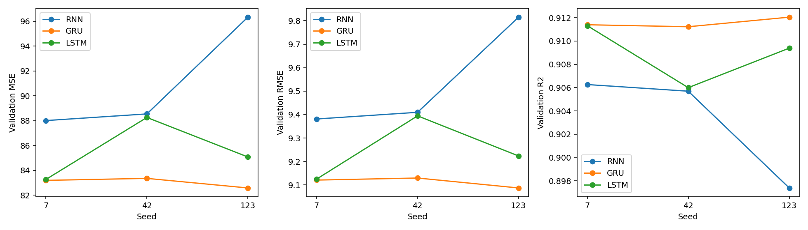

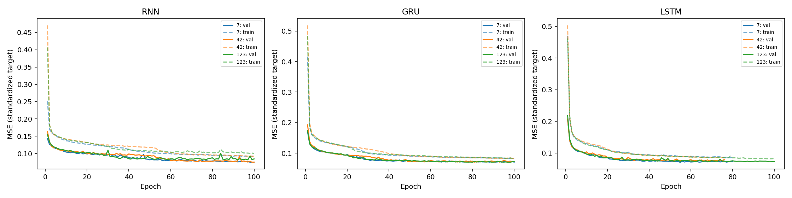

- RNN: лучшее значение seed = 7, validation MSE = 88.0045; снижение относительно базовой конфигурации 0.60 %.
- GRU: лучшее значение seed = 123, validation MSE = 82.5756; снижение относительно базовой конфигурации 0.92 %.
- LSTM: лучшее значение seed = 7, validation MSE = 83.2611; снижение относительно базовой конфигурации 5.66 %.

Seed показывает чувствительность к инициализации и порядку батчей. Выбор лучшего seed по валидации не заменяет оценку устойчивости:

| model | mean | std | min | max |
| --- | --- | --- | --- | --- |
| GRU | 9.112408 | 0.022339 | 9.087109 | 9.129418 |
| LSTM | 9.247536 | 0.136427 | 9.124750 | 9.394399 |
| RNN | 9.535234 | 0.242764 | 9.381072 | 9.815070 |

Различия между гиперпараметрами, сопоставимые с разбросом по seed, не следует считать устойчивым преимуществом по одному запуску. Здесь каждый вариант гиперпараметров проверен только при seed 42; повторный подбор на нескольких seed не выполнялся.

## Итоговый тест после выбора по валидации

| model | MSE | RMSE | R2 |
| --- | --- | --- | --- |
| Persistence | 135.729812 | 11.650314 | 0.860295 |
| RNN | 62.211729 | 7.887441 | 0.935966 |
| GRU | 62.272090 | 7.891267 | 0.935904 |
| LSTM | 61.734299 | 7.857118 | 0.936458 |

- RNN: `batch_size_128`, параметры `{'window': 24, 'hidden_size': 32, 'learning_rate': 0.001, 'batch_size': 128, 'seed': 42}`, лучшая эпоха 90.
- GRU: `seed_123`, параметры `{'window': 24, 'hidden_size': 32, 'learning_rate': 0.001, 'batch_size': 256, 'seed': 123}`, лучшая эпоха 97.
- LSTM: `batch_size_128`, параметры `{'window': 24, 'hidden_size': 32, 'learning_rate': 0.001, 'batch_size': 128, 'seed': 42}`, лучшая эпоха 91.

На тесте лучший результат у LSTM: RMSE 7.8571 kWh, R² 0.936458. Результат относится к данному временному разбиению.

Перебор нескольких конфигураций может переобучить выбор на валидацию; для более строгой оценки нужны дополнительные временные разбиения. Тестовый период уже использовался в первоначальной лабораторной, поэтому это повторная оценка на прежнем отрезке, а не совершенно новый независимый тест.

## Воспроизведение

```powershell
python lab3/investigations/run.py --workers 3
```

Готовые запуски с совпадающими настройками, хешами кода и данных переиспользуются. `--force` повторяет обучение. Каждый запуск хранит веса, полный CSV истории, валидационные прогнозы и лог в `runs/`. Сводная таблица — `validation_summary.csv`.
