# Лабораторная работа № 4. Восстановление изображений MNIST с GAN+VAE

Свёрточная VAE-GAN получает зашумлённое изображение рукописной цифры и восстанавливает исходное изображение размером 28 × 28. Для искажения к нормализованным пикселям добавляется гауссовский шум со стандартным отклонением 0,5. Значения ограничиваются диапазоном [0, 1].

[Установка зависимостей и запуск](RUNNING.md)

[Подробный разбор моделей, функций потерь и градиентов](additions.md)

## Архитектура

| Компонент | Назначение |
| --- | --- |
| Энкодер | Две свёртки уменьшают изображение до карт признаков 32 × 7 × 7. Полносвязный слой выдаёт среднее и логарифм дисперсии для 32 координат латентного распределения. |
| Декодер-генератор | Преобразует латентный вектор в изображение через полносвязный слой и две транспонированные свёртки. Один и тот же модуль восстанавливает вход и генерирует цифры из случайных векторов. |
| Дискриминатор | Две свёртки и полносвязный слой оценивают, относится ли изображение к чистым данным MNIST. |

Компоненты реализованы на NumPy. Слои и их обратный проход находятся в [layers.py](source/layers.py), архитектуры и Adam - в [models.py](source/models.py), обучение и оценка - в [main.py](source/main.py).

## Обучение

Используется стандартное разбиение MNIST на 60 000 обучающих и 10 000 тестовых изображений. Каждая обучающая пара состоит из чистого изображения и его зашумлённой копии. Метки классов для восстановления не используются.

1. Энкодер получает зашумлённый вход. Латентный вектор вычисляется как $z = \mu + \exp(\tfrac{1}{2}\log\sigma^2) \odot \varepsilon$, где $\varepsilon \sim \mathcal{N}(0, I)$.
2. Декодер-генератор восстанавливает изображение из $z$ и отдельно генерирует изображение из вектора, взятого из стандартного нормального распределения.
3. Дискриминатор обучается отличать чистые изображения от восстановленных и сгенерированных.
4. Энкодер и декодер-генератор обновляются при фиксированных весах дискриминатора. Их функция потерь объединяет попиксельную BCE между восстановлением и чистой целью, KL-дивергенцию с весом 0,001 и состязательную BCE с весом 0,02.

## Оценка восстановления

При восстановлении на тесте декодер получает среднее латентного распределения $\mu$. Для зашумлённого входа и восстановленного изображения считаются MSE относительно чистого оригинала и PSNR в децибелах по общему MSE. Скрипт сохраняет примеры в трёх рядах с одинаковой шкалой яркости - оригиналы, зашумлённые входы и результаты восстановления.

## Базовые прогоны

Для обоих прогонов использованы одна архитектура, три эпохи, батч 256, seed 42 и гауссовский шум с `σ = 0,5`. Оба архива содержат веса, журнал обучения, метрики и примеры восстановления. В архиве PyTorch также сохранён исходный код. [Архив PyTorch](baselines/pytorch/) · [Архив NumPy](baselines/numpy/)

## Сравнение на одинаковых тестовых входах

Для всех 10 000 тестовых изображений шум с `σ = 0,5` сгенерирован один раз на NumPy с seed 43. Обе модели получили те же значения пикселей и восстановили изображения по среднему латентного распределения. MSE и PSNR рассчитаны относительно чистых оригиналов.

| Изображения | MSE | PSNR, дБ |
| --- | ---: | ---: |
| Зашумлённый вход | 0,11565 | 9,37 |
| Восстановление PyTorch | 0,02097 | 16,78 |
| Восстановление NumPy | 0,01935 | 17,13 |

У сохранённой модели NumPy средний MSE ниже на 7,7%. Она дала меньший MSE на 6 727 изображениях, модель PyTorch - на 3 273. Результат относится к этим двум чекпойнтам и выбранному шуму. [Полные метрики](baselines/comparison/metrics.json)

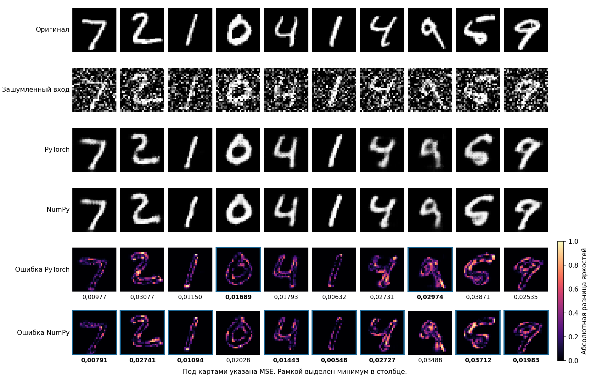


### Толщина нулевой рамки

Сравнили $P=0$, $P=1$ и $P=2$ при окне $4\times4$ и шаге 2. Для каждого варианта провели три обучения с seed 42, 43 и 44. Толщина рамки меняет размер выходных карт второй свёртки, а вместе с ним число весов следующего линейного слоя.

| Рамка $P$ | Размер карты | Параметры энкодера | Средняя MSE ↓ | Средний PSNR, дБ ↑ |
| --- | --- | ---: | ---: | ---: |
| 0 | $6\times6$ | 82 288 | 0,03404 | 14,70 |
| **1** | $7\times7$ | 108 912 | **0,03287** | **14,84** |
| 2 | $8\times8$ | 139 632 | 0,03338 | 14,77 |

У $P=1$ была наименьшая MSE во всех трёх повторах. Средняя ошибка на 3,4% ниже, чем у $P=0$, и на 1,5% ниже, чем у $P=2$. [Подробная методика](additions.md#padding-experiment) · [Скрипт эксперимента](source/padding_experiment.py)

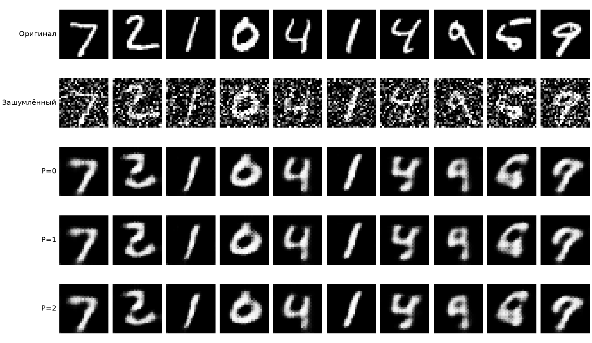

### Карты ошибок и точность по отдельным цифрам

Для каждого пикселя карта показывает абсолютную разницу яркостей между восстановлением и оригиналом. Чем светлее клетка, тем больше разница. Под картами указана MSE по всем 784 пикселям цифры. Синяя рамка выделяет вариант с наименьшей MSE в столбце.

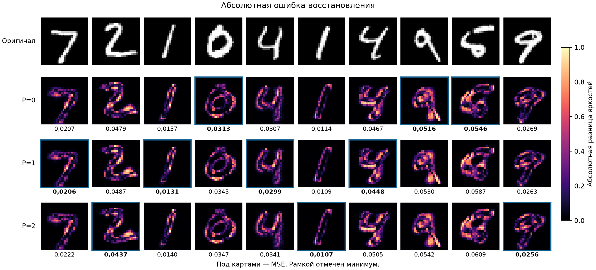

На всей тестовой выборке MSE каждой цифры сначала усредняли по трём повторам отдельно для каждого $P$. Затем для этой цифры выбирали вариант с наименьшей средней ошибкой.

| Рамка $P$ | Цифры с наименьшей MSE | Доля тестовой выборки |
| --- | ---: | ---: |
| 0 | 1 506 | 15,06% |
| **1** | **5 370** | **53,70%** |
| 2 | 3 124 | 31,24% |

### Размер окна

Сравнили семь квадратных окон от $1\times1$ до $7\times7$. Для каждого размера провели по семь обучений с seed от 42 до 48, всего 49 прогонов. Шаг равен 2, число фильтров равно 32. Толщину рамки выбирали по формуле $P=\lfloor(K-1)/2\rfloor$, чтобы при каждом $K$ получать карты $7\times7$.

| Окно | Рамка $P$ | Параметры второй свёртки | Средняя MSE ± стандартное отклонение | Средний PSNR, дБ |
| --- | ---: | ---: | ---: | ---: |
| $1\times1$ | 0 | 544 | 0,03456 ± 0,00229 | 14,62 |
| $2\times2$ | 0 | 2 080 | 0,03285 ± 0,00237 | 14,84 |
| **$3\times3$** | 1 | 4 640 | **0,03212 ± 0,00159** | **14,94** |
| $4\times4$ | 1 | 8 224 | 0,03249 ± 0,00158 | 14,89 |
| $5\times5$ | 2 | 12 832 | 0,03316 ± 0,00210 | 14,80 |
| $6\times6$ | 2 | 18 464 | 0,03285 ± 0,00204 | 14,84 |
| $7\times7$ | 3 | 25 120 | 0,03403 ± 0,00249 | 14,69 |

У окна $3\times3$ самая низкая средняя MSE, на 1,1% ниже исходного $4\times4$. В отдельных повторах $3\times3$ и $4\times4$ заняли первое место по три раза, а $6\times6$ - один раз. [Подробная методика](additions.md#window-size-experiment) · [Скрипт эксперимента](source/window_experiment.py)

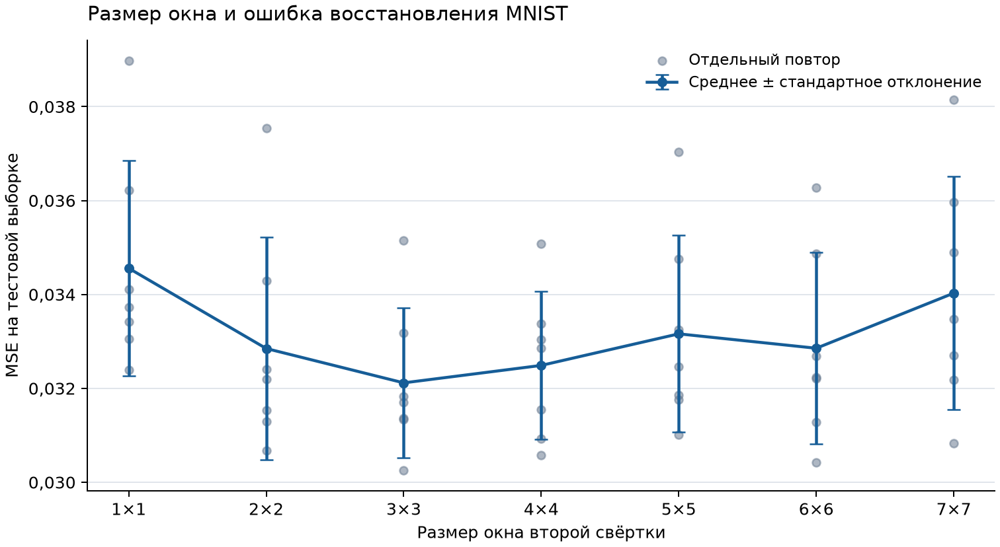

### Размер окна при фиксированной рамке

Сравнили пять окон от $2\times2$ до $6\times6$ с одинаковым дополнением $P=1$ и шагом 2. Для каждого размера взяли десять повторов с seed от 42 до 51. Для $3\times3$ и $4\times4$ использовали 14 результатов предыдущего исследования с совпадающими настройками и провели ещё 36 обучений. При фиксированной рамке размер выходных карт зависит от окна, поэтому меняется длина входа в линейный слой энкодера. [Подробная методика](additions.md#window-size-fixed-padding)

| Окно | Размер выходной карты | Параметры энкодера | Средняя MSE ± стандартное отклонение | Средний PSNR, дБ |
| --- | --- | ---: | ---: | ---: |
| $2\times2$ | $8\times8$ | 133 488 | 0,03352 ± 0,00247 | 14,76 |
| **$3\times3$** | $7\times7$ | 105 328 | **0,03263 ± 0,00159** | **14,87** |
| $4\times4$ | $7\times7$ | 108 912 | 0,03294 ± 0,00160 | 14,83 |
| $5\times5$ | $6\times6$ | 86 896 | 0,03386 ± 0,00175 | 14,71 |
| $6\times6$ | $6\times6$ | 92 528 | 0,03450 ± 0,00191 | 14,63 |

У окна $3\times3$ самая низкая средняя MSE, на 0,94% ниже, чем у $4\times4$. В отдельных повторах каждый из этих размеров занял первое место по пять раз.

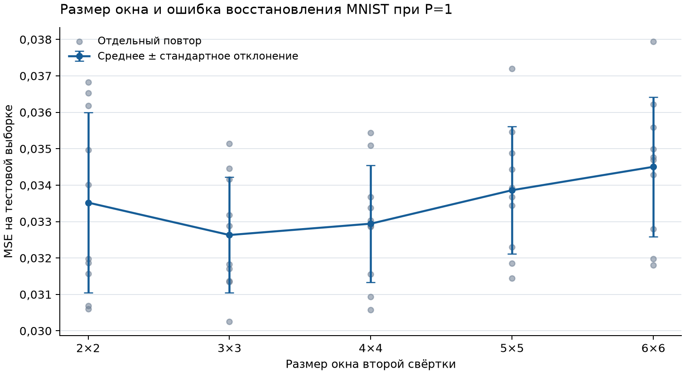

### Шаг второй свёртки

Сравнили шаги 1, 2, 3 и 4 с окном $4\times4$ и рамкой $P=1$. На каждый шаг приходится десять seed от 42 до 51. Для шага 2 использовали десять совпадающих результатов предыдущего исследования, для остальных шагов провели 30 новых обучений. Шаг меняет размер выходной карты и число параметров следующего линейного слоя. [Подробная методика](additions.md#stride-experiment)

| Шаг $S$ | Выходная карта | Параметры энкодера | Средняя MSE ± стандартное отклонение | Средний PSNR, дБ |
| ---: | --- | ---: | ---: | ---: |
| **1** | $13\times13$ | 354 672 | **0,02888 ± 0,00098** | **15,40** |
| 2 | $7\times7$ | 108 912 | 0,03294 ± 0,00160 | 14,83 |
| 3 | $5\times5$ | 59 760 | 0,03764 ± 0,00315 | 14,26 |
| 4 | $4\times4$ | 41 328 | 0,04173 ± 0,00420 | 13,81 |

Шаг 1 дал наименьшую MSE во всех десяти повторах. Средняя ошибка на 12,3% ниже, чем у шага 2. Энкодер с шагом 1 содержит в 3,26 раза больше параметров, поскольку его линейный слой получает больше значений из карт признаков.

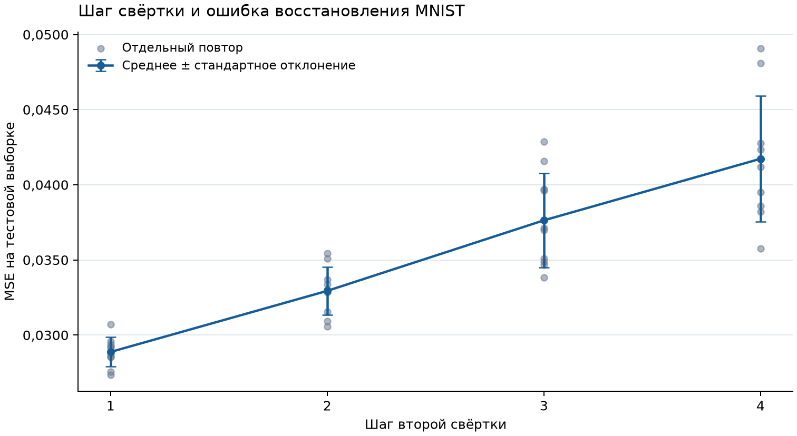

#### Время восстановления и обучения

Время измеряли на Intel Core i5-10300H с одним потоком OpenBLAS. Для восстановления использовали десять серий на одних и тех же 128 цифрах, по одной и в батчах по 32. Для обучения воспроизвели две эпохи на seed 42 и разделили 512 обновлений на десять серий. На графике для каждого шага показаны среднее время и стандартное отклонение по сериям. [Методика замера](additions.md#stride-timing)

| Шаг | По одной, мс на цифру | Батч из 32, мс на цифру | Обновление, мс на батч | 512 обновлений, с |
| ---: | ---: | ---: | ---: | ---: |
| 1 | 0,580 | 0,213 | 59,80 | 30,62 |
| 2 | 0,509 | 0,153 | 47,99 | 24,57 |
| 3 | 0,508 | 0,122 | 45,71 | 23,40 |
| 4 | 0,504 | 0,118 | 43,93 | 22,49 |

У шага 1 средняя MSE на 12,3% ниже, чем у шага 2. При этом восстановление одной цифры занимает на 14,0% больше времени, а обновление на батче - на 24,6% больше. Плотнее расположенные окна дают больше значений для следующего линейного слоя.

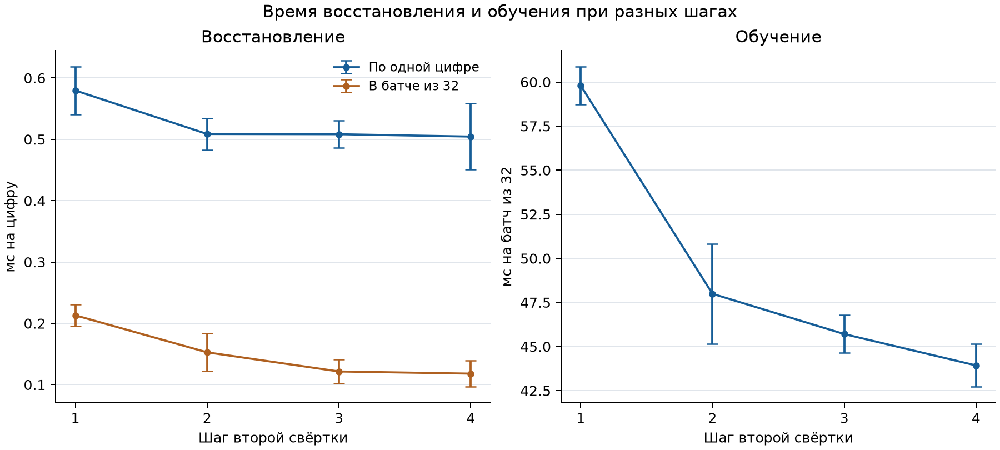

### Число выходов энкодера

Сравнили 16, 32, 64, 128 и 256 выходов, по десять повторов на вариант. Длина кода равна половине числа выходов. Она определяет размеры последнего линейного слоя энкодера и первого линейного слоя декодера. Во всех прогонах использовали свёртки с окном $4\times4$, шагом 2 и рамкой $P=1$, а также одни и те же настройки оптимизации и весов потерь. Для базовых 64 выходов использовали десять совпадающих результатов предыдущего исследования, для остальных вариантов выполнили 40 новых обучений. [Подробная методика](additions.md#latent-size-experiment)

| Выходы энкодера | Чисел в коде | Параметры энкодера и декодера | Средняя MSE ± стандартное отклонение | Средний PSNR, дБ |
| ---: | ---: | ---: | ---: | ---: |
| 16 | 8 | 56 177 | 0,042598 ± 0,002533 | 13,71 |
| 32 | 16 | 93 825 | 0,035099 ± 0,002058 | 14,55 |
| 64 | 32 | 169 121 | 0,032941 ± 0,001603 | 14,83 |
| **128** | **64** | 319 713 | **0,032914 ± 0,002343** | **14,84** |
| 256 | 128 | 620 897 | 0,034893 ± 0,002171 | 14,58 |

Наименьшая средняя MSE при 128 выходах оказалась на 0,084% ниже, чем при 64. Оба варианта заняли первое место по пять раз. При 64 выходах почти та же средняя точность достигнута примерно с половиной параметров энкодера и декодера.

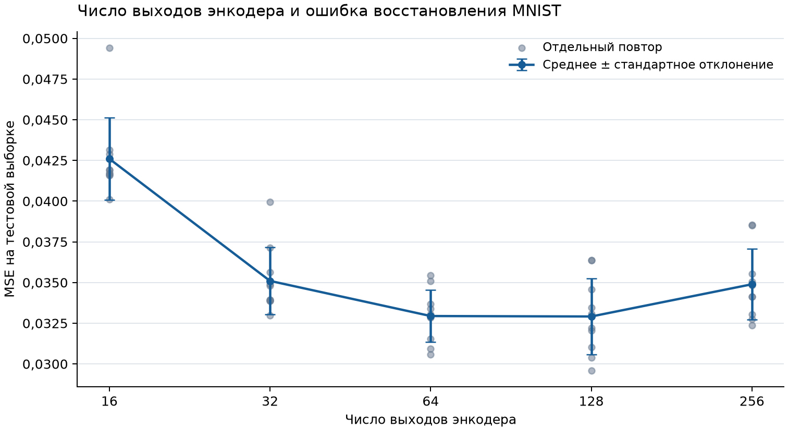

### Карты ошибок в остальных исследованиях

Карты показывают абсолютную разницу с оригиналом для первых десяти тестовых цифр и seed обучения 42. Для подсчёта на всей выборке усредняли MSE каждой из 10 000 цифр по всем повторам, затем определяли вариант с наименьшей ошибкой для каждой цифры. [Методика](additions.md#architecture-error-maps)

<details>
<summary>Карты ошибок для семи размеров окна</summary>

| Окно | Цифры с наименьшей MSE | Доля |
| --- | ---: | ---: |
| $1\times1$ | 480 | 4,80% |
| $2\times2$ | 1 540 | 15,40% |
| **$3\times3$** | **3 617** | **36,17%** |
| $4\times4$ | 1 805 | 18,05% |
| $5\times5$ | 689 | 6,89% |
| $6\times6$ | 1 633 | 16,33% |
| $7\times7$ | 236 | 2,36% |

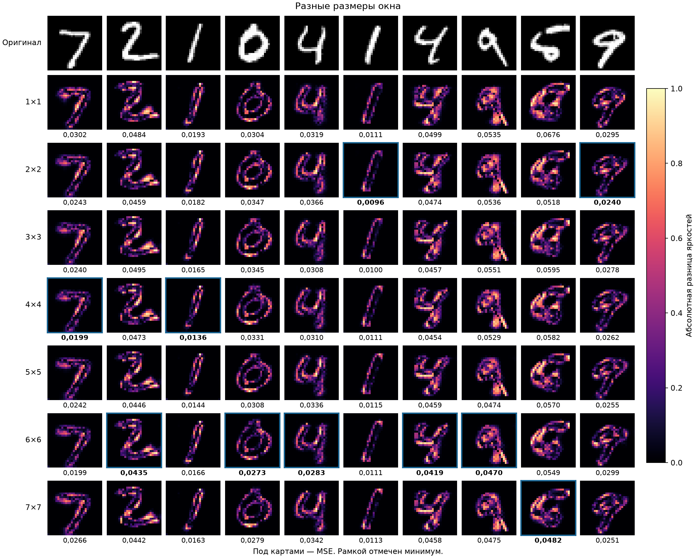

</details>

<details>
<summary>Карты ошибок для окон при P=1</summary>

| Окно | Цифры с наименьшей MSE | Доля |
| --- | ---: | ---: |
| $2\times2$ | 1 287 | 12,87% |
| **$3\times3$** | **4 923** | **49,23%** |
| $4\times4$ | 2 675 | 26,75% |
| $5\times5$ | 782 | 7,82% |
| $6\times6$ | 333 | 3,33% |

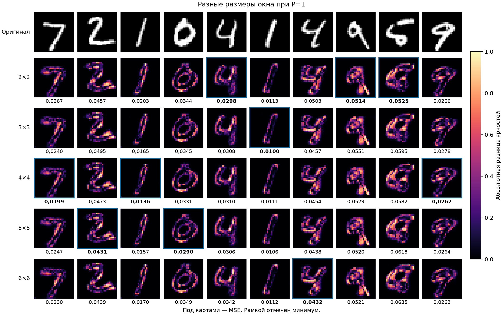

</details>

<details>
<summary>Карты ошибок для шагов второй свёртки</summary>

| Шаг | Цифры с наименьшей MSE | Доля |
| ---: | ---: | ---: |
| **1** | **9 836** | **98,36%** |
| 2 | 133 | 1,33% |
| 3 | 20 | 0,20% |
| 4 | 11 | 0,11% |

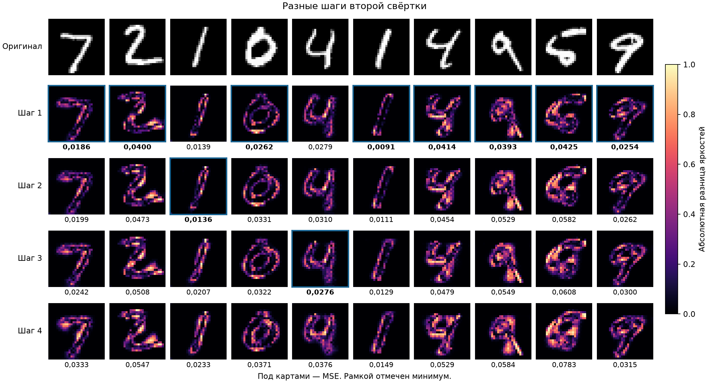

</details>

<details>
<summary>Карты ошибок для числа выходов энкодера</summary>

| Выходы энкодера | Цифры с наименьшей MSE | Доля |
| ---: | ---: | ---: |
| 16 | 117 | 1,17% |
| 32 | 1 797 | 17,97% |
| 64 | 3 309 | 33,09% |
| **128** | **3 695** | **36,95%** |
| 256 | 1 082 | 10,82% |

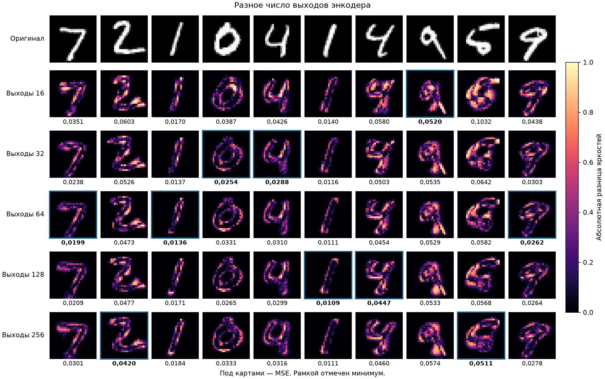

</details>

### Воспроизведение исследований

```bash
python lab4/source/padding_experiment.py --batch-size 32 --output lab4/results/padding-32-errors
python lab4/source/window_experiment.py
python lab4/source/window_experiment.py --fixed-padding
python lab4/source/window_experiment.py --vary-stride
python lab4/source/stride_timing.py
python lab4/source/latent_experiment.py
python lab4/source/error_maps_experiment.py
```

Команды запускаются из корня репозитория. Метрики и рисунки первых шести команд сохраняются соответственно в `lab4/results/padding-32-errors/`, `lab4/results/window-sizes/`, `lab4/results/window-sizes-p1/`, `lab4/results/stride-sizes/`, `lab4/results/stride-timing/` и `lab4/results/latent-sizes/`. Скрипт сравнения рамок также сохраняет `per-image-mse.csv` со средней ошибкой каждой тестовой цифры для всех трёх вариантов.

Последняя команда использует сохранённые метрики четырёх исследований архитектуры. Она записывает карты, сводки и `per-image-mse.csv` для каждого исследования в `lab4/results/error-maps/`.
