# Лабораторная работа № 4. Математика и реализация GAN+VAE

Модель восстанавливает рукописную цифру по зашумлённому изображению MNIST. Энкодер оценивает распределение латентного кода, декодер преобразует код в изображение, а дискриминатор даёт дополнительный сигнал о правдоподобии результата. Декодер VAE одновременно служит генератором GAN. Прямой проход, обратное распространение и Adam реализованы на NumPy.

[Основной отчёт](README.md) · [Установка и запуск](RUNNING.md)

Если вы впервые разбираете нейросети, начните с [пикселей и каналов](#data). Затем пройдите от [расчёта для одного окна](#one-window) через [карты первого слоя](#feature-maps) к [схеме второй свёртки](#second-convolution). После этого по [схеме архитектуры](#architecture) можно проследить путь целого изображения.

## Содержание

1. [Задача и подготовка данных](#data)
2. [Три компонента и размеры тензоров](#architecture)
3. [Свёртка и транспонированная свёртка](#convolution)
4. [VAE, репараметризация и KL-дивергенция](#vae)
5. [Бинарная кросс-энтропия](#bce)
6. [GAN и две фазы обучения](#gan)
7. [Обратное распространение на NumPy](#backpropagation)
8. [Оптимизация и журнал обучения](#adam)
9. [Метрики и сравнение моделей](#evaluation)
10. [Вопросы для защиты](#questions)

<a id="data"></a>
## 1. Задача и подготовка данных

### Как картинка становится числами

Представьте клетчатый лист с цифрой. **Пиксель** - одна клетка. У чёрной клетки яркость $0$, у белой - $1$, у серой - число между ними, например $0.4$. Поэтому цифру можно записать таблицей. В записи `x[5, 9, 0]` число `5` выбирает строку, `9` - столбец, `0` - канал. Индексы в NumPy начинаются с нуля.

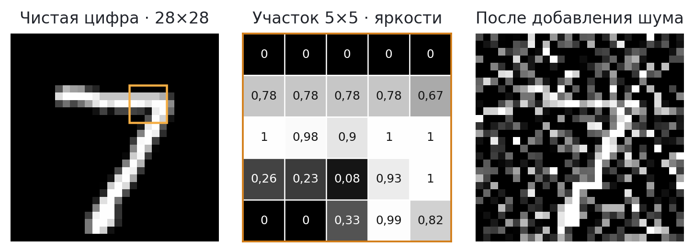

**Канал** - одна таблица значений для всех позиций изображения. У MNIST одна таблица яркости, поэтому форма одной цифры в коде - `(28, 28, 1)`. У цветного RGB-изображения три таблицы одинакового размера для красной, зелёной и синей составляющих. Например, один пиксель может иметь красную компоненту $1$, зелёную $0.3$ и синюю $0$. Внутри нейросети тоже будут таблицы, по одной на выходной канал слоя. В них хранятся вычисленные **признаки**. Например, число в такой таблице может показывать, насколько сильно фильтр отреагировал на участок рядом со штрихом.

**Тензор** здесь - массив чисел с несколькими осями. Можно читать его форму как инструкцию по индексации. В `(16, 28, 28, 1)` сначала выбираем одну из 16 цифр, затем строку, столбец и канал. Группу изображений, которые модель обрабатывает за один раз, называют **батчем**.

### Как получается учебная пара

Одно изображение MNIST содержит $28 \times 28 = 784$ полутоновых пикселя. Загрузчик читает стандартные выборки из 60 000 обучающих и 10 000 тестовых изображений. Исходную яркость $I$ из диапазона $[0,255]$ переводят в $x=I/255$. К чистому изображению добавляют независимый гауссовский шум по пикселям, затем ограничивают яркость допустимым диапазоном. [Загрузка MNIST](source/data.py) · [Нормализация и зашумление](source/main.py)

$$
\xi_{ij}\sim\mathcal N(0,1), \qquad
\widetilde x_{ij}=\operatorname{clip}\bigl(x_{ij}+0.5\,\xi_{ij},\,0,\,1\bigr).
$$

При $x_{ij}=0.6$ и $\xi_{ij}=-1$ на вход подаётся $0.1$. При $x_{ij}=0.1$ и том же шуме промежуточная яркость равна $-0.4$, поэтому после ограничения пиксель получает значение $0$. Из-за ограничения часть пикселей на входе принимает ровно $0$ или $1$.

Запись $\xi_{ij}\sim\mathcal N(0,1)$ означает, что для каждого пикселя берут случайное число из нормального распределения с центром в нуле и стандартным отклонением $1$. Умножение на $0.5$ задаёт типичный масштаб добавки. Поэтому одни клетки становятся светлее, другие темнее, а рисунок цифры иногда виден с трудом. На увеличенном фрагменте выше яркости подписаны с округлением до сотых.

Пара для обучения состоит из зашумлённого входа $\widetilde x$ и чистой цели $x$. Чистое изображение уже есть в MNIST, а искажение строит скрипт, поэтому пары можно получать заново в каждом батче. Для дискриминатора метки формируются из происхождения изображения. Чистый оригинал получает метку $1$, выход генератора получает метку $0$. Для обучения используются яркости пикселей и эти двоичные метки.

<a id="architecture"></a>
## 2. Три компонента и размеры тензоров

Нейросеть - последовательность вычислений, которые организованы в **слои**. У некоторых слоёв есть **параметры** - числа, хранящиеся внутри модели. Во время обучения эти числа меняют, чтобы уменьшать ошибку. При восстановлении тестовой цифры уже обученные параметры используют для вычисления результата.

| Компонент | Что получает | Что выдаёт и для чего |
| --- | --- | --- |
| Энкодер | Зашумлённую цифру | Числа, по которым строится внутренний код картинки |
| Декодер-генератор | Код из энкодера или случайный код | Изображение. В первом случае оно должно восстановить конкретную цифру, во втором - выглядеть как правдоподобная новая цифра |
| Дискриминатор | Чистую цифру или результат генератора | Одну оценку того, насколько изображение похоже на оригинал из набора MNIST |

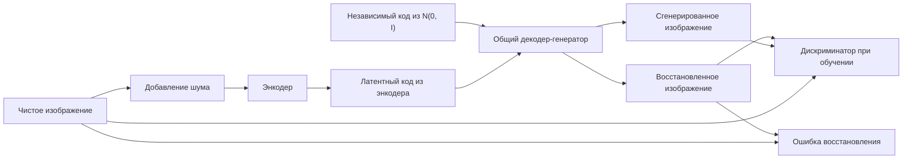

Энкодер $E_\phi$ выдаёт два вектора по 32 числа - среднее $\mu$ и логарифм дисперсии $\ell$. Из них получают латентный код $z$. Декодер-генератор $G_\theta$ выдаёт 784 логита яркости, к которым применяется сигмоида. Дискриминатор $D_\psi$ выдаёт один логит на изображение. Его сигмоида задаёт оценку вероятности класса «чистый оригинал». [Архитектуры моделей](source/models.py)

NumPy использует порядок осей `(N, H, W, C)`, где $N$ - число объектов в текущем проходе, $H$ и $W$ - высота и ширина, $C$ - каналы. Следующая таблица показывает формы одного объекта без оси батча. В число параметров включены смещения.

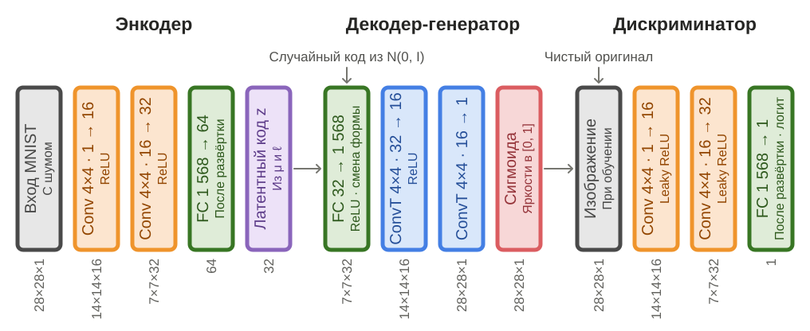

| Компонент | Операция | Форма выхода | Параметры |
| --- | --- | --- | ---: |
| Энкодер | Свёртка 1 → 16 и ReLU | `(14, 14, 16)` | 272 |
| Энкодер | Свёртка 16 → 32 и ReLU | `(7, 7, 32)` | 8 224 |
| Энкодер | Развёртка и линейный слой 1 568 → 64 | `(64,)` | 100 416 |
| Декодер-генератор | Линейный слой 32 → 1 568, ReLU и изменение формы | `(7, 7, 32)` | 51 744 |
| Декодер-генератор | Транспонированная свёртка 32 → 16 и ReLU | `(14, 14, 16)` | 8 208 |
| Декодер-генератор | Транспонированная свёртка 16 → 1 | `(28, 28, 1)` | 257 |
| Дискриминатор | Свёртка 1 → 16 и Leaky ReLU | `(14, 14, 16)` | 272 |
| Дискриминатор | Свёртка 16 → 32 и Leaky ReLU | `(7, 7, 32)` | 8 224 |
| Дискриминатор | Развёртка и линейный слой 1 568 → 1 | `(1,)` | 1 569 |

### Как меняется форма массива в энкодере

1. **`(14, 14, 16)`.** После первого слоя получается 16 таблиц по 14 строк и 14 столбцов. Каждая таблица отвечает на вопрос «где и насколько сильно сработал один фильтр?».
2. **`(7, 7, 32)`.** Следующий слой получает эти 16 таблиц, комбинирует их и строит 32 новые таблицы меньшего размера.
3. **Развёртка, или Flatten.** Она выписывает все $7\cdot7\cdot32=1568$ чисел в один список в фиксированном порядке. Например, таблица `[[1, 2], [3, 4]]` превращается в `[1, 2, 3, 4]`.
4. **Линейный слой, или FC (fully connected).** Каждое число на выходе вычисляется из всего списка. Например, для входа `[2, 3]`, весов `[0.5, −1]` и смещения `0.1` выход равен $2\cdot0.5+3\cdot(-1)+0.1=-1.9$. Чтобы получить 64 выхода энкодера, слой использует 64 разных набора весов и 64 смещения.

Декодер делает обратное изменение формы после своего линейного слоя. Из списка длиной 1 568 он собирает 32 карты $7\times7$. Затем свёрточные операции увеличивают высоту и ширину, пока не получится изображение $28\times28$.

**ReLU и Leaky ReLU** - функции активации. Они меняют каждое число карты по отдельности и сохраняют её размеры. ReLU вычисляет $\max(0,x)$. Leaky ReLU сохраняет положительные числа, а отрицательные умножает на $0.2$. Например, из `[−2, 0, 3]` ReLU делает `[0, 0, 3]`, а Leaky ReLU - `[−0.4, 0, 3]`. Такая обработка добавляет сети нелинейность. Без неё последовательность линейных преобразований со смещениями можно было бы свести к одному такому преобразованию.

Всего **179 186 обучаемых параметров**. Из них 108 912 принадлежат энкодеру, 60 209 - декодеру-генератору и 10 065 - дискриминатору. В первой свёртке энкодера, например, 16 фильтров. На каждый приходится $4\cdot4=16$ весов для одного входного канала и одно смещение. Это $16\cdot17=272$ параметра.

В одном шаге обучения размер исходного батча равен $B$. Энкодер обрабатывает $B$ зашумлённых входов. Декодер-генератор получает сразу $2B$ кодов, из которых первые $B$ восстанавливают входные цифры, а остальные $B$ взяты из стандартного нормального распределения. В первой фазе дискриминатор видит $3B$ изображений, во второй - $2B$ выходов генератора.

<a id="convolution"></a>
## 3. Свёртка и транспонированная свёртка

<a id="one-window"></a>
### Обычная свёртка на одном окне

**Окно** - маленький фрагмент входа. Например, квадрат $2\times2$ из четырёх соседних пикселей. **Фильтр**, или **ядро**, - набор коэффициентов такого же размера для каждого входного канала. Коэффициенты называют **весами**, потому что они определяют, с каким знаком и насколько сильно каждое значение из окна повлияет на ответ. В обученной модели эти числа хранятся в слое. Ниже взяты простые веса для ручного счёта.

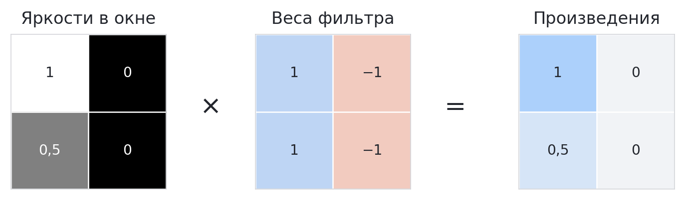

1. Кладём фильтр на окно и умножаем числа, которые оказались друг над другом. Например, в нижней левой позиции $0.5\cdot1=0.5$.
2. Складываем четыре произведения. На рисунке получается $1+0+0.5+0=1.5$.
3. Прибавляем **смещение** $b$. Это одно дополнительное число, общее для всех позиций данного фильтра. Если $b=0.1$, итоговый ответ равен $1.6$.
4. Записываем ответ в одну клетку выходной карты и передвигаем окно. На следующем участке повторяем расчёт с теми же весами и смещением.

У фильтра на рисунке слева стоят плюсы, а справа минусы. Он даёт положительный ответ, когда левая половина окна ярче правой. Если переставить яркие числа в правый столбец, сумма произведений станет $-1.5$, а со смещением ответ будет $-1.4$. Так одна и та же операция оценивает переход яркости в разных местах изображения. Веса настоящего слоя подбираются при обучении под задачу восстановления.

### Как из одного числа получается карта

Пусть перед нами две строки по три пикселя. Возьмём тот же фильтр $2\times2$ со смещением $0.1$ и будем сдвигать окно на одну клетку вправо.

| | Столбец 1 | Столбец 2 | Столбец 3 |
| --- | ---: | ---: | ---: |
| Верхняя строка | 1 | 0 | 0.5 |
| Нижняя строка | 0.5 | 0 | 0 |

1. Берём столбцы 1 и 2. Это окно с рисунка выше. В первую клетку выхода записываем $1.6$.
2. Берём столбцы 2 и 3. Веса остаются на своих местах внутри окна. Теперь $0.5$ находится справа и умножается на $-1$. Остальные произведения нулевые, поэтому во вторую клетку выхода записываем $-0.5+0.1=-0.4$.

Получилась выходная строка `[1.6, -0.4]`. На более высоком входе окно можно сдвигать и вниз. Каждому положению окна соответствует своя клетка в выходной карте.

<a id="feature-maps"></a>
### Один фильтр - один выходной канал

Проведём фильтром по всем разрешённым позициям. Из ответов получится таблица **активаций**, или **карта признака**. Каждый её элемент относится к своему участку входа. Первый слой энкодера применяет 16 разных фильтров к одной и той же входной цифре. Поэтому из одного канала яркости получаются 16 карт признаков.

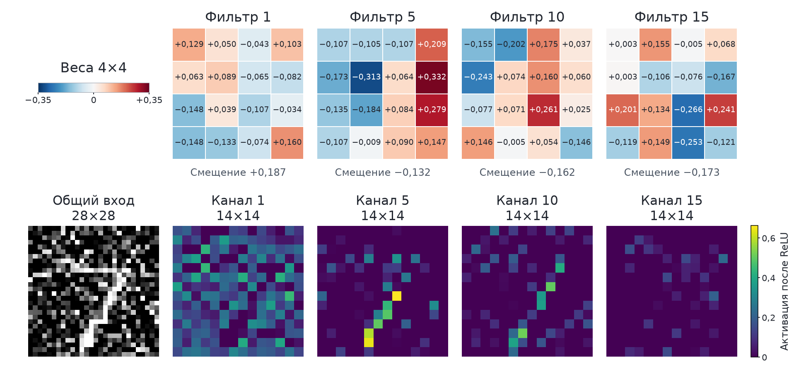

Над каждой из четырёх карт показан фильтр, который её построил. Его 16 весов расположены так же, как пиксели в окне $4\times4$. Синим показаны отрицательные веса, красным — положительные. Под каждым фильтром подписано смещение, которое прибавляется к сумме произведений. В нижнем ряду чем светлее клетка карты, тем сильнее отклик после ReLU. Веса и карты получены из первого слоя сохранённой [NumPy-модели](baselines/numpy/checkpoint.npz).

Например, у фильтра №5 все веса в крайнем правом столбце положительные, а в крайнем левом — отрицательные. Если пиксель в правом столбце окна становится ярче, сумма до ReLU растёт. Если ярче становится пиксель в левом столбце, сумма уменьшается.

**Когда меняются веса?** Пока фильтр скользит по изображению, он использует одни и те же веса и смещение в каждой позиции. Во время обучения Adam обновляет эти числа по градиентам. При восстановлении цифр сохранённой моделью веса и смещения фиксированы для всех изображений. На другой цифре отклики могут измениться, потому что в окна попадут другие яркости.

<a id="second-convolution"></a>
### Как вторая свёртка соединяет 16 каналов

Для ручного счёта возьмём две входные карты и окно $1\times1$. В одной и той же строке и столбце первая карта содержит $0.8$, вторая содержит $0.6$. Каждый фильтр берёт оба числа и умножает каждое на свой вес.

- У фильтра №1 веса $1$ и $1$, а смещение равно $0.1$. В первую карту он запишет $0.8\cdot1+0.6\cdot1+0.1=1.5$.
- У фильтра №2 веса $1$ и $-1$, а смещение равно $0$. Во вторую карту он запишет $0.8\cdot1+0.6\cdot(-1)=0.2$.

В первом расчёте оба входа дают положительный вклад, во втором вклад второй карты вычитается. Так фильтр может реагировать на сочетания признаков, которые первый слой выделил по отдельности. В настоящем слое каждый фильтр работает с 16 картами и окнами $4\times4$.


1. Выбираем один выходной ряд и столбец $(i,j)$. На входе берём **окно $4\times4$ в одном и том же месте всех 16 карт**. Синим на схеме показаны три таких окна из 16.
2. У фильтра №1 свой квадрат весов $4\times4$ для каждой карты. Умножаем попарно значения окон и веса. Складываем все $4\cdot4\cdot16=256$ произведений, прибавляем одно смещение и записываем **одно число** в клетку $(i,j)$ выходной карты №1.
3. Для фильтров №2–32 берём те же входные окна. Каждый фильтр использует собственные веса и смещение и заполняет клетку $(i,j)$ в своей карте.

Сдвигая окно, заполняем следующие клетки каждой карты. В нашем слое получается 49 позиций, расположенных сеткой $7\times7$, и 32 карты, по одной на фильтр. Выход для одного изображения имеет форму `(7, 7, 32)`.

#### Клетка (0,0) выходной карты №1

Возьмём ту же зашумлённую цифру, что и на [рисунке с фильтрами первого слоя](#feature-maps). Для клетки $(0,0)$ окно начинается в левом верхнем углу каждой карты с рамкой. В окно попадают верхняя строка и левый столбец рамки (семь серых нулей) и девять значений из самой карты (голубые клетки).

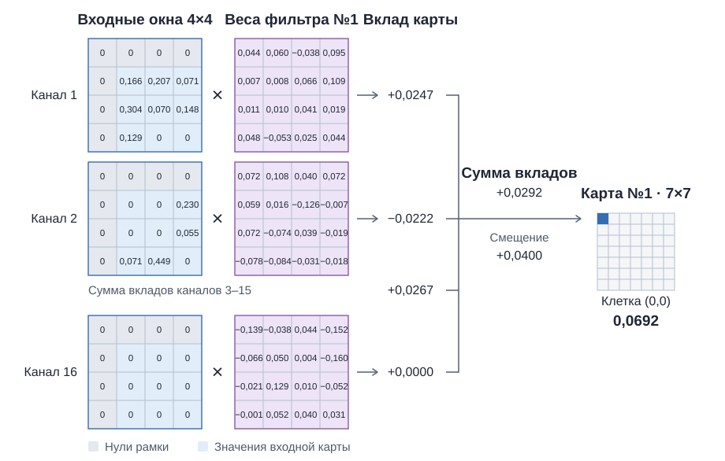

После сложения вкладов всех 16 карт прибавляем смещение фильтра №1 и получаем $0.0692$ в клетке $(0,0)$ до ReLU. Числа на рисунке округлены после расчёта.

#### Как вторая свёртка заполняет все выходные карты

Пусть $H$ и $W$ — высота и ширина **выходной** карты. Здесь $H=W=7$, поэтому индексы $i$ и $j$ идут от 0 до 6. Окно для клетки $(i,j)$ начинается в строке $2i$ и столбце $2j$ входной карты с нулевой рамкой.

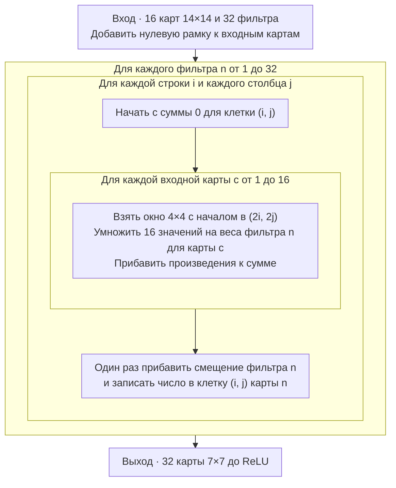

Тот же обход в псевдокоде. `X` — входные карты с рамкой, `Y` — выходные карты, а `u` и `v` — строка и столбец внутри окна.

```text
для фильтра n от 1 до 32:
    для строки i от 0 до H−1:
        для столбца j от 0 до W−1:
            сумма = 0
            для входной карты c от 1 до 16:
                для строки u от 0 до 3:
                    для столбца v от 0 до 3:
                        сумма += X[2*i + u, 2*j + v, c] * вес[u, v, c, n]
            Y[i, j, n] = сумма + смещение[n]
```

### Почему размеры уменьшаются с 28 до 14 и затем до 7

- **Размер окна $K=4$.** Фильтр за один раз смотрит на квадрат $4\times4$ в каждой входной карте.
- **Шаг $S=2$.** После расчёта окно сдвигается на две клетки по горизонтали или вертикали.
- **Дополнение $P=1$.** По периметру добавляется рамка толщиной в одну клетку из нулей, чтобы обрабатывать участки у края.

Например, по горизонтали из 28 столбцов после добавления рамки получается 30. Левая граница окна шириной 4 может встать на позиции $0,2,4,\ldots,26$ от начала дополненного массива. Это 14 позиций. По вертикали столько же, поэтому на каждый фильтр приходится карта $14\times14$. Следующий слой начинает с 14 столбцов. После рамки их 16, допустимые начала окна идут от 0 до 12 включительно с шагом 2, что даёт 7 позиций.

Влияние этих настроек на восстановление цифр сравнивается в экспериментах с [нулевой рамкой](#padding-experiment), [размером окна](#window-size-experiment) и [шагом](#stride-experiment).

### От ручного расчёта к формуле и коду

В формуле $u,v$ - позиция внутри окна, $c$ - входной канал, а $o$ - номер фильтра и одновременно выходного канала. Если фиксировать $(i,j,o)$, сумма ниже даёт одно число, как в расчёте с четырьмя клетками. Индексы $iS+u-P$ и $jS+v-P$ указывают, какую клетку входа умножить на данный вес.

Для выходного канала $o$ и координат $(i,j)$ слой в коде вычисляет

$$
Y_{ijo}=b_o+
\sum_{u=0}^{K-1}\sum_{v=0}^{K-1}\sum_{c=0}^{C_{\mathrm{in}}-1}
W_{uvco}\,X_{iS+u-P,\,jS+v-P,\,c}.
$$

Индексы за границами $X$ соответствуют нулям. Операцию с таким порядком индексов также называют кросс-корреляцией. В нейронных сетях этот слой принято называть свёрткой. Для длины $H$ размер выхода равен $\left\lfloor(H+2P-K)/S\right\rfloor+1$. В проекте $K=4$, шаг $S=2$, дополнение $P=1$, поэтому размеры по каждой пространственной оси меняются как $28\to14\to7$.

Пусть окно равно `[[1, 0], [2, 1]]`, ядро равно `[[1, -1], [0, 1]]`, а смещение равно нулю. Для этой позиции выход равен $1\cdot1+0\cdot(-1)+2\cdot0+1\cdot1=2$.

В `image_columns` вход дополняется нулями. `sliding_window_view` даёт окна, а срезы с шагом 2 выбирают нужные позиции. Все окна разворачиваются в матрицу $C$ формы $(N H_{\mathrm{out}} W_{\mathrm{out}},\,K^2 C_{\mathrm{in}})$. Весам соответствует матрица $W$ формы $(K^2 C_{\mathrm{in}},\,C_{\mathrm{out}})$. Тогда весь прямой проход сводится к `C @ W + b` и восстановлению пространственной формы. Например, во второй свёртке энкодера за один раз умножаются матрицы $(49N,256)$ и $(256,32)$. [image_columns и Conv2D](source/layers.py)

Матричное умножение здесь можно читать так. Каждая строка $C$ - список чисел из одного окна, каждый столбец $W$ - список весов одного фильтра. Число на пересечении строки и столбца в результате - сумма попарных произведений для этого окна и фильтра. Так одна операция NumPy обрабатывает все окна и фильтры батча.

### Транспонированная свёртка

Теперь представьте, что у нас есть маленькая карта и нужно из неё собрать большую. Одно число из маленькой карты умножают на несколько весов и раскладывают результаты в соседние клетки большой карты. Когда два таких участка накладываются, их значения складываются. Декодер обучает веса этой операции, чтобы из небольших карт получались нужные штрихи на изображении.

Для линейной свёртки с фиксированными весами связь между сбором значений из окна и распределением вкладов по окну можно записать как $\langle Ax,y\rangle=\langle x,A^\top y\rangle$. Отсюда слово «транспонированная».

При выбранных параметрах размер выхода равен $(H-1)S-2P+K=2H$. Поэтому декодер последовательно увеличивает карты $7\to14\to28$. В коде каждый входной вектор каналов умножается на матрицу весов и выдаёт $K^2 C_{\mathrm{out}}$ чисел. `columns_image` раскладывает эти числа по окнам, суммирует перекрытия и удаляет внешнее дополнение. Смещение прибавляется после сборки. [columns_image и ConvTranspose2D](source/layers.py)

В одномерном примере вход `[2, 1]`, ядро `[1, 2, 3, 4]`, шаг 2, дополнение 1 и смещение 0. Первый вход даёт вклад `[2, 4, 6, 8]` с позиции 0, второй - `[1, 2, 3, 4]` с позиции 2. После сложения получается `[2, 4, 7, 10, 3, 4]`. Удаление крайних позиций даёт `[4, 7, 10, 3]`.

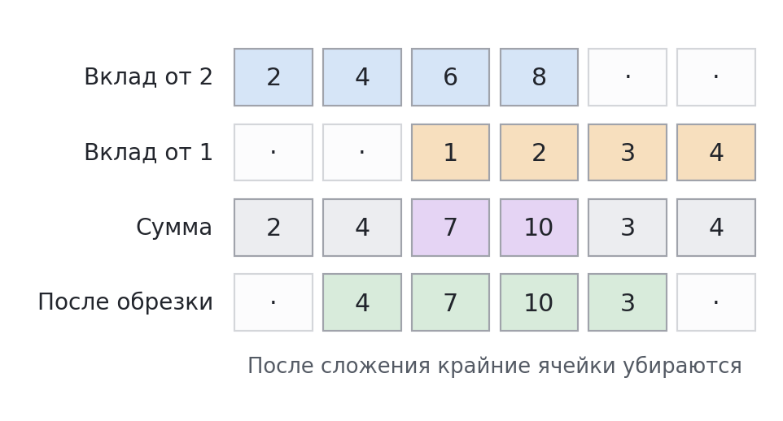

В двумерном слое из одной позиции строится квадрат вкладов $4\times4$, а окна сдвигаются по двум осям. В последнем слое генератора остаётся один канал с числами для яркости. Сигмоида переводит их в диапазон от 0 до 1.

<a id="vae"></a>
## 4. VAE, репараметризация и KL-дивергенция

### Куда деваются 1 568 чисел после второй свёртки

В базовой модели вторая свёртка строит **32 карты по $7\times7$**. Поэтому для одной цифры на этом этапе получается $7\cdot7\cdot32=1568$ **значений активаций**. Для другой цифры значения будут другими. Обучаемые параметры самой второй свёртки хранятся в её 32 фильтрах. В каждом фильтре $4\cdot4\cdot16=256$ весов и одно смещение, всего $32\cdot257=8224$ параметра.

После ReLU энкодер делает ещё два шага.

1. **Развёртка.** Слой `Reshape(-1)` выписывает все 1 568 значений карт в один список $h$. Форма массива меняется с `(7, 7, 32)` на `(1568,)`.
2. **Линейный слой.** Слой `Linear(1568, 64)` вычисляет 64 взвешенные суммы. Для каждой суммы он использует **весь** список $h$, свой набор из 1 568 весов и своё смещение. Первый набор весов даёт первое выходное число, второй даёт второе и так далее.

Например, из списка `[2, 1, 3, 4]` линейный слой может получить два числа.

- С весами `[1, 1, −1, 1]` и смещением $0.5$ получается $2+1-3+4+0.5=4.5$.
- С весами `[−1, 2, 1, −1]` и смещением $0$ получается $-2+2+3-4=-1$.

Получился список `[4.5, −1]`. Оба числа вычислены из всех четырёх входов. Так же устроен переход $1568\to64$. В коде матрица весов имеет форму `(1568, 64)`, каждый её столбец участвует в расчёте одного результата. С учётом смещений у этого линейного слоя $1568\cdot64+64=100416$ обучаемых параметров. [Энкодер](source/models.py) · [Операция Linear](source/layers.py)

### Что такое латентный код и зачем уменьшать карты

**Латентный код** $z$ — внутреннее представление конкретной цифры, состоящее из **32 чисел**. Его можно представить как 32 настройки, которые декодер использует вместе, чтобы нарисовать цифру. Например, сочетание нескольких координат может описывать наклон или толщину штриха. Смысл координат формируется во время обучения.

Размеры меняются на разных этапах по разным причинам.

| Этап | Что получается | Чисел на одну цифру |
| --- | --- | ---: |
| Вход | Одна карта яркостей $28\times28$ | 784 |
| Первая свёртка и ReLU | 16 карт признаков $14\times14$ | 3 136 |
| Вторая свёртка и ReLU | 32 карты признаков $7\times7$ | 1 568 |
| Линейный выход энкодера | Параметры распределения кода | 64 |
| Вход декодера | Один выбранный латентный код $z$ | 32 |
| Восстановление | Одна карта яркостей $28\times28$ | 784 |

Свёртки с шагом 2 вычисляют отклики в меньшем числе пространственных позиций. При этом каждый новый канал хранит свой набор откликов. Поэтому размеры карты по высоте и ширине уменьшаются уже после первой свёртки, а общее число значений на этом шаге растёт с 784 до 3 136. Уменьшение размера карт сокращает число входов линейного слоя. Для 32 карт $14\times14$ понадобилось бы 6 272 входа, а с картами $7\times7$ достаточно 1 568. Компактное представление всей цифры появляется дальше, когда формируется $z$.

Зачем нужен короткий код? При обучении декодер получает эти 32 числа и должен по ним восстановить **чистую версию конкретной зашумлённой цифры**. Допустим, у семёрки рядом со штрихом появилась случайная белая точка. Чистая цель показывает, что полезно сохранить положение и наклон штриха, а белую точку на восстановлении погасить. Ошибка по пикселям помогает энкодеру и декодеру совместно научиться передавать через код такую информацию. Разным изображениям может соответствовать один код, поэтому мелкие детали могут теряться.

Декодер строит выход полного размера $28\times28$. Его собственный линейный слой `Linear(32, 1568)` вычисляет из кода 1 568 новых значений. Из них собираются 32 карты $7\times7$, которые две [транспонированные свёртки](#convolution) увеличивают до $14\times14$ и затем до $28\times28$. [Декодер в коде](source/models.py)

### Почему 64 числа дают код из 32 чисел

Вариационный автоэнкодер (VAE) описывает для каждой зашумлённой цифры **распределение возможных кодов**. Длину кода задаёт отдельная настройка архитектуры `LATENT_DIM = 32`. Для каждой координаты энкодер предсказывает центр и разброс. Влияние этой настройки на восстановление сравнивается в [эксперименте с длиной кода](#latent-size-experiment).

| Часть выхода энкодера | Что означает |
| --- | --- |
| Первые 32 числа $\mu$ | Средние. $\mu_j$ задаёт центр распределения координаты $z_j$. |
| Следующие 32 числа $\ell$ | Логарифмы дисперсий. Через $\ell_j$ вычисляется разброс координаты $z_j$. |

Например, $\mu_j=0.5$ задаёт центр. Со стандартным отклонением $0.1$ значения обычно оказываются ближе к $0.5$, а со стандартным отклонением $1$ разброс больше. Для одного $z_j$ выбирается одно значение из предсказанного распределения. Так **32 пары параметров описывают 32 координаты кода**, и один выбранный код содержит 32 числа.

Почему энкодер выдаёт логарифм дисперсии? Его последний слой может выдавать числа любого знака, а дисперсия должна быть положительной. Сеть предсказывает $\ell_j=\log(\sigma_{z,j}^2)$, а затем из неё вычисляются дисперсия $e^{\ell_j}$ и стандартное отклонение $\sigma_{z,j}=e^{\ell_j/2}$. Например, при $\ell_j=\log(0.25)$ дисперсия равна $0.25$, а стандартное отклонение равно $0.5$. При $\ell_j=0$ оба значения равны $1$.

Для фиксированной зашумлённой цифры $\widetilde x$ все 32 координаты выбираются независимо с их собственными средними и дисперсиями. Это называют нормальным распределением с диагональной ковариацией.

$$
q_\phi(z\mid\widetilde x)=\mathcal N\!\left(
  \mu,\,\operatorname{diag}(e^\ell)
\right).
$$

### Зачем нужна репараметризация

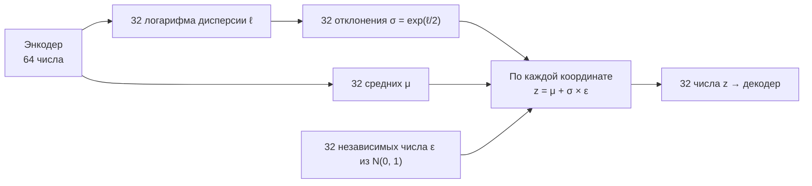

При обучении для каждой координаты берём случайное число $\varepsilon_j$ из стандартного нормального распределения со средним $0$ и дисперсией $1$. Затем **масштабируем** его через $\sigma_{z,j}$, чтобы получить нужный разброс, и **сдвигаем** на $\mu_j$, чтобы получить нужный центр.

$$
\varepsilon\sim\mathcal N(0,I),\qquad
z=\mu+e^{\ell/2}\odot\varepsilon.
$$

Знак $\odot$ означает умножение по координатам. Например, при $\mu_j=0.5$ и дисперсии $0.25$ стандартное отклонение равно $0.5$. Если выпало $\varepsilon_j=-0.4$, координата кода равна $0.5+0.5\cdot(-0.4)=0.3$. Если выпадет $\varepsilon_j=0.4$, получим $0.7$. Повторяем это для всех 32 координат и отправляем в декодер один вектор $z$.

Это и есть **репараметризация**. В прямом проходе случайность содержится в выбранном $\varepsilon$. В обратном проходе это уже известное число, поэтому можно проследить, как изменения выходов энкодера повлияют на код. Например, если увеличить $\mu_j$ с $0.50$ до $0.51$ при том же $\varepsilon_j=-0.4$ и том же разбросе, $z_j$ вырастет с $0.30$ до $0.31$. Так градиент ошибки восстановления идёт от декодера через $z$ к $\mu$ и $\ell$, а затем к весам энкодера.

Шум $\xi$ из [подготовки данных](#data) добавляется к яркостям 784 пикселей зашумлённого входа. Случайные числа $\varepsilon$ здесь используются уже внутри модели, когда из параметров распределения строится код из 32 чисел.

### Какой код получает декодер

| Режим | Откуда берутся 32 числа |
| --- | --- |
| Восстановление при обучении | Энкодер получает зашумлённую цифру, вычисляет $\mu$ и $\ell$, затем по ним выбирается $z=\mu+e^{\ell/2}\odot\varepsilon$. Результат сравнивают с чистой цифрой. |
| Восстановление на тесте | Берём $z=\mu$. Для одного и того же зашумлённого входа это даёт воспроизводимое восстановление. |
| Генерация новой цифры | Начинаем с 32 независимых случайных чисел со средним $0$ и дисперсией $1$ и подаём их прямо в декодер. |

Общее правило для генерации записывают как $p(z)=\mathcal N(0,I)$. Его называют **априорным распределением**, потому что оно задано заранее, до получения изображения. Распределение $q_\phi(z\mid\widetilde x)$ вычисляет энкодер для конкретной зашумлённой цифры. [Выбор кодов при обучении и восстановлении](source/main.py)

### Откуда берутся восстановление и KL

У восстановления и KL разные роли. Попиксельная ошибка показывает, насколько результат похож на **чистую цифру с этого входа**. **KL-дивергенция** сравнивает два распределения в пространстве кодов. Для каждой цифры она измеряет, насколько предсказанное $q_\phi(z\mid\widetilde x)$ отличается от общего $p(z)$.

Представьте, что для некоторой координаты энкодер систематически выбирает средние около $10$ и очень маленький разброс. Тогда коды для восстановления лежат около $10$, в то время как при генерации из стандартного нормального распределения значения обычно близки к $0$. Штраф KL поощряет центры ближе к $0$ и разброс ближе к $1$, чтобы согласовать эти два способа получать код. Ошибка восстановления одновременно поощряет сохранять в коде информацию, нужную для восстановления конкретного входа. В коде штраф KL умножается на $0.001$. Состязательная потеря описана отдельно в [разделе про GAN](#gan).

Для одной цифры складываем вклады всех 32 координат.

$$
\operatorname{KL}(q\,\Vert\,p)
=\frac12\sum_{j=1}^{32}
\left(\mu_j^2+e^{\ell_j}-1-\ell_j\right).
$$

Например, при $\mu_j=0$ и $\ell_j=0$ распределение этой координаты совпадает с априорным, поэтому вклад равен $0$. При том же разбросе и среднем $\mu_j=2$ вклад равен $\tfrac12(4+1-1-0)=2$. Для примера выше с $\mu_j=0.5$ и дисперсией $0.25$ вклад равен $\tfrac12(0.25+0.25-1-\log 0.25)\approx0.4431$. Код суммирует вклады координат и усредняет результат по изображениям батча. [Расчёт KL в train_step](source/main.py)

### Откуда берутся формулы KL и ELBO

Поскольку для одного изображения возможны многие коды, его правдоподобие учитывает вклад всех этих кодов. **ELBO** - величина, которую используют при обучении VAE как доступную для оценки нижнюю границу логарифма этого правдоподобия. При чтении формулы удобно найти в ней два знакомых слагаемых - качество восстановления и штраф KL.

В вероятностной модели декодер задаёт $p_\theta(x\mid z)$. Вероятность чистого изображения получается после интегрирования по всем $z$. Для любого приближённого распределения $q=q_\phi(z\mid\widetilde x)$ выполняется разложение

$$
\log p_\theta(x)
=
\underbrace{\mathbb E_q[\log p_\theta(x\mid z)]
-\operatorname{KL}\bigl(q\,\Vert\,p(z)\bigr)}_{\mathrm{ELBO}}
+
\operatorname{KL}\bigl(q\,\Vert\,p_\theta(z\mid x)\bigr).
$$

Последний член неотрицателен, поэтому ELBO - нижняя граница логарифма правдоподобия. Первый член внутри ELBO поощряет декодирование в чистое изображение, второй задаёт регуляризацию латентного распределения. В лабораторной этот принцип реализован как попиксельно усреднённая BCE, отдельный вес KL и дополнительная состязательная потеря. [Вывод ELBO и репараметризация](https://arxiv.org/abs/1312.6114)

Для одной координаты логарифм отношения плотностей имеет вид

$$
\log\frac{q(z_j)}{p(z_j)}
=\frac12\left(-\ell_j-\frac{(z_j-\mu_j)^2}{e^{\ell_j}}+z_j^2\right).
$$

Под $q$ ожидаемое значение средней дроби равно $1$, а $\mathbb E_q[z_j^2]=\mu_j^2+e^{\ell_j}$. Подставляя эти значения, получаем вклад одной координаты в формулу KL выше. Независимость координат позволяет сложить 32 таких вклада. До усреднения по батчу и умножения на вес KL производная по $\mu_j$ равна $\mu_j$, а производная по $\ell_j$ равна $(e^{\ell_j}-1)/2$. [Обратное распространение в VAE](#backpropagation)

<a id="bce"></a>
## 5. Бинарная кросс-энтропия

**Логит** - число, которое выдаёт последний слой до преобразования сигмоидой. Например, логиты $-2$, $0$ и $2$ дают примерно $0.12$, $0.50$ и $0.88$. У генератора такой переход выполняется для каждого пикселя, а у дискриминатора - один раз для оценки всего изображения.

**Функция потерь** сводит ошибку к числу, которое обучение старается уменьшить. Для дискриминатора при цели $1$ и оценке $0.9$ вклад BCE составляет около $0.11$. Если тот же оригинал получил оценку $0.1$, вклад становится около $2.30$. При восстановлении в качестве цели можно подставить промежуточную яркость, например $0.8$. Тогда меньшую потерю даёт предсказание, близкое к $0.8$.

Логит $s$ может принимать любое вещественное значение. Сигмоида переводит его в $p=\sigma(s)=1/(1+e^{-s})$. Для цели $y$ бинарная кросс-энтропия равна

$$
\operatorname{BCE}(s,y)
=-y\log p-(1-y)\log(1-p)
=\log(1+e^s)-ys.
$$

В коде последнее выражение вычисляется через `np.logaddexp(0, s) - y * s`. Эта форма устойчива для логитов с большой абсолютной величиной. Производная особенно проста.

$$
\frac{\partial \operatorname{BCE}(s,y)}{\partial s}
=\sigma(s)-y.
$$

При восстановлении $y$ - яркость чистого пикселя в $[0,1]$, то есть мягкая цель. При обучении дискриминатора $y\in\{0,1\}$. В обоих случаях функция имеет один вид, меняются смысл цели и способ усреднения. [binary_cross_entropy и train_step](source/main.py)

Например, для логита $s=1$ и целевой яркости $y=0.8$ получаем $p\approx0.7311$, потерю $\log(1+e)-0.8\approx0.5133$ и градиент $-0.0689$. При градиентном спуске такой сигнал увеличивает логит и приближает яркость к цели. В батче восстановление усредняется по $784B$ пикселям, поэтому попиксельный градиент делится на $784B$.

Пиксельная потеря привязывает выход к конкретной цифре на входе. Если разные чистые штрихи могли дать похожий зашумлённый фрагмент, усреднение возможных яркостей может давать размытие. Состязательная потеря добавляет сигнал о правдоподобии целого изображения. В статье Larsen и соавторов VAE/GAN использует признаки дискриминатора для самой ошибки восстановления. В этой реализации ошибка восстановления вычисляется по пикселям, а дискриминатор участвует через отдельную состязательную потерю. [Larsen и соавторы, Autoencoding beyond pixels](https://arxiv.org/abs/1512.09300)

<a id="gan"></a>
## 6. GAN и две фазы обучения

Один шаг обучения начинается с двух групп выходов генератора. Для каждой зашумлённой цифры получается восстановление. Столько же изображений получается из случайных кодов. Затем по очереди обновляются две группы весов.

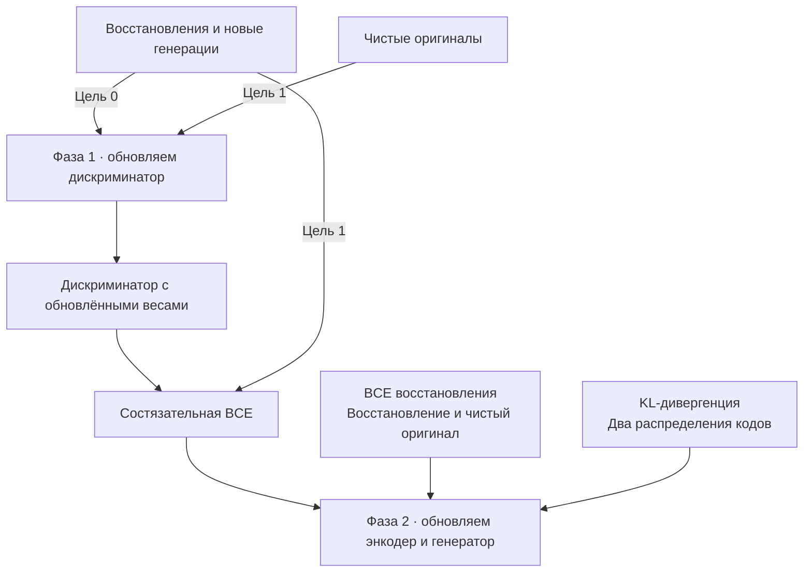

Например, если в батче две чистые цифры, генератор создаёт два восстановления и две новые цифры. В первой фазе дискриминатор видит все шесть изображений и учится правильно определять их происхождение. Во второй фазе он оценивает четыре выхода генератора. Для этих выходов цель $1$ говорит, какую оценку генератор старается получить после обновления. Ошибку по пикселям можно посчитать у двух восстановлений, потому что у каждого есть соответствующий оригинал.

Обозначим $r_i=\sigma(G_\theta(z_i))$ восстановление, а $g_i=\sigma(G_\theta(u_i))$ изображение из независимого кода $u_i\sim\mathcal N(0,I)$. Генератор использует одни и те же веса для обеих групп. Дискриминатор выдаёт логит $d(t)=D_\psi(t)$ для любого изображения $t$. Принцип GAN состоит в том, что дискриминатор учится различать источники изображений, а генератор учится повышать оценку своих выходов у дискриминатора. [Goodfellow и соавторы, Generative Adversarial Networks](https://arxiv.org/abs/1406.2661)

### Фаза дискриминатора

Для чистых изображений используется целевая метка $1$, для восстановленных и сгенерированных - $0$. В формуле $\mathcal F=(r_1,\ldots,r_B,g_1,\ldots,g_B)$ содержит все $2B$ синтетических выходов.

$$
L_D=
\frac12\left[
  \frac1B\sum_{i=1}^B \operatorname{BCE}(d(x_i),1)
  +\frac1{2B}\sum_{t\in\mathcal F}\operatorname{BCE}(d(t),0)
\right].
$$

Чистые изображения дают половину веса потери. Восстановленные и сгенерированные дают по четверти. Градиент по логиту реального изображения равен $(\sigma(d)-1)/(2B)$, а по логиту синтетического - $\sigma(d)/(4B)$. Обратный проход вычисляет градиенты весов дискриминатора, затем отдельный Adam обновляет только $\psi$.

В идеализированном случае для фиксированного генератора и достаточно гибкого дискриминатора оптимальная вероятность класса «чистый» в точке $t$ равна $p_{\mathrm{data}}(t)/(p_{\mathrm{data}}(t)+p_{\mathrm{fake}}(t))$, где $p_{\mathrm{fake}}$ - смесь распределений восстановлений и новых генераций. Это получается из максимизации $p_{\mathrm{data}}\log p+p_{\mathrm{fake}}\log(1-p)$ по $p$ для каждой точки. Оценка дискриминатора поэтому отражает, насколько характерен образ для реальных данных среди двух источников.

### Фаза энкодера и декодера-генератора

Те же синтетические изображения пропускаются через уже обновлённый дискриминатор. Целевая метка для потери генератора теперь $1$. Так оптимизация увеличивает оценку «чистого» для обеих групп выходов.

$$
L_{\mathrm{adv}}
=\frac1{2B}\sum_{t\in\mathcal F}\operatorname{BCE}(d(t),1),
\qquad
L_{E,G}=L_{\mathrm{rec}}+0.001\,L_{\mathrm{KL}}+0.02\,L_{\mathrm{adv}}.
$$

Это несатурирующая состязательная потеря. По логиту дискриминатора её производная пропорциональна $\sigma(d)-1$, поэтому сигнал по логиту велик, когда дискриминатор уверенно отвергает синтетический результат. Веса $\psi$ на этой фазе зафиксированы. Их текущие значения участвуют в вычислении градиента по пикселям, который затем проходит в генератор. Для ветки восстановления он поступает и в энкодер. У изображений из независимого кода нет привязанного чистого оригинала, поэтому их вклад в обновление генератора идёт через $L_{\mathrm{adv}}$. [Порядок операций в train_step](source/main.py)

<a id="backpropagation"></a>
## 7. Обратное распространение на NumPy

**Прямой проход** вычисляет ответ модели от входа до выхода. После него можно посчитать, насколько ответ отличается от цели. **Обратный проход** идёт от потери к предыдущим слоям и определяет, как небольшое изменение каждого параметра повлияет на потерю. Эти чувствительности называют **градиентами**. Дальше оптимизатор использует их для обновления параметров.

Рассмотрим один вес $w$ и одно смещение $b$.

1. Пусть вход равен $2$, целевое значение - $1$, а параметры - $w=0.6$ и $b=0.1$. Прямой проход даёт $y=2w+b=1.3$. Для примера возьмём квадрат ошибки $L=(y-1)^2=0.09$.
2. Производная потери по выходу равна $2(y-1)=0.6$. Увеличение веса меняет выход в два раза сильнее, чем такое же увеличение смещения. Поэтому градиенты параметров равны $0.6\cdot2=1.2$ для веса и $0.6\cdot1=0.6$ для смещения. Умножение этих чувствительностей - **цепное правило**.
3. При простом шаге градиентного спуска с размером шага $0.1$ вычитаем $0.1$ градиента из каждого параметра. Получаем $w=0.48$ и $b=0.04$. Новый прямой проход даёт $y=1.0$. В лабораторной по тому же принципу вычисляют чувствительности, а шаги обновления рассчитывает Adam.

Обратный проход последовательно применяет цепное правило. Каждый слой получает градиент скалярной функции потерь по своему выходу, вычисляет градиенты своих параметров и отдаёт предыдущему слою градиент по входу. При `forward(..., retain=True)` слои сохраняют промежуточные значения. `Network.backward` обходит их в обратном порядке. [Слои](source/layers.py) · [Network](source/models.py)

### Линейные слои и свёртки

Пусть $Y=XW+b$, а $\Delta Y=\partial L/\partial Y$. Для линейного слоя цепное правило даёт

$$
\Delta W=X^\top\Delta Y,\qquad
\Delta b=\sum_{\text{строки}}\Delta Y,\qquad
\Delta X=\Delta Y\,W^\top.
$$

Для обычной свёртки вместо $X$ подставляется матрица окон $C$. Градиент $\Delta C=\Delta Y W^\top$ показывает вклад каждой позиции каждого окна. `columns_image` суммирует вклады, относящиеся к одному входному пикселю. Это важно, поскольку соседние окна перекрываются и одна яркость может влиять на несколько выходов.

Для транспонированной свёртки прямой проход сначала вычисляет $C=X_{\mathrm{flat}}W$, затем собирает пространственный выход. В обратном проходе сборка заменяется извлечением окон $\Delta C=\operatorname{image\_columns}(\Delta Y)$. После этого $\Delta W=X_{\mathrm{flat}}^\top\Delta C$ и $\Delta X_{\mathrm{flat}}=\Delta C W^\top$. Градиент смещения собирается по батчу и пространственным координатам, поскольку одно смещение используется во всех пикселях выходного канала.

ReLU пропускает градиент на положительной полуоси и обнуляет его на отрицательной. Для Leaky ReLU отрицательная ветвь умножает градиент на $0.2$. В нуле код использует наклон неположительной ветви. Изменение формы тензора в обратном проходе возвращает исходную форму градиента.

### От выхода дискриминатора до латентного кода

1. На фазе $E,G$ у синтетического изображения $t$ градиент по логиту дискриминатора равен $0.02\,(\sigma(d(t))-1)/(2B)$. Вызов `backward(parameter_grad=False, input_grad=True)` возвращает градиент по синтетическим пикселям.
2. Яркость $t$ получена сигмоидой от логитов генератора, поэтому градиент по этим логитам умножается на $t(1-t)$. К первым $B$ изображениям прибавляется градиент восстановления $(r_i-x_i)/(784B)$.
3. Обратный проход генератора вычисляет градиенты общих весов по всем $2B$ изображениям. Первые $B$ возвращённых градиентов по кодам относятся к энкодеру.

Пусть $g_z$ - градиент по коду восстановления на последнем шаге. Поскольку $z=\mu+e^{\ell/2}\odot\varepsilon$, имеем $\partial z/\partial\mu=1$ по каждой координате и $\partial z/\partial\ell=\frac12 e^{\ell/2}\odot\varepsilon$. К этому сигналу прибавляются производные KL. При $\beta=0.001$ получаем

$$
\begin{aligned}
g_\mu
&= g_z+\frac{\beta}{B}\mu,\\
g_\ell
&=\frac12 g_z\odot e^{\ell/2}\odot\varepsilon
  +\frac{\beta}{2B}(e^\ell-1).
\end{aligned}
$$

Именно эти величины код называет `mean_gradient` и `log_variance_gradient`. Их объединяют в матрицу $(B,64)$, которая подаётся на обратный проход последнего слоя энкодера. [train_step в main.py](source/main.py)

<a id="adam"></a>
## 8. Оптимизация и журнал обучения

**Эпоха** - один проход по обучающей выборке. Модель берёт её частями по 256 изображений, и для каждой части выполняет обе фазы обучения. В 60 000 изображений помещаются 234 полных батча и последний батч из 96 изображений. Каждая группа параметров получает по 235 обновлений за эпоху.

**Adam** определяет размер обновления для каждого веса по истории его градиентов. Скользящее среднее самого градиента сглаживает смену направления от батча к батчу. Среднее квадратов показывает типичный масштаб градиента. После деления на корень из этой величины параметры с крупными и мелкими градиентами получают более сопоставимые обновления.

Веса и смещения инициализируются равномерно в диапазоне $\left[-1/\sqrt{\mathrm{fan\_in}},1/\sqrt{\mathrm{fan\_in}}\right]$. Для линейного слоя `fan_in` равен размеру входа, для обычной свёртки - $K^2 C_{\mathrm{in}}$, для транспонированной в этой реализации - $K^2 C_{\mathrm{out}}$. В начале каждой эпохи порядок обучающих изображений заново перемешивается. [Инициализация](source/layers.py) · [Цикл обучения](source/main.py)

Для каждого параметра Adam хранит скользящее среднее градиента $m_t$ и его квадрата $v_t$. Пусть $g_t$ - градиент параметра на шаге $t$, а $\eta$ - скорость обучения. Все операции ниже выполняются поэлементно.

$$
\begin{aligned}
m_t &= 0.9m_{t-1}+0.1g_t,&
v_t &= 0.999v_{t-1}+0.001g_t^2,\\
\widehat m_t &= \frac{m_t}{1-0.9^t},&
\widehat v_t &= \frac{v_t}{1-0.999^t},\\
w_t &= w_{t-1}-\eta\frac{\widehat m_t}{\sqrt{\widehat v_t}+10^{-8}}.
\end{aligned}
$$

Коррекция смещения учитывает, что обе оценки начинаются с нулей. При первом градиенте $g_1=0.4$ получаем $m_1=0.04$ и $v_1=0.00016$, после коррекции - $0.4$ и $0.16$. При $\eta=0.001$ параметр уменьшается примерно на $0.001$. Энкодер и декодер-генератор используют общий шаг Adam со скоростью $0.001$. Дискриминатор имеет собственные моменты и скорость $0.0002$. [Реализация Adam](source/models.py) · [Kingma и Ba, Adam](https://arxiv.org/abs/1412.6980)

В `history.csv` записываются значения отдельных членов потери до применения их коэффициентов. Среднее за эпоху взвешивается по размеру батча. Для базового NumPy-прогона журнал выглядит так. [Исходный журнал](baselines/numpy/history.csv)

| Эпоха | BCE восстановления | KL | Состязательная BCE | Потеря дискриминатора |
| ---: | ---: | ---: | ---: | ---: |
| 1 | 0,2968 | 11,6229 | 1,6325 | 0,3408 |
| 2 | 0,1867 | 27,7034 | 2,4871 | 0,2140 |
| 3 | 0,1477 | 38,9850 | 1,4575 | 0,4263 |

Например, в третьей эпохе средний вклад KL в цель $E,G$ составляет $0.001\cdot38.9850\approx0.0390$, а вклад состязательной BCE - $0.02\cdot1.4575\approx0.0291$. BCE за три эпохи уменьшилась, а среднее отклонение приближённого распределения от априорного по KL выросло. Состязательные потери меняются вместе с обоими участниками игры. Качество восстановления оценивается отдельно на тестовых изображениях.

<a id="evaluation"></a>
## 9. Метрики и сравнение моделей

### Как восстанавливается тестовое изображение

На вход энкодера поступает зашумлённая цифра. Кодом для декодера служит $\mu$, то есть среднее латентного распределения. Для фиксированного входа это даёт воспроизводимый выход. Для восстановления достаточно энкодера и декодера. Вызовы `reconstruct` и `restoration_scores` отвечают за вычисление яркостей и метрик. [Оценка в main.py](source/main.py)

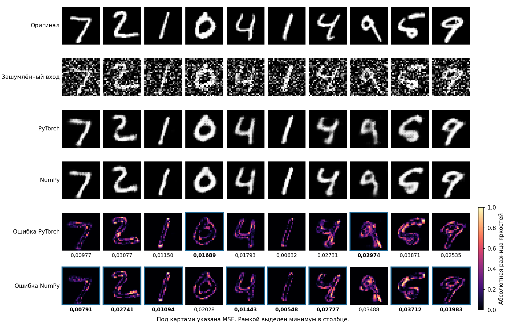

Читайте рисунок сверху вниз по одному столбцу. После оригинала, зашумлённого входа и двух восстановлений идут карты ошибок PyTorch и NumPy. В каждой клетке карты показана абсолютная разница яркостей $|\widehat{x}_{ij}-x_{ij}|$ между восстановленным пикселем и пикселем **чистого оригинала**. На общей шкале от 0 до 1 чёрный цвет означает совпадение, а светлые клетки показывают, где модель сильнее изменила штрих или фон относительно оригинала.

Под каждой картой указана MSE по всем 784 пикселям этой цифры. Синяя рамка выделяет модель с меньшей ошибкой в столбце. Например, для нуля в четвёртом столбце MSE равна 0,01689 у PyTorch и 0,02028 у NumPy. Для семёрки в первом столбце точнее NumPy с MSE 0,00791 против 0,00977 у PyTorch.

### MSE и PSNR

**MSE** - средний квадрат разницы между предсказанной и исходной яркостью. Например, если для двух пикселей ошибки равны $0.1$ и $-0.3$, квадраты равны $0.01$ и $0.09$, а среднее равно $0.05$. Знак ошибки исчезает, а большие промахи влияют сильнее. Идеальное совпадение даёт нулевую MSE.

**PSNR** выражает в децибелах отношение максимально возможной яркости к корню из MSE. Чем ближе восстановление к оригиналу по MSE, тем выше PSNR.

Для $N$ изображений обозначим яркость чистого пикселя через $x_{np}$, а яркость оцениваемого изображения через $a_{np}$. В роли $a$ выступает зашумлённый вход или выход модели. Реализация суммирует квадрат ошибки по всем пикселям и делит сумму на их число.

$$
\operatorname{MSE}=\frac{1}{784N}
\sum_{n=1}^{N}\sum_{p=1}^{784}(a_{np}-x_{np})^2,\qquad
\operatorname{PSNR}=10\log_{10}\frac{1^2}{\operatorname{MSE}}.
$$

Пиковая яркость равна $1$ из-за нормализации. Меньшему MSE соответствует больший PSNR. В проекте PSNR вычисляют из общего MSE, поэтому его величина отражает ту же ошибку в децибелах. Для численной устойчивости в логарифме используется нижняя граница MSE $10^{-12}$. Например, при MSE $0.01$ PSNR равен $20$ дБ, а уменьшение MSE вдвое добавляет $10\log_{10}2\approx3.01$ дБ.

### Общие входы для сравнения PyTorch и NumPy

В `compare.py` для всех 10 000 тестовых изображений используется один поток гауссовского шума с $\sigma=0.5$ и seed 43. Для каждого батча зашумлённые пиксели вычисляются один раз. При передаче PyTorch меняется только порядок осей с `NHWC` на `NCHW`. Обе модели восстанавливают каждый вход по $\mu$ с архивными весами. Скрипт записывает SHA-256 общих зашумлённых входов, чтобы можно было сверить набор при повторной оценке. [Скрипт сравнения](baselines/compare.py) · [Метрики](baselines/comparison/metrics.json)

| Изображения | MSE | PSNR, дБ |
| --- | ---: | ---: |
| Общий зашумлённый вход | 0,11565 | 9,37 |
| Восстановление PyTorch | 0,02097 | 16,78 |
| Восстановление NumPy | 0,01935 | 17,13 |

Относительная разница MSE равна $100\,(1-\mathrm{MSE}_{\mathrm{NumPy}}/\mathrm{MSE}_{\mathrm{PyTorch}})\approx7.73\%$ в пользу сохранённой модели NumPy. При сравнении ошибки каждой пары восстановлений по отдельности NumPy дала меньший MSE на 6 727 изображениях, PyTorch - на 3 273. Эти показатели относятся к двум обученным экземплярам и одной реализации шума. Значение seed при обучении было одинаковым, а генераторы случайных чисел и порядок их вызовов различались. Поэтому таблица описывает качество конкретных весов в общих тестовых условиях. [Результаты и примеры рядом](baselines/comparison/reconstructions.png)

### Что в PyTorch может помочь при обучении

В архивной версии PyTorch `loss.backward()` автоматически вычисляет, как ошибка зависит от каждого веса энкодера и декодера. Это снижает риск ошибки в формулах обратного прохода, например при передаче сигнала от дискриминатора к декодеру. Обновления выполняет `torch.optim.Adam`. В версии NumPy градиенты для тех же операций вычисляются явно, а Adam написан вручную с теми же скоростями обучения. [Обучение PyTorch](baselines/pytorch/source/main.py) · [Градиенты NumPy](source/main.py) · [Adam на NumPy](source/models.py)

PyTorch также использует `binary_cross_entropy_with_logits` для численно устойчивого вычисления ошибки восстановления. Она принимает логиты и объединяет сигмоиду с вычислением ошибки. В NumPy эквивалентная формула вычисляется через `np.logaddexp`, тоже численно устойчиво. Если обе реализации верно вычисляют градиенты и обновления, эти инструменты решают одну и ту же задачу обучения. [Функция потерь PyTorch](baselines/pytorch/source/main.py) · [Функция потерь NumPy](source/main.py)

При проверке на первых 128 тестовых цифрах я перенёс веса архивной NumPy-модели в энкодер и декодер PyTorch с учётом порядка осей. На одинаковых зашумлённых входах максимальная разница яркости восстановленных пикселей была меньше $10^{-6}$. При раздельном обучении получились разные веса. На них PyTorch точнее восстанавливает часть цифр, а NumPy даёт меньшую среднюю MSE по тестовой выборке.

<a id="padding-experiment"></a>
### Эксперимент с нулевым дополнением

Изменяем $P$ во **второй свёртке энкодера**. При $P=0$, $P=1$ и $P=2$ вокруг входных карт добавляется соответственно ноль, один или два ряда нулей с каждой стороны. Размер окна $4\times4$ и шаг 2 одинаковы во всех вариантах. Размер выходных карт меняется между $6\times6$, $7\times7$ и $8\times8$, поэтому меняется и число весов в следующем линейном слое. Декодер и дискриминатор имеют одну и ту же архитектуру во всех прогонах.

Для каждого $P$ модель обучается с нуля две эпохи на одной и той же случайной подвыборке из 8 192 обучающих цифр MNIST. При пробном сравнении с батчем 256 изображения всех трёх вариантов оставались размытыми. Для основного сравнения размер батча уменьшили до 32, чтобы за те же две эпохи сделать 512 обновлений весов. Использовались три seed обучения (42, 43 и 44). При одинаковом seed все варианты получали одинаковый порядок батчей и один и тот же шум. Оценка прошла на всех 10 000 тестовых цифрах с общим шумом $\sigma=0.5$ и seed 43. [Скрипт эксперимента](source/padding_experiment.py)

| Рамка $P$ | Карта после второй свёртки | Параметры энкодера | Средняя MSE ↓ | Средний PSNR, дБ ↑ |
| --- | --- | ---: | ---: | ---: |
| 0 | $6\times6$ | 82 288 | 0,03404 | 14,70 |
| **1** | $7\times7$ | 108 912 | **0,03287** | **14,84** |
| 2 | $8\times8$ | 139 632 | 0,03338 | 14,77 |

При $P=1$ ошибка была самой низкой во всех трёх повторах. В среднем MSE уменьшилась на 3,4% относительно $P=0$ и на 1,5% относительно $P=2$. Этот результат относится к двум эпохам обучения на выбранной подвыборке MNIST.

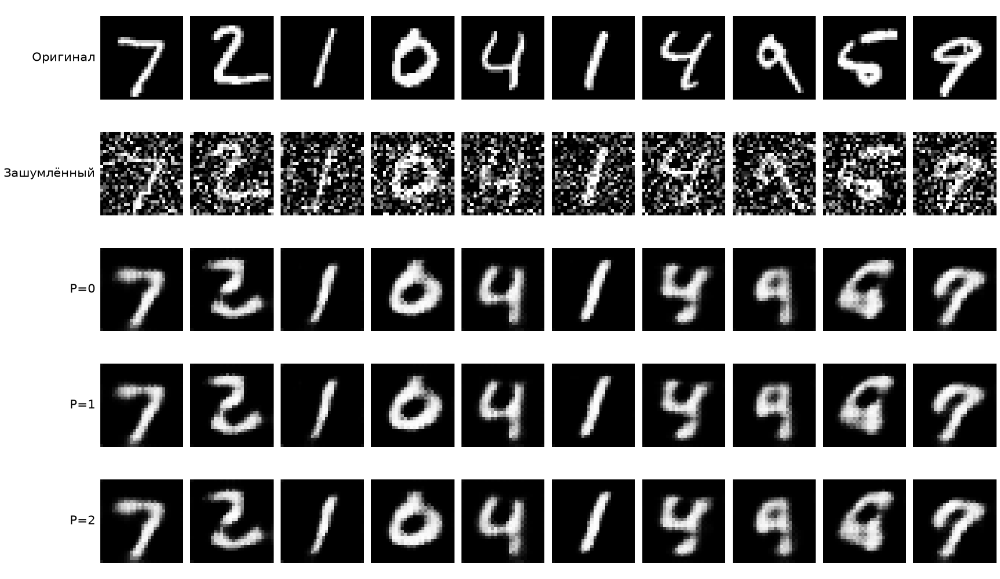

#### Карты ошибок и точность по отдельным цифрам

Для каждого пикселя карты ошибок берём абсолютную разницу яркостей $|\widehat{x}_{ij}-x_{ij}|$ между восстановлением и оригиналом. Чем светлее клетка на карте, тем больше ошибка в этой позиции. Для целой цифры вычисляем MSE, то есть среднее квадратов этих разниц по всем 784 пикселям.

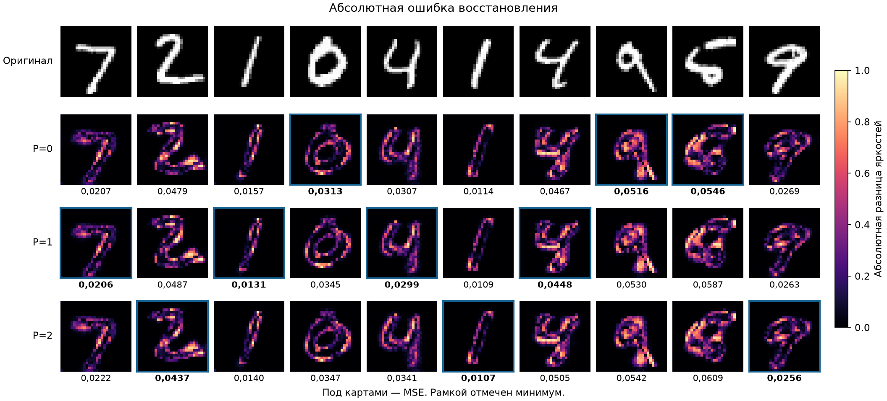

Для сравнения на всех 10 000 тестовых цифрах сначала усредняем MSE каждой цифры по трём seed обучения отдельно для каждого $P$. Затем считаем, у какого $P$ средняя ошибка для этой цифры самая низкая.

| Рамка $P$ | Цифры с минимальной MSE | Доля тестовой выборки |
| --- | ---: | ---: |
| 0 | 1 506 | 15,06% |
| **1** | **5 370** | **53,70%** |
| 2 | 3 124 | 31,24% |

Для первой семёрки на рисунке минимальная MSE у $P=1$ (0,0206), а для следующей двойки — у $P=2$ (0,0437).

Повторить эксперимент можно из корня репозитория.

```bash
python lab4/source/padding_experiment.py --batch-size 32 --output lab4/results/padding-32-errors
```

В `lab4/results/padding-32-errors/` сохраняются метрики, примеры восстановления, карты ошибок и `per-image-mse.csv` со средней MSE для каждой тестовой цифры и каждого $P$.

<a id="window-size-experiment"></a>
### Эксперимент с размером окна второй свёртки

Сравниваем семь квадратных окон от $1\times1$ до $7\times7$ во второй свёртке энкодера. Шаг 2 и число фильтров 32 одинаковы. Для стороны окна $K$ берём нулевую рамку $P=\lfloor(K-1)/2\rfloor$. При входе $14\times14$ это даёт карты $7\times7$ во всех вариантах, поэтому размер следующего линейного слоя одинаков. Число параметров самой второй свёртки равно $32(16K^2+1)$ и растёт с окном.

Для каждого $K$ проведено семь обучений с нуля с seed от 42 до 48, всего 49 прогонов. Каждый вариант обучался две эпохи на одной подвыборке из 8 192 цифр MNIST с батчем 32. При одинаковом seed совпадали начальные параметры остальных слоёв, порядок батчей и шум на обучении. Все модели проверялись на одних и тех же 10 000 зашумлённых тестовых цифрах с $\sigma=0.5$ и seed шума 43. [Скрипт эксперимента](source/window_experiment.py)

| Окно | Рамка $P$ | Параметры второй свёртки | Средняя MSE ± стандартное отклонение | Средний PSNR, дБ |
| --- | ---: | ---: | ---: | ---: |
| $1\times1$ | 0 | 544 | 0,03456 ± 0,00229 | 14,62 |
| $2\times2$ | 0 | 2 080 | 0,03285 ± 0,00237 | 14,84 |
| **$3\times3$** | **1** | **4 640** | **0,03212 ± 0,00159** | **14,94** |
| $4\times4$ | 1 | 8 224 | 0,03249 ± 0,00158 | 14,89 |
| $5\times5$ | 2 | 12 832 | 0,03316 ± 0,00210 | 14,80 |
| $6\times6$ | 2 | 18 464 | 0,03285 ± 0,00204 | 14,84 |
| $7\times7$ | 3 | 25 120 | 0,03403 ± 0,00249 | 14,69 |

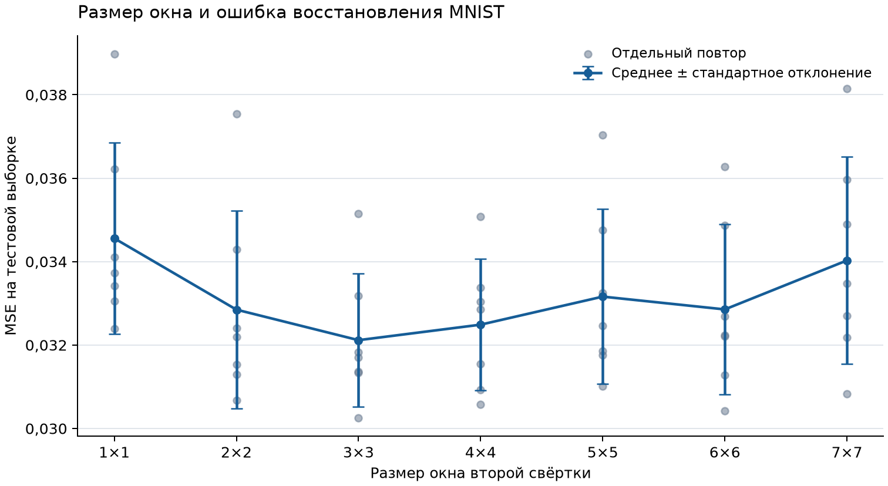

Самая низкая средняя ошибка у окна $3\times3$. Она на 1,1% ниже, чем у исходного окна $4\times4$, и на 7,1% ниже, чем у окна $1\times1$. В отдельных повторах $3\times3$ и $4\times4$ оказались лучшими по три раза, а $6\times6$ — один раз. Средние для $3\times3$ и $4\times4$ различаются примерно на $0.00037$, при стандартном отклонении около $0.0016$ у обоих размеров. Это результат для выбранной подвыборки MNIST и двух эпох обучения.

Эксперимент можно повторить из корня репозитория.

```bash
python lab4/source/window_experiment.py
```

В `lab4/results/window-sizes/` сохраняются метрики каждого прогона, сводка и график. При повторном запуске с тем же протоколом скрипт использует уже рассчитанные прогоны.

<a id="window-size-fixed-padding"></a>
### Эксперимент с размером окна при фиксированной рамке

Сравниваем окна $2\times2$, $3\times3$, $4\times4$, $5\times5$ и $6\times6$ во второй свёртке энкодера. Для всех окон $P=1$, шаг равен 2, число фильтров равно 32. При входе $14\times14$ сторона карты на выходе равна $\lfloor(14+2-K)/2\rfloor+1$. Поэтому меняется размер входа в линейный слой энкодера, а вместе с ним и число параметров энкодера.

Для каждого окна используются десять seed от 42 до 51, всего 50 результатов обучения. Во всех вариантах две эпохи на общей подвыборке из 8 192 обучающих цифр и батч 32. Оценка проходит на одних и тех же 10 000 тестовых цифрах с шумом $\sigma=0.5$ и seed шума 43. Для $3\times3$ и $4\times4$ семь результатов на окно взяли из предыдущего эксперимента с теми же $P=1$, размерами карт и настройками обучения. Остальные 36 моделей обучили с нуля в этом эксперименте. [Скрипт эксперимента](source/window_experiment.py)

| Окно | Размер выходной карты | Параметры энкодера | Средняя MSE ± стандартное отклонение | Средний PSNR, дБ |
| --- | --- | ---: | ---: | ---: |
| $2\times2$ | $8\times8$ | 133 488 | 0,03352 ± 0,00247 | 14,76 |
| **$3\times3$** | $7\times7$ | 105 328 | **0,03263 ± 0,00159** | **14,87** |
| $4\times4$ | $7\times7$ | 108 912 | 0,03294 ± 0,00160 | 14,83 |
| $5\times5$ | $6\times6$ | 86 896 | 0,03386 ± 0,00175 | 14,71 |
| $6\times6$ | $6\times6$ | 92 528 | 0,03450 ± 0,00191 | 14,63 |

При $P=1$ наименьшая средняя MSE у окна $3\times3$. Она на 0,94% ниже, чем у исходного $4\times4$. Оба размера дают карты $7\times7$ и оказались лучшими по пять раз из десяти. Разница средних около $0.00031$ при стандартном отклонении около $0.0016$ у каждого размера.

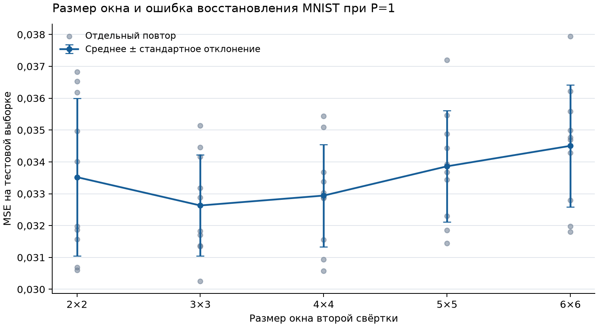

Эксперимент можно повторить из корня репозитория.

```bash
python lab4/source/window_experiment.py --fixed-padding
```

Скрипт сохраняет метрики и график в `lab4/results/window-sizes-p1/`. В пустом каталоге он выполняет все 50 обучений, при повторном запуске с тем же протоколом использует готовые прогоны.

<a id="stride-experiment"></a>
### Эксперимент с шагом второй свёртки

Сравниваем шаги $S=1,2,3,4$ во второй свёртке энкодера с окном $4\times4$, рамкой $P=1$ и 32 фильтрами. Первая свёртка использует шаг 2. На входе второй свёртки карты $14\times14$, поэтому сторона выходной карты равна $\lfloor(14+2-4)/S\rfloor+1$. При большем шаге окон меньше, поэтому сокращается и вход следующего линейного слоя. Длина латентного кода равна 32 для всех вариантов.

Для каждого шага используем десять seed от 42 до 51. Две эпохи обучения, батч 32 и подвыборка из 8 192 цифр общие для всех вариантов. При одном seed совпадают начальные веса свёрток, порядок батчей и шум на входе. Для $S=2$ взяли десять совпадающих прогонов с окном $4\times4$ из предыдущего исследования. Для остальных шагов выполнили 30 новых обучений. Все модели оценивались на одних и тех же 10 000 тестовых цифрах с шумом $\sigma=0.5$ и seed шума 43. [Скрипт эксперимента](source/window_experiment.py)

| Шаг $S$ | Выходная карта | Параметры энкодера | Средняя MSE ± стандартное отклонение | Средний PSNR, дБ |
| ---: | --- | ---: | ---: | ---: |
| **1** | $13\times13$ | 354 672 | **0,02888 ± 0,00098** | **15,40** |
| 2 | $7\times7$ | 108 912 | 0,03294 ± 0,00160 | 14,83 |
| 3 | $5\times5$ | 59 760 | 0,03764 ± 0,00315 | 14,26 |
| 4 | $4\times4$ | 41 328 | 0,04173 ± 0,00420 | 13,81 |

Шаг 1 дал наименьшую MSE во всех десяти повторах. В среднем ошибка на 12,3% ниже, чем у исходного шага 2. У всех вариантов по 8 224 параметра во второй свёртке. Разницу в числе параметров энкодера даёт следующий линейный слой, который при шаге 1 получает $13\cdot13\cdot32=5408$ значений, а при шаге 2 — 1 568.

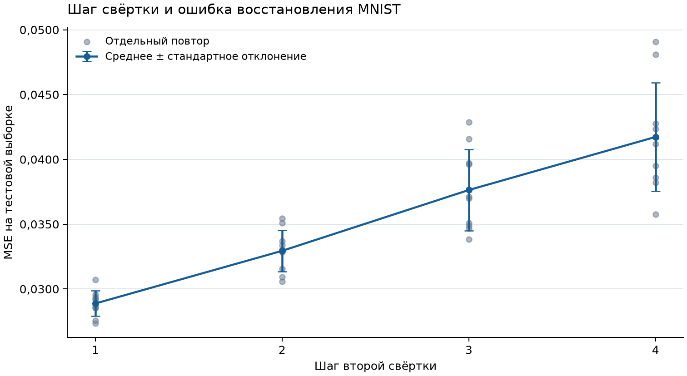

Эксперимент можно повторить из корня репозитория.

```bash
python lab4/source/window_experiment.py --vary-stride
```

В `lab4/results/stride-sizes/` сохраняются метрики отдельных прогонов, сводка и график. В пустом каталоге выполняются все 40 обучений.

<a id="stride-timing"></a>
#### Как шаг влияет на время работы

Время измеряем на Intel Core i5-10300H с NumPy и одним потоком OpenBLAS. Для каждого шага воспроизводим обучение с seed 42 на той же подвыборке из 8 192 цифр. Две эпохи по 256 батчей дают 512 обновлений весов. Перед замерами прогреваем каждый вариант на четырёх батчах, затем начинаем обучение с исходными весами.

- **Обучение.** Замеряем вызовы `train_step` после подготовки батчей из 32 цифр. Внутри вызова создаётся шум, выполняются прямой и обратный проходы и обновляются веса. Делим 512 обновлений на десять серий по 51–52 батча. Для каждой серии считаем среднее время батча, а для графика берём среднее и стандартное отклонение по десяти сериям. Суммарное время — сумма длительностей всех обновлений.
- **Восстановление.** После обучения измеряем `reconstruct` на одних и тех же 128 зашумлённых тестовых цифрах. В одной серии подаём цифры по одной, в другой группируем их в батчи по 32. Для каждого режима выполняем десять серий после прогрева и делим длительность серии на 128, чтобы получить время на одну цифру.

В каждой серии меняем порядок шагов генератором с фиксированным seed. [Скрипт замеров](source/stride_timing.py)

| Шаг | По одной, мс на цифру | Батч из 32, мс на цифру | Обновление, мс на батч | 512 обновлений, с |
| ---: | ---: | ---: | ---: | ---: |
| 1 | 0,580 ± 0,039 | 0,213 ± 0,018 | 59,80 ± 1,07 | 30,62 |
| 2 | 0,509 ± 0,026 | 0,153 ± 0,031 | 47,99 ± 2,83 | 24,57 |
| 3 | 0,508 ± 0,022 | 0,122 ± 0,019 | 45,71 ± 1,07 | 23,40 |
| 4 | 0,504 ± 0,054 | 0,118 ± 0,021 | 43,93 ± 1,21 | 22,49 |

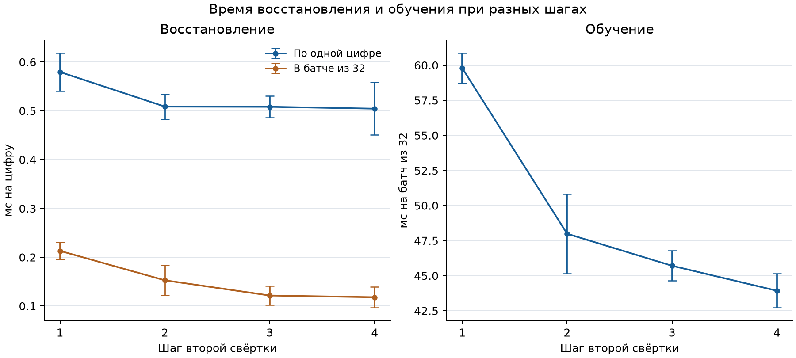

По сравнению с шагом 2 шаг 1 увеличил среднее время восстановления одной цифры на 14,0%, время на цифру в батче на 39,5% и время обновления весов на 24,6%. При этом в исследовании качества шаг 1 снизил среднюю MSE на 12,3%. Он даёт 169 позиций на каждой карте второй свёртки вместо 49 при шаге 2, поэтому растут объём вычислений и размер следующего линейного слоя. При обработке по одной цифре средние для шагов 2–4 близки относительно разброса замеров. Абсолютное время зависит от процессора, числа потоков и размера батча.

Замер можно повторить из корня репозитория после эксперимента с шагами.

```bash
python lab4/source/stride_timing.py
```

Длительности отдельных серий, сводка и график сохраняются в `lab4/results/stride-timing/`.

<a id="latent-size-experiment"></a>
### Эксперимент с числом выходов энкодера

Сравниваем 16, 32, 64, 128 и 256 выходов энкодера. Если код содержит $L$ чисел, энкодер выдаёт $2L$ параметров распределения, а декодер принимает $L$ чисел. Поэтому меняются размеры двух линейных слоёв, `1568 → 2L` в конце энкодера и `L → 1568` в начале декодера. Свёртки по-прежнему используют окно $4\times4$, шаг 2 и рамку $P=1$. Вес KL равен 0,001, вес состязательной потери равен 0,02. При той же формуле KL суммирование идёт по числу координат выбранного кода.

Для каждого количества выходов берём десять seed обучения от 42 до 51. Во всех вариантах две эпохи на общей подвыборке из 8 192 обучающих цифр MNIST и батч 32. При одном seed совпадают начальные веса свёрток и дискриминатора, порядок батчей и шум, добавляемый к изображению. Для 64 выходов подходят десять предыдущих прогонов с окном $4\times4$ и $P=1$. Для остальных четырёх вариантов выполнили 40 новых обучений. Для всех 50 результатов оценка проводится на одних и тех же 10 000 тестовых цифрах с шумом $\sigma=0.5$ и seed шума 43. [Скрипт эксперимента](source/latent_experiment.py)

| Выходы энкодера | Чисел в коде | Параметры энкодера и декодера | Средняя MSE ± стандартное отклонение | Средний PSNR, дБ |
| ---: | ---: | ---: | ---: | ---: |
| 16 | 8 | 56 177 | 0,042598 ± 0,002533 | 13,71 |
| 32 | 16 | 93 825 | 0,035099 ± 0,002058 | 14,55 |
| 64 | 32 | 169 121 | 0,032941 ± 0,001603 | 14,83 |
| **128** | **64** | 319 713 | **0,032914 ± 0,002343** | **14,84** |
| 256 | 128 | 620 897 | 0,034893 ± 0,002171 | 14,58 |

Наименьшая средняя MSE получилась при 128 выходах. Она на 0,084% ниже, чем при 64 выходах. Разница между средними составляет около $0.000028$, а каждый из этих двух вариантов показал наименьшую ошибку на пяти seed из десяти. При 64 выходах энкодер и декодер вместе содержат 169 121 параметр, почти вдвое меньше, чем при 128 выходах. Результат относится к выбранной подвыборке и двум эпохам обучения.

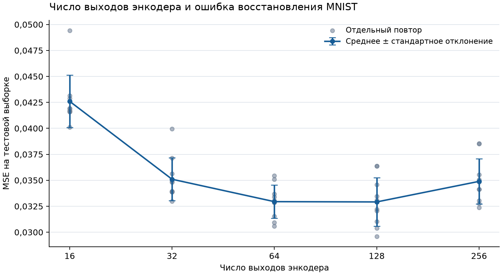

Эксперимент можно повторить из корня репозитория.

```bash
python lab4/source/latent_experiment.py
```

Скрипт сохраняет отдельные прогоны, сводные метрики и график в `lab4/results/latent-sizes/`. В пустом каталоге выполняются все 50 обучений.

<a id="architecture-error-maps"></a>
### Карты ошибок в остальных исследованиях архитектуры

Для карт ошибок используем первые десять тестовых цифр и seed обучения 42. В каждом столбце сверху оригинал, ниже абсолютная разница яркостей $|\widehat{x}_{ij}-x_{ij}|$ для каждого варианта. У цветов общая шкала от 0 до 1. Число под картой — MSE по 784 пикселям, округлённая до четырёх знаков. Рамка выделяет наименьшую MSE в столбце по значениям до округления.

Для таблиц берём все 10 000 тестовых цифр. Для каждой цифры и варианта усредняем MSE по тем же seed, что и в основном сравнении. В исследовании семи размеров окна это семь повторов, в трёх остальных исследованиях — десять. Затем считаем, на скольких цифрах каждый вариант дал наименьшую среднюю MSE. Эта величина показывает частоту выигрышей по отдельным цифрам, а средняя MSE по выборке учитывает ещё и размер каждой ошибки.

В исходных сериях сохранились средние метрики. Для попиксельных карт скрипт воспроизводит 155 уникальных прогонов и сверяет их MSE с исходными значениями. Результат общего прогона используется во всех исследованиях, где совпадают архитектура, seed и настройки обучения. [Скрипт воспроизведения и сравнения](source/error_maps_experiment.py)

#### Семь размеров окна

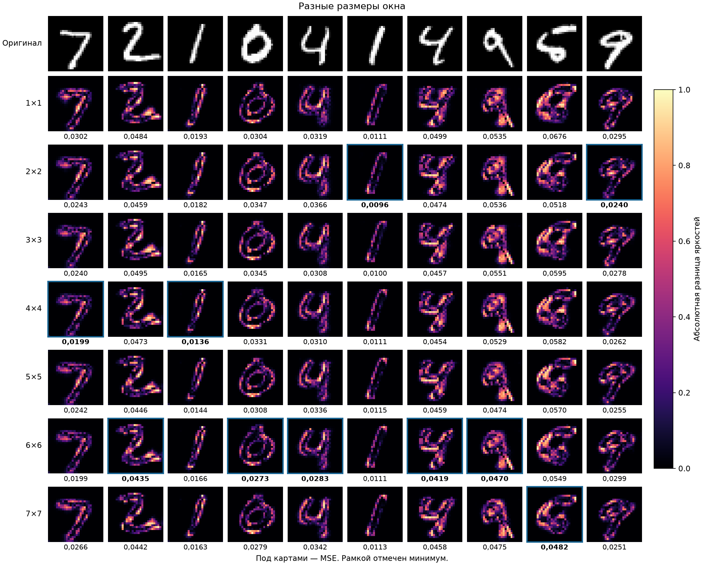

| Окно | Цифры с наименьшей MSE | Доля |
| --- | ---: | ---: |
| $1\times1$ | 480 | 4,80% |
| $2\times2$ | 1 540 | 15,40% |
| **$3\times3$** | **3 617** | **36,17%** |
| $4\times4$ | 1 805 | 18,05% |
| $5\times5$ | 689 | 6,89% |
| $6\times6$ | 1 633 | 16,33% |
| $7\times7$ | 236 | 2,36% |

#### Пять размеров окна при P=1

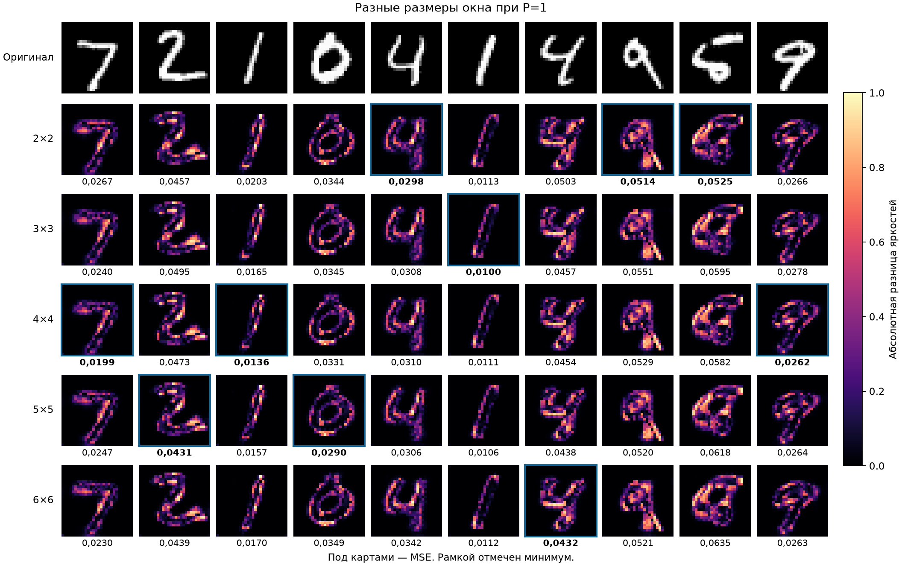

| Окно | Цифры с наименьшей MSE | Доля |
| --- | ---: | ---: |
| $2\times2$ | 1 287 | 12,87% |
| **$3\times3$** | **4 923** | **49,23%** |
| $4\times4$ | 2 675 | 26,75% |
| $5\times5$ | 782 | 7,82% |
| $6\times6$ | 333 | 3,33% |

#### Шаг второй свёртки

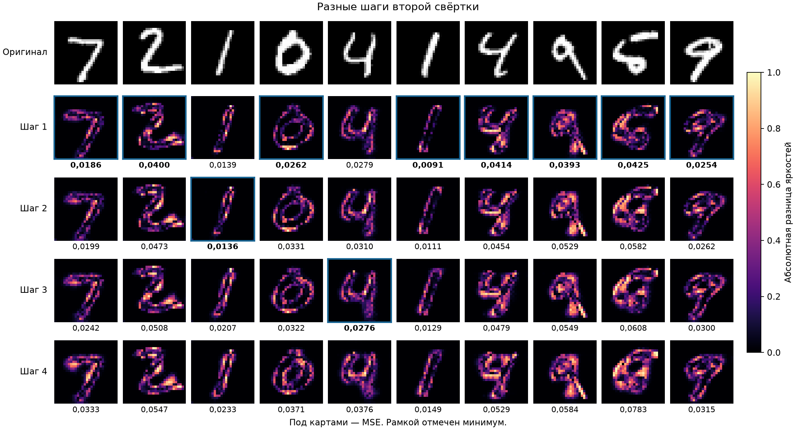

| Шаг | Цифры с наименьшей MSE | Доля |
| ---: | ---: | ---: |
| **1** | **9 836** | **98,36%** |
| 2 | 133 | 1,33% |
| 3 | 20 | 0,20% |
| 4 | 11 | 0,11% |

#### Число выходов энкодера

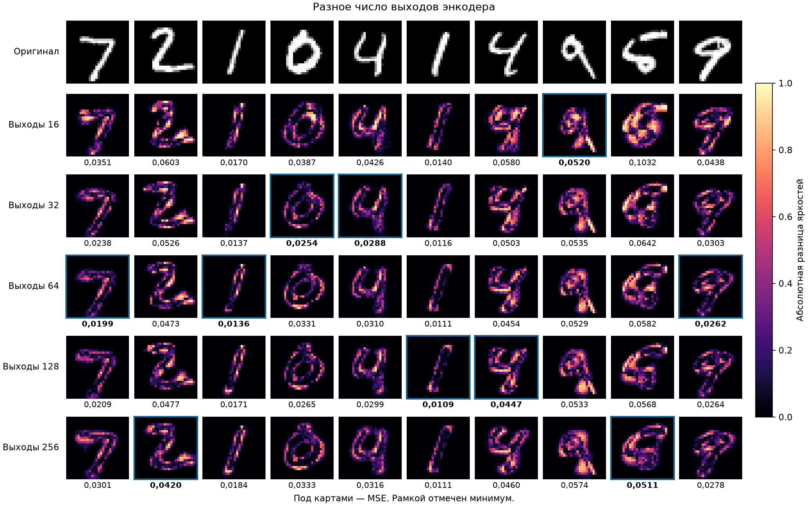

| Выходы энкодера | Цифры с наименьшей MSE | Доля |
| ---: | ---: | ---: |
| 16 | 117 | 1,17% |
| 32 | 1 797 | 17,97% |
| 64 | 3 309 | 33,09% |
| **128** | **3 695** | **36,95%** |
| 256 | 1 082 | 10,82% |

После основных исследований карты и подсчёт можно воспроизвести из корня репозитория.

```bash
python lab4/source/error_maps_experiment.py
```

Для каждого исследования в `lab4/results/error-maps/` сохраняются `error-maps.png`, сводка `comparison.json` и `per-image-mse.csv` с ошибками всех 10 000 цифр после усреднения по seed.

<a id="questions"></a>
## 10. Вопросы для защиты

**Чем отличаются фильтр и канал?** Фильтр хранит веса и задаёт вычисление для одного окна. Канал содержит значения во всех пространственных позициях. При обычной свёртке каждый фильтр создаёт один выходной канал, используя все входные каналы.

**Почему у второй свёртки энкодера 8 224 параметра?** У каждого из 32 фильтров есть $4\cdot4\cdot16=256$ весов и одно смещение. Итого $32\cdot257=8224$. Каждый фильтр использует этот набор параметров во всех позициях.

**Зачем у выходов генератора меняется цель с $0$ на $1$?** При обновлении дискриминатора цель $0$ указывает синтетический источник. При обновлении генератора цель $1$ задаёт желаемую оценку этих изображений обученным дискриминатором.

**Почему у энкодера 64 выхода при латентной размерности 32?** Первые 32 задают средние $\mu$, остальные 32 - логарифмы дисперсий $\ell$. Код $z$ строится по одной координате из каждой пары.

**Зачем генератору и восстановленные изображения, и независимые коды?** В первой ветке он учится восстанавливать конкретный зашумлённый вход. Во второй ветке он учится выдавать правдоподобную цифру из кода, взятого из $\mathcal N(0,I)$. Обе ветки изменяют одни и те же веса.

**Почему можно передать градиент через дискриминатор с фиксированными весами?** Производная по входу определяется текущим преобразованием дискриминатора. Код вычисляет эту производную и передаёт её генератору. Обновление параметров выполняется отдельно оптимизатором.

**Зачем при оценке брать $\mu$?** Для одного входа энкодер возвращает одинаковое среднее. Декодирование этого вектора позволяет измерить восстановление при фиксированном зашумлении и показать воспроизводимые примеры.

**Что означает меньший MSE в таблице сравнения?** При заданных весах и шуме яркости результата в среднем ближе к яркостям чистых оригиналов по квадрату ошибки. Поскольку входы совпадают попиксельно, разница связана с восстановлением одних и тех же искажений.
