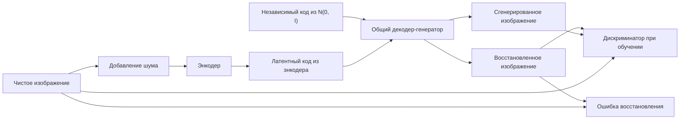

# Лабораторная работа № 4. Математика и реализация GAN+VAE

Модель восстанавливает рукописную цифру по зашумлённому изображению MNIST. Энкодер оценивает распределение латентного кода, декодер преобразует код в изображение, а дискриминатор даёт дополнительный сигнал о правдоподобии результата. Декодер VAE одновременно служит генератором GAN. Прямой проход, обратное распространение и Adam реализованы на NumPy.

[Основной отчёт](README.md) · [Установка и запуск](RUNNING.md)

## Содержание

1. [Задача и подготовка данных](#data)
2. [Три компонента и размеры тензоров](#architecture)
3. [Свёртка и транспонированная свёртка](#convolution)
4. [VAE, репараметризация и KL-дивергенция](#vae)
5. [Бинарная кросс-энтропия](#bce)
6. [GAN и две фазы обучения](#gan)
7. [Обратное распространение на NumPy](#backpropagation)
8. [Оптимизация и журнал обучения](#adam)
9. [Метрики и сравнение моделей](#evaluation)
10. [Вопросы для защиты](#questions)

## 1. Задача и подготовка данных

Одно изображение MNIST содержит $28 \times 28 = 784$ полутоновых пикселя. Загрузчик читает стандартные выборки из 60 000 обучающих и 10 000 тестовых изображений. Исходную яркость $I$ из диапазона $[0,255]$ переводят в $x=I/255$. К чистому изображению добавляют независимый гауссовский шум по пикселям, затем ограничивают яркость допустимым диапазоном. [Загрузка MNIST](source/data.py) · [Нормализация и зашумление](source/main.py)

$$
\xi_{ij}\sim\mathcal N(0,1), \qquad
\widetilde x_{ij}=\operatorname{clip}\bigl(x_{ij}+0.5\,\xi_{ij},\,0,\,1\bigr).
$$

При $x_{ij}=0.6$ и $\xi_{ij}=-1$ на вход подаётся $0.1$. При $x_{ij}=0.1$ и том же шуме промежуточная яркость равна $-0.4$, поэтому после ограничения пиксель получает значение $0$. Из-за ограничения часть пикселей на входе принимает ровно $0$ или $1$.

Пара для обучения состоит из зашумлённого входа $\widetilde x$ и чистой цели $x$. Чистое изображение уже есть в MNIST, а искажение строит скрипт, поэтому пары можно получать заново в каждом батче. Для дискриминатора метки формируются из происхождения изображения. Чистый оригинал получает метку $1$, выход генератора получает метку $0$. Для обучения используются яркости пикселей и эти двоичные метки.

## 2. Три компонента и размеры тензоров

Энкодер $E_\phi$ выдаёт два вектора по 32 числа — среднее $\mu$ и логарифм дисперсии $\ell$. Из них получают латентный код $z$. Декодер-генератор $G_\theta$ выдаёт 784 логита яркости, к которым применяется сигмоида. Дискриминатор $D_\psi$ выдаёт один логит на изображение. Его сигмоида задаёт оценку вероятности класса «чистый оригинал». [Архитектуры моделей](source/models.py)

NumPy использует порядок осей `(N, H, W, C)`, где $N$ — число объектов в текущем проходе, $H$ и $W$ — высота и ширина, $C$ — каналы. Следующая таблица показывает формы одного объекта без оси батча. В число параметров включены смещения.

| Компонент | Операция | Форма выхода | Параметры |
| --- | --- | --- | ---: |
| Энкодер | Свёртка 1 → 16 и ReLU | `(14, 14, 16)` | 272 |
| Энкодер | Свёртка 16 → 32 и ReLU | `(7, 7, 32)` | 8 224 |
| Энкодер | Развёртка и линейный слой 1 568 → 64 | `(64,)` | 100 416 |
| Декодер-генератор | Линейный слой 32 → 1 568, ReLU и изменение формы | `(7, 7, 32)` | 51 744 |
| Декодер-генератор | Транспонированная свёртка 32 → 16 и ReLU | `(14, 14, 16)` | 8 208 |
| Декодер-генератор | Транспонированная свёртка 16 → 1 | `(28, 28, 1)` | 257 |
| Дискриминатор | Свёртка 1 → 16 и Leaky ReLU | `(14, 14, 16)` | 272 |
| Дискриминатор | Свёртка 16 → 32 и Leaky ReLU | `(7, 7, 32)` | 8 224 |
| Дискриминатор | Развёртка и линейный слой 1 568 → 1 | `(1,)` | 1 569 |

Всего **179 186 обучаемых параметров**. Из них 108 912 принадлежат энкодеру, 60 209 — декодеру-генератору и 10 065 — дискриминатору. Например, у второй свёртки энкодера $32$ фильтра по $4\cdot4\cdot16$ весов и по одному смещению. ReLU действует поэлементно как $\max(0,x)$. Leaky ReLU в дискриминаторе имеет наклон $0.2$ на отрицательной полуоси, поэтому градиент доступен и для отрицательных активаций.

В одном шаге обучения размер исходного батча равен $B$. Энкодер обрабатывает $B$ зашумлённых входов. Декодер-генератор получает сразу $2B$ кодов, из которых первые $B$ восстанавливают входные цифры, а остальные $B$ взяты из стандартного нормального распределения. В первой фазе дискриминатор видит $3B$ изображений, во второй — $2B$ выходов генератора.

## 3. Свёртка и транспонированная свёртка

### Обычная свёртка

Фильтр покрывает окно входного изображения. Для одной позиции он вычисляет взвешенную сумму окна по всем входным каналам и добавляет смещение. Благодаря общим весам один фильтр может реагировать на похожий штрих в разных частях изображения.

Для выходного канала $o$ и координат $(i,j)$ слой в коде вычисляет

$$
Y_{ijo}=b_o+
\sum_{u=0}^{K-1}\sum_{v=0}^{K-1}\sum_{c=0}^{C_{\mathrm{in}}-1}
W_{uvco}\,X_{iS+u-P,\,jS+v-P,\,c}.
$$

Индексы за границами $X$ соответствуют нулям. Операцию с таким порядком индексов также называют кросс-корреляцией. В нейронных сетях этот слой принято называть свёрткой. Для длины $H$ размер выхода равен $\left\lfloor(H+2P-K)/S\right\rfloor+1$. В проекте $K=4$, шаг $S=2$, дополнение $P=1$, поэтому размеры по каждой пространственной оси меняются как $28\to14\to7$.

Пусть окно равно `[[1, 0], [2, 1]]`, ядро равно `[[1, -1], [0, 1]]`, а смещение равно нулю. Для этой позиции выход равен $1\cdot1+0\cdot(-1)+2\cdot0+1\cdot1=2$.

В `image_columns` вход дополняется нулями. `sliding_window_view` даёт окна, а срезы с шагом 2 выбирают нужные позиции. Все окна разворачиваются в матрицу $C$ формы $(N H_{\mathrm{out}} W_{\mathrm{out}},\,K^2 C_{\mathrm{in}})$. Весам соответствует матрица $W$ формы $(K^2 C_{\mathrm{in}},\,C_{\mathrm{out}})$. Тогда весь прямой проход сводится к `C @ W + b` и восстановлению пространственной формы. Например, во второй свёртке энкодера за один раз умножаются матрицы $(49N,256)$ и $(256,32)$. [image_columns и Conv2D](source/layers.py)

### Транспонированная свёртка

Обычная свёртка собирает значения из окна в одну позицию выхода. Транспонированный оператор распределяет вклад одной позиции по соответствующему окну и суммирует вклады в местах пересечения. Для линейной свёртки с фиксированными весами эту связь можно записать как $\langle Ax,y\rangle=\langle x,A^\top y\rangle$. Декодер обучает свои веса для такого оператора.

При выбранных параметрах размер выхода равен $(H-1)S-2P+K=2H$. Поэтому декодер последовательно увеличивает карты $7\to14\to28$. В коде каждый входной вектор каналов умножается на матрицу весов и выдаёт $K^2 C_{\mathrm{out}}$ чисел. `columns_image` раскладывает эти числа по окнам, суммирует перекрытия и удаляет внешнее дополнение. Смещение прибавляется после сборки. [columns_image и ConvTranspose2D](source/layers.py)

В одномерном примере вход `[2, 1]`, ядро `[1, 2, 3, 4]`, шаг 2, дополнение 1 и смещение 0. Первый вход даёт вклад `[2, 4, 6, 8]` с позиции 0, второй — `[1, 2, 3, 4]` с позиции 2. После сложения получается `[2, 4, 7, 10, 3, 4]`. Удаление крайних позиций даёт `[4, 7, 10, 3]`.

## 4. VAE, репараметризация и KL-дивергенция

### Латентный код и априорное распределение

Латентный код — компактное внутреннее представление изображения. Например, направление в латентном пространстве может соответствовать изменению наклона или толщины штриха. Смысл координат формируется во время обучения и задаётся совместной работой энкодера и декодера.

У VAE энкодер задаёт приближённое распределение $q_\phi(z\mid\widetilde x)$ с диагональной ковариацией. В каждой координате $\ell_j=\log(\sigma_{z,j}^2)$, так что $\sigma_{z,j}^2=e^{\ell_j}>0$. Сеть может предсказывать произвольный логарифм дисперсии, а экспонента преобразует его в положительную дисперсию.

$$
q_\phi(z\mid\widetilde x)=\mathcal N\!\left(
  \mu,\,\operatorname{diag}(e^\ell)
\right),
\qquad
p(z)=\mathcal N(0,I).
$$

Стандартное нормальное $p(z)$ служит общим априорным распределением. Из него берутся коды для генерации новых изображений. KL-дивергенция при обучении поощряет согласованность этого распределения с кодами, полученными от энкодера. [Kingma и Welling, Auto-Encoding Variational Bayes](https://arxiv.org/abs/1312.6114)

### Зачем нужна репараметризация

Случайную часть выносят в независимый вектор $\varepsilon$. Умножение его на стандартное отклонение и прибавление среднего дают нужное распределение кода.

$$
\varepsilon\sim\mathcal N(0,I),\qquad
z=\mu+e^{\ell/2}\odot\varepsilon.
$$

Во время обратного прохода сэмпл $\varepsilon$ фиксирован. Тогда изменение $\mu$ или $\ell$ меняет $z$ через дифференцируемые операции. Например, для $\mu=0.5$, дисперсии $0.25$ и $\varepsilon=-0.4$ стандартное отклонение равно $0.5$, а латентное значение равно $0.5+0.5(-0.4)=0.3$.

### Откуда берутся восстановление и KL

В вероятностной модели декодер задаёт $p_\theta(x\mid z)$. Вероятность чистого изображения получается после интегрирования по всем $z$. Для любого приближённого распределения $q=q_\phi(z\mid\widetilde x)$ выполняется разложение

$$
\log p_\theta(x)
=
\underbrace{\mathbb E_q[\log p_\theta(x\mid z)]
-\operatorname{KL}\bigl(q\,\Vert\,p(z)\bigr)}_{\mathrm{ELBO}}
+
\operatorname{KL}\bigl(q\,\Vert\,p_\theta(z\mid x)\bigr).
$$

Последний член неотрицателен, поэтому ELBO — нижняя граница логарифма правдоподобия. Первый член внутри ELBO поощряет декодирование в чистое изображение, второй задаёт регуляризацию латентного распределения. В лабораторной этот принцип реализован как попиксельно усреднённая BCE, отдельный вес KL и дополнительная состязательная потеря. [Вывод ELBO и репараметризация](https://arxiv.org/abs/1312.6114)

Для одной координаты логарифм отношения плотностей имеет вид

$$
\log\frac{q(z_j)}{p(z_j)}
=\frac12\left(-\ell_j-\frac{(z_j-\mu_j)^2}{e^{\ell_j}}+z_j^2\right).
$$

Под $q$ ожидаемое значение средней дроби равно $1$, а $\mathbb E_q[z_j^2]=\mu_j^2+e^{\ell_j}$. Независимость координат превращает логарифм произведения в сумму, поэтому для изображения

$$
\operatorname{KL}(q\,\Vert\,p)
=\frac12\sum_{j=1}^{32}
\left(\mu_j^2+e^{\ell_j}-1-\ell_j\right).
$$

Код суммирует по 32 координатам и усредняет по $B$ изображениям. При $\mu=0$ и $\ell=0$ вклад координаты равен нулю. В примере с $\mu=0.5$ и дисперсией $0.25$ он равен $\frac12(0.25+0.25-1-\log 0.25)\approx0.4431$. Градиент по $\mu_j$ равен $\mu_j$, а по $\ell_j$ — $(e^{\ell_j}-1)/2$ до батчевого усреднения и умножения на вес KL. [Расчёт KL в train_step](source/main.py)

## 5. Бинарная кросс-энтропия

Логит $s$ может принимать любое вещественное значение. Сигмоида переводит его в $p=\sigma(s)=1/(1+e^{-s})$. Для цели $y$ бинарная кросс-энтропия равна

$$
\operatorname{BCE}(s,y)
=-y\log p-(1-y)\log(1-p)
=\log(1+e^s)-ys.
$$

В коде последнее выражение вычисляется через `np.logaddexp(0, s) - y * s`. Эта форма устойчива для логитов с большой абсолютной величиной. Производная особенно проста.

$$
\frac{\partial \operatorname{BCE}(s,y)}{\partial s}
=\sigma(s)-y.
$$

При восстановлении $y$ — яркость чистого пикселя в $[0,1]$, то есть мягкая цель. При обучении дискриминатора $y\in\{0,1\}$. В обоих случаях функция имеет один вид, меняются смысл цели и способ усреднения. [binary_cross_entropy и train_step](source/main.py)

Например, для логита $s=1$ и целевой яркости $y=0.8$ получаем $p\approx0.7311$, потерю $\log(1+e)-0.8\approx0.5133$ и градиент $-0.0689$. При градиентном спуске такой сигнал увеличивает логит и приближает яркость к цели. В батче восстановление усредняется по $784B$ пикселям, поэтому попиксельный градиент делится на $784B$.

Пиксельная потеря привязывает выход к конкретной цифре на входе. Если разные чистые штрихи могли дать похожий зашумлённый фрагмент, усреднение возможных яркостей может давать размытие. Состязательная потеря добавляет сигнал о правдоподобии целого изображения. В статье Larsen и соавторов VAE/GAN использует признаки дискриминатора для самой ошибки восстановления. В этой реализации ошибка восстановления вычисляется по пикселям, а дискриминатор участвует через отдельную состязательную потерю. [Larsen и соавторы, Autoencoding beyond pixels](https://arxiv.org/abs/1512.09300)

## 6. GAN и две фазы обучения

Обозначим $r_i=\sigma(G_\theta(z_i))$ восстановление, а $g_i=\sigma(G_\theta(u_i))$ изображение из независимого кода $u_i\sim\mathcal N(0,I)$. Генератор использует одни и те же веса для обеих групп. Дискриминатор выдаёт логит $d(t)=D_\psi(t)$ для любого изображения $t$. Принцип GAN состоит в том, что дискриминатор учится различать источники изображений, а генератор учится повышать оценку своих выходов у дискриминатора. [Goodfellow и соавторы, Generative Adversarial Networks](https://arxiv.org/abs/1406.2661)

### Фаза дискриминатора

Для чистых изображений используется целевая метка $1$, для восстановленных и сгенерированных — $0$. В формуле $\mathcal F=(r_1,\ldots,r_B,g_1,\ldots,g_B)$ содержит все $2B$ синтетических выходов.

$$
L_D=
\frac12\left[
  \frac1B\sum_{i=1}^B \operatorname{BCE}(d(x_i),1)
  +\frac1{2B}\sum_{t\in\mathcal F}\operatorname{BCE}(d(t),0)
\right].
$$

Чистые изображения дают половину веса потери. Восстановленные и сгенерированные дают по четверти. Градиент по логиту реального изображения равен $(\sigma(d)-1)/(2B)$, а по логиту синтетического — $\sigma(d)/(4B)$. Обратный проход вычисляет градиенты весов дискриминатора, затем отдельный Adam обновляет только $\psi$.

В идеализированном случае для фиксированного генератора и достаточно гибкого дискриминатора оптимальная вероятность класса «чистый» в точке $t$ равна $p_{\mathrm{data}}(t)/(p_{\mathrm{data}}(t)+p_{\mathrm{fake}}(t))$, где $p_{\mathrm{fake}}$ — смесь распределений восстановлений и новых генераций. Это получается из максимизации $p_{\mathrm{data}}\log p+p_{\mathrm{fake}}\log(1-p)$ по $p$ для каждой точки. Оценка дискриминатора поэтому отражает, насколько характерен образ для реальных данных среди двух источников.

### Фаза энкодера и декодера-генератора

Те же синтетические изображения пропускаются через уже обновлённый дискриминатор. Целевая метка для потери генератора теперь $1$. Так оптимизация увеличивает оценку «чистого» для обеих групп выходов.

$$
L_{\mathrm{adv}}
=\frac1{2B}\sum_{t\in\mathcal F}\operatorname{BCE}(d(t),1),
\qquad
L_{E,G}=L_{\mathrm{rec}}+0.001\,L_{\mathrm{KL}}+0.02\,L_{\mathrm{adv}}.
$$

Это несатурирующая состязательная потеря. По логиту дискриминатора её производная пропорциональна $\sigma(d)-1$, поэтому сигнал по логиту велик, когда дискриминатор уверенно отвергает синтетический результат. Веса $\psi$ на этой фазе зафиксированы. Их текущие значения участвуют в вычислении градиента по пикселям, который затем проходит в генератор. Для ветки восстановления он поступает и в энкодер. У изображений из независимого кода нет привязанного чистого оригинала, поэтому их вклад в обновление генератора идёт через $L_{\mathrm{adv}}$. [Порядок операций в train_step](source/main.py)

## 7. Обратное распространение на NumPy

Обратный проход последовательно применяет цепное правило. Каждый слой получает градиент скалярной функции потерь по своему выходу, вычисляет градиенты своих параметров и отдаёт предыдущему слою градиент по входу. При `forward(..., retain=True)` слои сохраняют промежуточные значения. `Network.backward` обходит их в обратном порядке. [Слои](source/layers.py) · [Network](source/models.py)

### Линейные слои и свёртки

Пусть $Y=XW+b$, а $\Delta Y=\partial L/\partial Y$. Для линейного слоя цепное правило даёт

$$
\Delta W=X^\top\Delta Y,\qquad
\Delta b=\sum_{\text{строки}}\Delta Y,\qquad
\Delta X=\Delta Y\,W^\top.
$$

Для обычной свёртки вместо $X$ подставляется матрица окон $C$. Градиент $\Delta C=\Delta Y W^\top$ показывает вклад каждой позиции каждого окна. `columns_image` суммирует вклады, относящиеся к одному входному пикселю. Это важно, поскольку соседние окна перекрываются и одна яркость может влиять на несколько выходов.

Для транспонированной свёртки прямой проход сначала вычисляет $C=X_{\mathrm{flat}}W$, затем собирает пространственный выход. В обратном проходе сборка заменяется извлечением окон $\Delta C=\operatorname{image\_columns}(\Delta Y)$. После этого $\Delta W=X_{\mathrm{flat}}^\top\Delta C$ и $\Delta X_{\mathrm{flat}}=\Delta C W^\top$. Градиент смещения собирается по батчу и пространственным координатам, поскольку одно смещение используется во всех пикселях выходного канала.

ReLU пропускает градиент на положительной полуоси и обнуляет его на отрицательной. Для Leaky ReLU отрицательная ветвь умножает градиент на $0.2$. В нуле код использует наклон неположительной ветви. Изменение формы тензора в обратном проходе возвращает исходную форму градиента.

### От выхода дискриминатора до латентного кода

1. На фазе $E,G$ у синтетического изображения $t$ градиент по логиту дискриминатора равен $0.02\,(\sigma(d(t))-1)/(2B)$. Вызов `backward(parameter_grad=False, input_grad=True)` возвращает градиент по синтетическим пикселям.
2. Яркость $t$ получена сигмоидой от логитов генератора, поэтому градиент по этим логитам умножается на $t(1-t)$. К первым $B$ изображениям прибавляется градиент восстановления $(r_i-x_i)/(784B)$.
3. Обратный проход генератора вычисляет градиенты общих весов по всем $2B$ изображениям. Первые $B$ возвращённых градиентов по кодам относятся к энкодеру.

Пусть $g_z$ — градиент по коду восстановления на последнем шаге. Поскольку $z=\mu+e^{\ell/2}\odot\varepsilon$, имеем $\partial z/\partial\mu=1$ по каждой координате и $\partial z/\partial\ell=\frac12 e^{\ell/2}\odot\varepsilon$. К этому сигналу прибавляются производные KL. При $\beta=0.001$ получаем

$$
\begin{aligned}
g_\mu
&= g_z+\frac{\beta}{B}\mu,\\
g_\ell
&=\frac12 g_z\odot e^{\ell/2}\odot\varepsilon
  +\frac{\beta}{2B}(e^\ell-1).
\end{aligned}
$$

Именно эти величины код называет `mean_gradient` и `log_variance_gradient`. Их объединяют в матрицу $(B,64)$, которая подаётся на обратный проход последнего слоя энкодера. [train_step в main.py](source/main.py)

## 8. Оптимизация и журнал обучения

Веса и смещения инициализируются равномерно в диапазоне $\left[-1/\sqrt{\mathrm{fan\_in}},1/\sqrt{\mathrm{fan\_in}}\right]$. Для линейного слоя `fan_in` равен размеру входа, для обычной свёртки — $K^2 C_{\mathrm{in}}$, для транспонированной в этой реализации — $K^2 C_{\mathrm{out}}$. Батчи формируются после нового перемешивания всех 60 000 обучающих изображений в каждой эпохе. При размере батча 256 получается 235 обновлений каждой группы параметров за эпоху. [Инициализация](source/layers.py) · [Цикл обучения](source/main.py)

Для каждого параметра Adam хранит скользящее среднее градиента $m_t$ и его квадрата $v_t$. Пусть $g_t$ — градиент параметра на шаге $t$, а $\eta$ — скорость обучения. Все операции ниже выполняются поэлементно.

$$
\begin{aligned}
m_t &= 0.9m_{t-1}+0.1g_t,&
v_t &= 0.999v_{t-1}+0.001g_t^2,\\
\widehat m_t &= \frac{m_t}{1-0.9^t},&
\widehat v_t &= \frac{v_t}{1-0.999^t},\\
w_t &= w_{t-1}-\eta\frac{\widehat m_t}{\sqrt{\widehat v_t}+10^{-8}}.
\end{aligned}
$$

Коррекция смещения учитывает, что обе оценки начинаются с нулей. При первом градиенте $g_1=0.4$ получаем $m_1=0.04$ и $v_1=0.00016$, после коррекции — $0.4$ и $0.16$. При $\eta=0.001$ параметр уменьшается примерно на $0.001$. Энкодер и декодер-генератор используют общий шаг Adam со скоростью $0.001$. Дискриминатор имеет собственные моменты и скорость $0.0002$. [Реализация Adam](source/models.py) · [Kingma и Ba, Adam](https://arxiv.org/abs/1412.6980)

В `history.csv` записываются значения отдельных членов потери до применения их коэффициентов. Среднее за эпоху взвешивается по размеру батча. Для базового NumPy-прогона журнал выглядит так. [Исходный журнал](baselines/numpy/history.csv)

| Эпоха | BCE восстановления | KL | Состязательная BCE | Потеря дискриминатора |
| ---: | ---: | ---: | ---: | ---: |
| 1 | 0,2968 | 11,6229 | 1,6325 | 0,3408 |
| 2 | 0,1867 | 27,7034 | 2,4871 | 0,2140 |
| 3 | 0,1477 | 38,9850 | 1,4575 | 0,4263 |

Например, в третьей эпохе средний вклад KL в цель $E,G$ составляет $0.001\cdot38.9850\approx0.0390$, а вклад состязательной BCE — $0.02\cdot1.4575\approx0.0291$. BCE за три эпохи уменьшилась, а среднее отклонение приближённого распределения от априорного по KL выросло. Состязательные потери меняются вместе с обоими участниками игры. Качество восстановления оценивается отдельно на тестовых изображениях.

## 9. Метрики и сравнение моделей

### Как восстанавливается тестовое изображение

На вход энкодера поступает зашумлённая цифра. Кодом для декодера служит $\mu$, то есть среднее латентного распределения. Для фиксированного входа это даёт воспроизводимый выход. Для восстановления достаточно энкодера и декодера. Вызовы `reconstruct` и `restoration_scores` отвечают за вычисление яркостей и метрик. [Оценка в main.py](source/main.py)

### MSE и PSNR

Для $N$ изображений обозначим яркость чистого пикселя через $x_{np}$, а яркость оцениваемого изображения через $a_{np}$. В роли $a$ выступает зашумлённый вход или выход модели. Реализация суммирует квадрат ошибки по всем пикселям и делит сумму на их число.

$$
\operatorname{MSE}=\frac{1}{784N}
\sum_{n=1}^{N}\sum_{p=1}^{784}(a_{np}-x_{np})^2,\qquad
\operatorname{PSNR}=10\log_{10}\frac{1^2}{\operatorname{MSE}}.
$$

Пиковая яркость равна $1$ из-за нормализации. Меньшему MSE соответствует больший PSNR. В проекте PSNR вычисляют из общего MSE, поэтому его величина отражает ту же ошибку в децибелах. Для численной устойчивости в логарифме используется нижняя граница MSE $10^{-12}$. Например, при MSE $0.01$ PSNR равен $20$ дБ, а уменьшение MSE вдвое добавляет $10\log_{10}2\approx3.01$ дБ.

### Общие входы для сравнения PyTorch и NumPy

В `compare.py` для всех 10 000 тестовых изображений используется один поток гауссовского шума с $\sigma=0.5$ и seed 43. Для каждого батча зашумлённые пиксели вычисляются один раз. При передаче PyTorch меняется только порядок осей с `NHWC` на `NCHW`. Обе модели восстанавливают каждый вход по $\mu$ с архивными весами. Скрипт записывает SHA-256 общих зашумлённых входов, чтобы можно было сверить набор при повторной оценке. [Скрипт сравнения](baselines/compare.py) · [Метрики](baselines/comparison/metrics.json)

| Изображения | MSE | PSNR, дБ |
| --- | ---: | ---: |
| Общий зашумлённый вход | 0,11565 | 9,37 |
| Восстановление PyTorch | 0,02097 | 16,78 |
| Восстановление NumPy | 0,01935 | 17,13 |

Относительная разница MSE равна $100\,(1-\mathrm{MSE}_{\mathrm{NumPy}}/\mathrm{MSE}_{\mathrm{PyTorch}})\approx7.73\%$ в пользу сохранённой модели NumPy. При сравнении ошибки каждой пары восстановлений по отдельности NumPy дала меньший MSE на 6 727 изображениях, PyTorch — на 3 273. Эти показатели относятся к двум обученным экземплярам и одной реализации шума. Значение seed при обучении было одинаковым, а генераторы случайных чисел и порядок их вызовов различались. Поэтому таблица описывает качество конкретных весов в общих тестовых условиях. [Результаты и примеры рядом](baselines/comparison/reconstructions.png)

## 10. Вопросы для защиты

**Почему у энкодера 64 выхода при латентной размерности 32?** Первые 32 задают средние $\mu$, остальные 32 — логарифмы дисперсий $\ell$. Код $z$ строится по одной координате из каждой пары.

**Зачем генератору и восстановленные изображения, и независимые коды?** В первой ветке он учится восстанавливать конкретный зашумлённый вход. Во второй ветке он учится выдавать правдоподобную цифру из кода, взятого из $\mathcal N(0,I)$. Обе ветки изменяют одни и те же веса.

**Почему можно передать градиент через дискриминатор с фиксированными весами?** Производная по входу определяется текущим преобразованием дискриминатора. Код вычисляет эту производную и передаёт её генератору. Обновление параметров выполняется отдельно оптимизатором.

**Зачем при оценке брать $\mu$?** Для одного входа энкодер возвращает одинаковое среднее. Декодирование этого вектора позволяет измерить восстановление при фиксированном зашумлении и показать воспроизводимые примеры.

**Что означает меньший MSE в таблице сравнения?** При заданных весах и шуме яркости результата в среднем ближе к яркостям чистых оригиналов по квадрату ошибки. Поскольку входы совпадают попиксельно, разница связана с восстановлением одних и тех же искажений.
